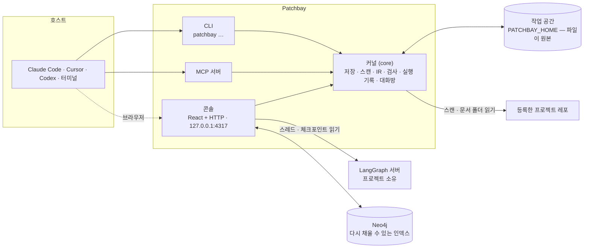

# Patchbay

**LLM 애플리케이션의 설계와 실물을 대조하는 localhost 워크스페이스.**

Patchbay가 답하는 질문은 하나입니다 — *"지금 돌고 있는 이 그래프가 내가 설계한 그 그래프인가."*

그래프 실행은 [LangGraph](https://langchain-ai.github.io/langgraph/), 관계 질의는 [Neo4j](https://neo4j.com/), 트레이스는 외부 관측 도구가 맡습니다. Patchbay는 **설계(IR)를 소유하고, 실물과의 차이를 띄웁니다.** 그래프 에디터나 트레이스 뷰어를 새로 만들지 않습니다.

조작은 Claude Code · Cursor · Codex 같은 호스트와 터미널에서 하고, 결과는 브라우저 콘솔에 나타납니다. 프롬프트로 한 일이 채팅에만 묻히지 않고 화면과 파일에 남는 것이 목표입니다.

> 문서는 한국어로 씁니다. 상태: 개인 개발 중(2026-10). 라이선스는 아직 정하지 않았습니다.

---

## 다섯 단계 — 그리고 0 대시보드

각 단계의 입력은 **앞 단계의 출력뿐**입니다. 앞 단계가 비면 다음 단계는 잠깁니다.


| 단계 | 결과물 | 넘어가는 조건 |
| --- | --- | --- |
| **0 대시보드** | 진행 · 에이전트 지표 · 먼저 볼 것 · 그래프 · 할 일. 레포 스캔(구조 요약)은 접힌 칸 | 단계가 아니라 늘 보는 곳 |
| **1 요구사항 설계** | **IR** — 노드 · State · 엣지 · 툴 · 권한 · 문서 · 평가. 채팅 상담으로 채우고, PRD 11절을 절마다 확인받고, 설계 규칙 검사(40개)를 통과해야 채택 | 채택은 사람만(`patchbay ir adopt`) |
| **2 시스템 구현** | IR에서 LangGraph 뼈대와 실패하는 평가 시험을 한 번 생성 → 빈 노드를 채움. 생성 뒤 코드는 프로젝트 소유 | 빈 노드 표시 0개 |
| **3 운영** | 프로젝트가 만든 화면을 Patchbay 안에서 쓰고(사용 창), 대화방에서 여러 LLM이 수행 · 검토 · 적용. 실행 기록과 일한 노드를 쌓음 | 설계의 노드를 모두 한 번 이상 지남 |
| **4 지식 그래프** | 파일 스캔에 **없는** 관계(실행 ↔ 요구사항 ↔ 평가 ↔ 문서)를 Neo4j에 | 스캔 복제본뿐이면 켤 이유가 없다 |
| **5 문서 호출** | 출발점 → 관계 1~2홉 → 이웃 안에서 순위, 민감도 필터 | 근거를 그래프 경로로 못 대면 통과 아님 |

v(n)과 v(n+1)의 평가 점수를 같은 묶음으로 비교할 수 있어야 버전입니다. 이전 판은 지우지 않고 보관합니다.

---

## 무엇이 들어 있나

- **설계 상담** — 호스트 모델(Claude Code · Codex)과 채팅으로 IR 초안을 채웁니다. 칸마다 출처(말함 · 해석 · 기본값 · 직접)를 남기고, PRD에서 "해석 · 기본값"만 골라 볼 수 있습니다.
- **채택과 버전** — `ir adopt`만이 승인된 설계를 씁니다. 교체 직전에 이전 판과 평가 결과를 `versions/<n>/`에 보관합니다.
- **뼈대 생성과 대조** — IR에서 LangGraph 뼈대 · State · 평가 시험을 만들고, 그래프의 노드 집합이 설계와 다르면 경고합니다.
- **대화방** — 프로젝트마다 Agent(리더 · 수행 · 검토)를 등록하고 Claude Code · Codex · Grok · LM Studio(로컬)를 한 방에서 부릅니다. 폰이나 터미널의 Claude Code 세션도 `room_bind`로 방에 묶으면 훅이 대화를 옮겨 적습니다.
- **할 일** — 대시보드의 할 일 목록. 순서 변경, 할 일마다 전용 대화, 실행 중 표시, 완료 보관.
- **배치도** — 항목과 아키텍처 맵을 손으로 배치하는 화면(XYFlow).
- **권한 두 축** — 콘텐츠 민감도(경로로 자동 분류, 비밀은 모델로 보내지 않음) × 행위자 능력(`cap:read · draft · pr · external`). 사람에게 보이는 접근 등급(자유 · 기록 · 허가 · 차단)과 사람 전용 승인은 다음 단계에서 집행합니다.
- **MCP 서버** — 호스트가 Patchbay를 도구로 씁니다: `list_projects` · `get_atlas` · `get_graph` · `get_impact` · `get_progress` · `get_project_bundle` · `find_documents` · `get_prd` · `get_runs` · `get_thread` · `list_pending_requests` · `answer_request` · `consult_history` · `consult_update` · `get_room` · `room_bind` · `llm_status` · `progress_write` · `place_on_board`.

---

## 구조



원칙 몇 가지:

- **파일이 원본이다.** 화면은 파일의 렌더이고, Neo4j는 파일에서 언제든 다시 채울 수 있는 인덱스입니다.
- **커널은 결정적이다.** 스캔 · 집계 · 파일 입출력은 LLM 없이 재현됩니다. 커널은 모델을 부르지 않습니다.
- **제안은 `*.proposed`, 확정 파일은 확인 없이 덮지 않는다.**
- **Patchbay는 실행 엔진이 아니다.** 그래프 실행은 LangGraph, 권한의 런타임 강제는 생성된 코드와 그 런타임이 합니다. Patchbay는 선언을 요구하고 어긋남을 띄웁니다.
- **삭제 대신 보관한다.** v(n)의 산출물이 남아야 v(n+1)과 비교됩니다.

---

## 파일 구조

```
Patchbay/
├── app/                      코드 (pnpm 모노레포)
│   ├── apps/flow/            콘솔 — React 화면 + HTTP 서버
│   ├── packages/core/        커널 — 저장 · 스캔 · IR · 검사 · 실행 기록 · 대화방 · 할 일
│   ├── packages/cli/         CLI (patchbay)
│   ├── packages/mcp/         MCP 서버
│   ├── packages/skills/      호스트용 스킬(map-project · propose-ontology …)
│   └── docker-compose.yml    Neo4j 사이드카
├── knowledge/                공개 위키 — LLM이 먼저 읽는 곳
│   ├── index.md              위키 목록
│   └── patchbay/
│       ├── 기획/저장구조.md    폴더 · 파일 · 경로 규칙의 원본
│       ├── 규칙/              에이전트 규칙 (.mdc)
│       ├── 사용설명서/  디자인/
│       └── 절차/              작업 한 번마다의 기록
├── archive/docs/             공개 문서의 옛 판
├── access.yaml               층별 접근 등급 기본값
├── llms.txt  CLAUDE.md  AGENTS.md
└── workspace/                작업 공간 (git에 없음 — 아래)
```

**작업 공간**(`PATCHBAY_HOME`)은 레포에 들어가지 않습니다. 사용자마다 따로 두고, 원하면 그 안의 git을 비공개 원격에 백업합니다(`patchbay backup`).

```
workspace/
├── studio.yaml               등록부 — 프로젝트 alias · 레포 경로 · 문서 폴더(docs)
├── agents.default.json  progress.md  skills/  room-mirror/
├── records/                  비공개 기록(사용자 문서 · 일지)
└── projects/<alias>/
    ├── overlay.yaml          승인된 설계(ir) · 연결 · 결정 · 작업 계획
    ├── ir.proposed.yaml  ir.provenance.yaml  ir.review.yaml   초안 · 출처 · PRD 검토
    ├── versions/<n>/         이전 판 (지우지 않음)
    ├── consult/  rooms/  threads/  runs/  ops/   상담 · 대화방 · 스레드 · 실행 기록 · 집계
    ├── inferred.json  ATLAS.md  FLOW.md          스캔 결과 · 구조 요약 (파생)
    ├── board.yaml  todos.json  todo-history/     배치도 · 할 일
    └── progress.yaml  PROGRESS.md                요청(asked) · 결과(did)
```

자세한 경로 규칙과 누가 무엇을 쓰는지는 [`knowledge/patchbay/기획/저장구조.md`](knowledge/patchbay/기획/저장구조.md)에 있습니다.

---

## 시작하기

필요한 것: **Node 22 이상, pnpm 9 이상**. 지식 그래프를 쓰려면 Docker. 설계 상담 · 대화방을 쓰려면 Claude Code · Codex 등 호스트 CLI에 로그인되어 있어야 합니다.

```bash
cd app
pnpm install
pnpm build                                  # 커널 · CLI · MCP
pnpm --filter @patchbay/flow build          # 콘솔 (화면 + 서버)

export PATCHBAY_HOME="$PWD/../workspace"     # 작업 공간 — 콘솔 · MCP · CLI가 같은 경로를 본다
node packages/cli/dist/index.js init
node packages/cli/dist/index.js project add --path /path/to/your-project --alias my-project
node packages/cli/dist/index.js flow        # 콘솔: http://127.0.0.1:4317
```

- 작업 공간 위치가 틀리면 Patchbay는 빈 작업 공간을 새로 만들지 않고 멈춥니다. 새로 만드는 명령은 `init` · `project add` · `project new`뿐입니다.
- Neo4j(선택): `cd app && docker compose --profile sidecars up -d` — 루프백(127.0.0.1)에만 열립니다.
- LangGraph: 프로젝트 레포에서 `langgraph dev`를 띄우면 콘솔이 `PATCHBAY_LANGGRAPH_URL`(기본 `http://127.0.0.1:2024`)로 읽습니다.

**MCP 서버를 호스트에 붙이기** (예: Claude Code)

```json
{
  "mcpServers": {
    "patchbay": {
      "command": "node",
      "args": ["/path/to/Patchbay/app/packages/mcp/dist/index.js"],
      "env": { "PATCHBAY_HOME": "/path/to/Patchbay/workspace" }
    }
  }
}
```

**자주 쓰는 CLI**: `scan` · `atlas`(구조 요약) · `ir check | prd | diff | adopt | generate` · `runs collect | compare | draft-evals` · `version compare` · `knowledge docs | audit` · `progress write` · `backup`.

---

## 지금 상태와 다음

| 무엇 | 상태 |
| --- | --- |
| 1~3단계(설계 상담 · 채택 · 뼈대 생성 · 운영 기록 · 버전 비교) | 구현됨 · 시험 1,000개 이상 |
| 대화방 · 할 일 · 폰 세션 옮겨 적기 | 구현됨 |
| 저장소 구조 — 코드 · 위키 · 작업 공간 3층 | 2026-10 정리 |
| 접근 등급 집행 · 사람 전용 승인 | 다음 |
| 공개 배포 · Docker 전체 컨테이너 | 그다음 |
| 위키 RAG 조회 계약 · 인덱스 | 그다음 |

## 문서

- [위키 목록](knowledge/index.md) — 먼저 읽을 곳
- [저장구조](knowledge/patchbay/기획/저장구조.md) — 폴더 · 파일 · 경로 규칙
- [사용설명서](knowledge/patchbay/사용설명서/Patchbay_사용설명서_20260918a.md) · [세부매뉴얼](knowledge/patchbay/사용설명서/Patchbay_세부매뉴얼_20260918a.md)
- [에이전트 규칙](knowledge/patchbay/규칙/README.md)
