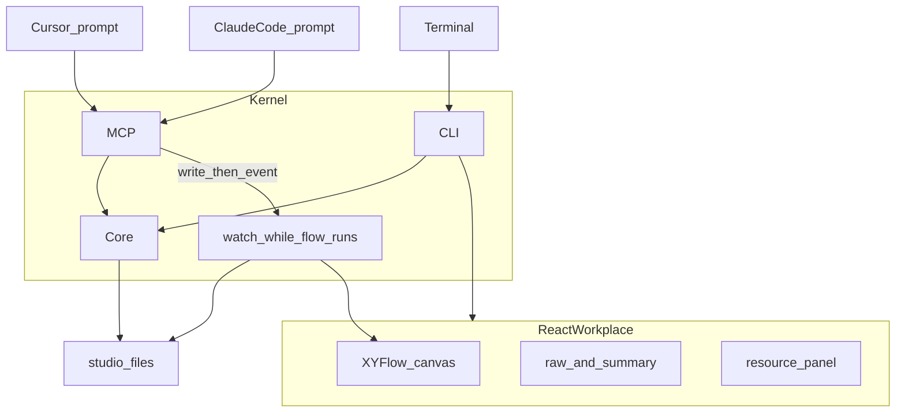

# Patchbay 기획서

| 항목 | 값 |
| --- | --- |
| 문서명 | Patchbay_기획 |
| 버전 | 20260917a |
| 이전 버전 | `Patchbay_기획_20260915a.md` |
| 상태 | 초안. 커널(스캔·CLI·읽기 MCP)은 `dev/`에 구현되어 있음. 이 판은 **작업면**을 React 캔버스로 재정의한다 |
| 독자 | 제품/아키텍처 검토용 LLM 및 사람 |
| 다음 파일명 | `Patchbay_기획_20260917b.md` 또는 날짜가 바뀌면 `Patchbay_기획_YYYYMMDDa.md` |

이 문서는 채팅 이력 없이 읽을 수 있는 단일 소스다. 구현 세부는 명세·구현계획에 둔다.

**20260917a판 변경 요지:** 사용자가 요구를 다시 고정했다. Patchbay의 전면은 마크다운 Atlas가 아니라 **옵시디언 캔버스·엑칼리드형 React 작업장**이다. LLM으로 한 일은 **원문과 정리본**을 같은 흐름에서 보고, 끝난 과정은 **스킬/에이전트**로 남기며, 기존 문서는 **그래프에서 골라 캔버스로 이동·연결**한다. 프롬프트에서 호출하면 **그 화면에 그려져야** 하고, LLM이든 프로그램이든 넣은 것은 **거의 실시간으로 동기화**되어야 한다. 20260915a의 “구조 파악 워크스페이스”라는 목적은 유지하되, 파악이 일어나는 **면**을 바꾼다.

---

## 0. 검토자에게 바라는 것

1. React 작업장이 Cursor/Claude를 “두 번째 IDE”로 만들지는 않는가. 조작은 여전히 호스트 프롬프트인가.
2. 원문 보존과 정리본이 실제로 대응 가능한가, 아니면 요약만 남고 원문이 사라지는가.
3. GraphRAG를 1차에 벡터DB로 열면 과한가. 스캔 그래프 + 노드 선택 + 부분 검색으로 충분한가.
4. 근실시간 동기화가 파일 소스 오브 트루스와 공존하는가.
5. “기능을 추가하면 화면에 반영”이 **데이터**(노드·연결·스킬)인지 **코드**(React 컴포넌트 핫리로드)인지. 이 문서는 전자만 v1로 둔다 — 후자는 아직 모른다.
6. 이미 만든 커널(스캔·PortId·overlay·읽기 MCP)을 버리고 앱을 새로 쓰는 것이 맞는가, 전면만 `apps/flow`에서 키우는 것이 맞는가.

동의하지 않으면 대체 설계로 적어 달라.

---

## 1. 한 줄 정의

**Patchbay는 LLM으로 진행한 일의 흐름을 React 캔버스에 원문과 정리본으로 펼치고, 기존 문서를 그래프에서 끌어와 쓰며, 끝난 흐름을 스킬로 남기는 로컬 작업장이다.**

구조 파악이 목적이다(20260915a). 그 파악은 이제 터미널 마크다운이 아니라 **떠 있는 화면**에서 일어난다.

오디오 패치베이 은유는 내부 모델에 남긴다: 잭=스킬·소스·산출물·세션 단계, 케이블=연결, 라벨=온톨로지. 사용자가 매일 보는 은유는 **캔버스**다.

---

## 2. 문제

LLM과 일을 하면 진행이 채팅·커밋·폴더에 흩어진다. 무엇이 어떤 순서로 됐는지, 그때 무슨 문장을 썼는지, 어떤 문서를 재료로 썼는지가 한 화면에 없다. 끝난 좋은 과정을 다음에도 같은 흐름으로 돌릴 방법이 없다.

기존 커널은 “이 레포에 어떤 파일·스킬이 있는가”는 스캔한다. 부족한 것은 **진행의 스토리**, **자원의 탐색과 배치**, **프롬프트와 화면의 동기화**다.

---

## 3. 제품 원칙

1. **호스트는 조작 면, React는 작업 화면이다.** Cursor·Claude Code·터미널을 채팅 IDE로 대체하지 않는다. 다만 호출의 결과는 채팅에만 묻히지 않고 **작업장 화면에 나타나야** 한다. (20260917a: 구 원칙 1 “호스트를 대체하는 UI 금지”를 이 문장으로 교체.)
2. **커널은 결정적이다.** 스캔·그래프 집계·파일 I/O는 LLM 없이 재현 가능하다. 정리본·온톨로지 제안·스킬 초안은 호스트 모델이 쓴다.
3. **제안은 호스트 모델이 한다.** 확정 파일은 확인 없이 덮지 않는다. 초안은 `*.proposed.*`.
4. **파일이 소스 오브 트루스다.** SQLite/클라우드 DB를 기본값으로 두지 않는다. 화면 상태는 파일의 렌더다.
5. **세 면이 같은 모델을 본다.** CLI, MCP, React는 같은 Core 타입을 읽는다. React만 다른 JSON을 만들어서는 안 된다.
6. **실행 엔진이 아니다.** n8n처럼 노드를 돌리지 않는다. 흐름을 보여주고, 연결하고, 끝난 흐름을 스킬로 남긴다.
7. **이름 없는 잭은 부채다.**
8. **Patch와 Wire를 구분한다.** 매칭 키는 `(from, to, kind)`.
9. **정보는 레이어로 나뉜다.** L1/L2/L3는 결정적 집계다. 사람이 읽는 서사 요약은 레이어가 아니라 정리본 노드다.
10. **작업장이 떠 있는 동안만 근실시간 푸시를 허용한다.** 파일은 진실이다. `patchbay flow`(작업장)가 켜져 있을 때 studio 파일을 감시해 화면에 푸시한다. 부팅 자동 데몬, 클라우드 워치, 커널이 git으로 “지금 하는 일”을 추측하는 것은 아니다. (20260917a: 구 원칙 10의 “워치 전면 금지”를 이 범위로 완화.)
11. **삭제 대신 보관한다.**
12. **원문은 정리본에 삼켜지지 않는다.** 같은 단계에 원문과 정리본이 대응된다.
13. **기존 산출물은 resource다.** 찾고 옮겨 연결해 다시 쓴다. 일회성 첨부로 끝나지 않는다.

---

## 4. v1에서 하지 않는 것

- 워크플로 실행 엔진, 멀티유저 SaaS, Cursor 채팅 대체, 범용 BI, 데스크탑 패키징(Tauri 등).
- 커널의 채팅 루프·직접 모델 호출.
- 부팅 시 자동 시작되는 백그라운드 워치 데몬.
- triage 자동 삭제, 살아있는 소스 트리 자동 재배치.
- 역할 배정의 자동 실행(리더가 워커 세션을 원격으로 켜는 것).
- **벡터DB/임베딩을 전제로 한 GraphRAG.** 1차는 스캔 그래프 + 발췌 + 노드 범위 검색이다. 임베딩 모델·인덱스 엔진은 정하지 않았다(13절).
- **LLM이 React 컴포넌트 코드를 추가하면 런타임에 UI가 생기는 플러그인 시스템.** 요구의 “기능 추가”는 v1에서 캔버스 데이터(노드·연결·스킬·문서 카드)를 뜻한다. 코드 면 핫리로드인지는 아직 모른다(13절).
- 텔레그램을 작업 화면으로 승격하지 않는다. 기존 조회 호스트는 유지하되 이번 전면 작업의 범위가 아니다.

---

## 5. 표면

전면은 하나다. **React 작업장** (`apps/flow`를 키운다. 패키지 이름을 바꿀지는 미정).

그 안에 겹이 있다.

| 겹 | 하는 일 |
| --- | --- |
| Flow 캔버스 | 옵시디언 캔버스·엑칼리드처럼 노드를 놓고 잇는다. LLM 진행 단계, 포트, 문서 카드. |
| Dual | 단계마다 원문과 정리본. 서로 오갈 수 있다. |
| Resources | 기존 폴더·문서. 그래프에서 노드를 고르거나 그 안에서 찾는다. 본 것을 캔버스로 이동·연결한다. |
| Atlas / Progress | 커널이 이미 만드는 구조 지도와 진행 파일. 작업장에서 읽는다. 기본 UI는 더 이상 이것만이 아니다. |
| Skill Bay | 끝난 캔버스 구간을 스킬로 남기고, 기존 `SKILL.md`를 패치한다. |

CLI와 MCP는 조작·자동화 면이다. 마크다운(`ATLAS.md`, `FLOW.md`)은 export이자 디버그 면이다.

---

## 6. 사용자 루프

### 6.1 작업장 루프 (이 판의 핵심)

1. `patchbay flow`로 React 작업장을 연다. 등록된 프로젝트의 스캔 그래프가 캔버스에 뜬다.
2. 프롬프트(Cursor/Claude)에서 MCP로 단계를 남기거나, 문서를 올리거나, 연결을 만든다. **같은 내용이 화면에 나타난다.**
3. 화면에서 노드를 옮기거나 잇거나 자원을 끌어와도 파일에 쓰이고, 프롬프트가 다시 읽으면 같다. **거의 실시간.**
4. 각 진행 단계는 원문(그대로)과 정리본(구조화)을 갖는다.
5. 그래프에서 노드를 고르면 그 범위의 문서를 보고, 찾기로 연 뒤 캔버스에 이동·연결한다.
6. 과정이 쓸 만하면 그 구간을 스킬/에이전트 초안으로 남긴다. 이후 같은 흐름을 프롬프트에서 다시 부른다.

### 6.2 등록 루프 (기존, 유지)

프로젝트를 들이는 세 경로는 유지한다: `project new` / `project add` / `project triage`. 합류 후 `scan`이 inferred/Atlas/Flow 파일을 만든다. 온보딩 스킬 3종은 부가다.

### 6.3 역할 분담 (기존, 이번 전면 아님)

`assignments.yaml` + `lead-project` / `pickup-role`은 이미 있는 기능으로 유지한다. 작업장 동기화의 선행 조건이 아니다.

---

## 7. 온톨로지 v0 (추가분)

기존 스튜디오 클래스(Project, Skill, Agent, Source, Artifact, Patch, Wire)와 도메인 클래스(Concept, Decision, Signal, View)는 유지한다.

이 판에서 **새 클래스**를 연다. 속성으로 때우기에는 수명이 다르다.

| 클래스 | 의미 |
| --- | --- |
| SessionStep | LLM 진행의 한 단계. `raw`(원문)와 `summary`(정리본)를 가진다. |
| Canvas | 작업장에 올라간 노드 위치·연결·문서 카드. 사람+에이전트 소유. 스캔이 덮지 않는다. |
| ResourceHit | 자원 그래프에서 고르거나 검색해 연 문서. Source/Artifact를 가리킨다. |

관계는 기존 Patch/Wire 매칭을 재사용한다. SessionStep도 PortId를 갖는다. kind 후보는 `step` — 명세에서 확정한다.

스캐너는 여전히 Agent를 자동으로 채우지 않는다.

---

## 8. 아키텍처



- **Core** 스캔·스키마·overlay·canvas 파일 I/O. LLM 없음.
- **MCP** 조회 + **쓰기**(캔버스에 올리기, 연결, 단계 기록). 쓰기 후 파일이 바뀌면 작업장이 구독한다.
- **CLI** 등록·스캔·패치·작업장 기동.
- **React** `@xyflow/react`. 읽기 전용 뷰어가 아니다.
- **Watch** 작업장 프로세스 안에서만. 별도 `patchbay watch` 데몬을 기본값으로 두지 않는다.

스택(유지): TypeScript, pnpm 모노레포, Node 22, Zod, YAML, `@modelcontextprotocol/sdk`, Vite, Hono, `@xyflow/react`.

추가 후보: 파일 감시(chokidar 등), 화면 푸시(SSE 또는 WebSocket). 둘 중 무엇으로 확정할지는 명세 임시 채택을 따른다.

---

## 9. 파일 (추가)

기존 트리(`studio.yaml`, `inferred.json`, `overlay.yaml`, `ATLAS.md`, `FLOW.md`, `progress.yaml`, `assignments.yaml` 등)는 유지한다.

추가:

```
<studio>/projects/<alias>/
  canvas.yaml          # 노드 위치, 캔버스 연결, 문서 카드. 스캔이 덮지 않음
  session.yaml         # SessionStep 목록 (raw/summary). 스캔이 덮지 않음
  session.proposed.yaml
```

`canvas.yaml`/`session.yaml` 소유권은 overlay와 같다. 스킬 초안은 proposed.

생성 마크다운(Atlas/FLOW.md)은 커널 소유, 다음 scan이 덮어쓴다.

---

## 10. 스킬

유지: `map-project`, `propose-ontology`, `propose-dashboard`, 온보딩 3종, `lead-project`, `pickup-role`.

신설(이 판의 본게임):

- `capture-step` — 프롬프트/화면에서 한 단계를 원문+정리로 남긴다. (호스트가 쓰고 MCP/CLI가 파일을 씀.)
- `place-resource` — 고른 문서를 캔버스에 올린다.
- `distill-skill` — 캔버스에서 고른 완료 구간을 `SKILL.md` 초안으로 남긴다.

이름은 구현 중 바뀌어도 된다. 역할이 바뀌면 안 된다.

---

## 11. 레포

```
dev/
  packages/core | cli | mcp | skills
  apps/flow              # 작업장 (키움)
  apps/telegram-bot      # 유지, 이번 전면 아님
docs/기획 | 명세 | 구현계획
```

---

## 12. 구현 방향 (요약)

이미 있는 것: 스캔 커널, CLI, 읽기 MCP, 읽기 전용 XYFlow, 스킬 파일, 텔레그램 조회, assignments.

다음에 할 것: 작업장을 편집·구독 가능하게 → 원문/정리 단계 → 자원 패널과 이동·연결 → 프롬프트 쓰기 MCP가 화면에 그리기 → 구간 스킬화.

세부 순서는 명세 Phase 13~ 와 구현계획 다음 판, 그리고 개발 캔버스에 둔다.

---

## 13. 열린 질문 (모름을 포함)

**모른다, 추측으로 구현하지 않는다.**

1. Cursor·Claude Code 대화 원문을 **자동으로** 파일에서 긁을 수 있는지. 호스트가 제공하는 로그 경로·권한·형식을 이 문서는 모른다. v1은 에이전트가 MCP로 원문을 **넘겨 주는** 모델이다.
2. GraphRAG의 임베딩 모델, 청크 크기, 인덱스 위치. 정하지 않았다.
3. “기능 추가”가 UI 코드 핫리로드인지. 정하지 않았다. v1은 데이터 면만.
4. SSE vs WebSocket. 명세에서 하나를 고른다.
5. `apps/flow` 패키지 이름을 `apps/workplace`로 바꿀지.
6. 내부 용어 `studio`를 사용자 언어에서 뺄지 (20260915a 질문 15). 사용자는 “워크플레이스”를 썼다. 코드 식별자는 당장 바꾸지 않는다.
7. 텔레그램을 작업장 이벤트와 언제 연결할지. 지금은 연결하지 않는다.
8. 근실시간의 수치 SLA(예: 500ms). “작업 중 새로고침이 없어도 된다”만 요구로 받는다.
9. 여러 작업장 창·여러 에이전트가 `canvas.yaml`을 동시에 쓸 때. 기존 last-write-wins를 쓸지 모른다.

이전 판의 스튜디오 루트(`~/.patchbay`), 심링크/복사, git ahead 없음, 트랜스크립트 스캔 OFF(자동 긁기)는 유지한다.

---

## 14. 결정 로그

| 날짜 | 결정 |
| --- | --- |
| 2026-09-15 | 목적을 구조 파악 워크스페이스로 재정정 |
| 2026-09-17 | 전면을 React 캔버스 작업장으로 재정의. 원문+정리, 자원 그래프에서 캔버스로 이동·연결, 프롬프트 호출→화면, 작업장 기동 중에만 근실시간 동기화 |
| 2026-09-17 | 구 원칙 1·10 개정. 실행 엔진·벡터 전제 GraphRAG·코드 플러그인 런타임은 v1 밖 |
| 2026-09-17 | 기존 커널은 유지하고 `apps/flow`를 키운다. 텔레그램·assignments는 유지하되 이번 전면의 선행이 아님 |

---

## 15. 변경 이력

| 버전 | 날짜 | 내용 |
| --- | --- | --- |
| 20260915a | 2026-09-15 | 구조 파악 워크스페이스로 포지션 정정 |
| 20260917a | 2026-09-17 | React 작업장, dual 기록, GraphRAG 자원, 프롬프트→화면, 근실시간 동기화. 원칙 1·10 개정 |
