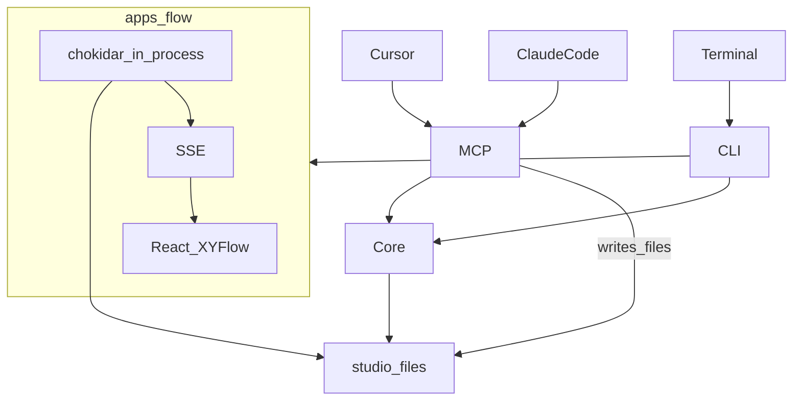
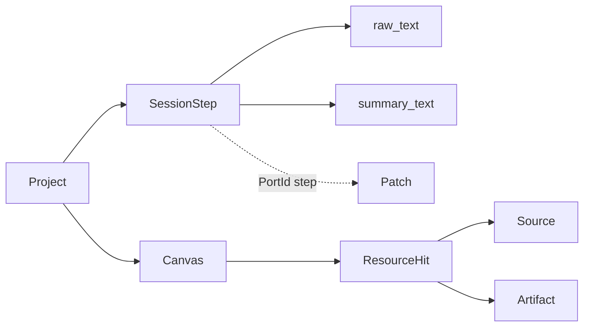
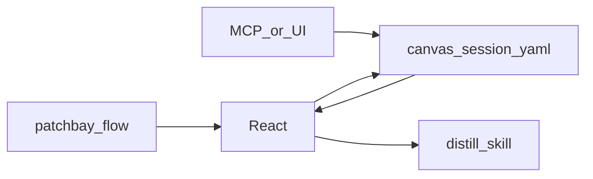
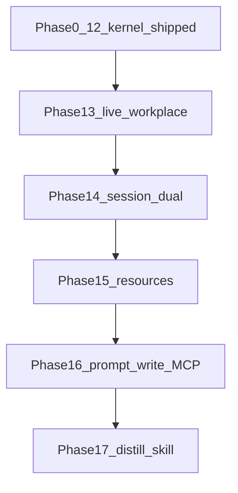

# Patchbay 명세서

| 항목 | 값 |
| --- | --- |
| 문서명 | Patchbay_명세 |
| 버전 | 20260917a |
| 이전 버전 | `Patchbay_명세_20260913c.md` |
| 기반 문서 | `Patchbay_기획_20260917a.md` |
| 용도 | 구현 중 대조. 커널 채택값(PortId 등)은 13c 7절을 따르고, **이 판이 덮어 쓴 원칙·Phase만** 여기 적는다 |
| 갱신 규칙 | 기획과 충돌하면 구현 전까지는 **이 문서 6절**이 이긴다 |

20260917a판 변경 요지: 작업면을 React 캔버스로 승격. 워치 전면 금지를 “작업장이 떠 있는 동안만”으로 완화. MCP 쓰기를 연다. SessionStep/Canvas 파일. Phase 13~16.

커널 Phase 0~12 코드는 `dev/`에 있고 이 시각 `pnpm test` **371 passed**. 13c 체크리스트의 미체크는 문서 갱신 지연이다. 제품 게이트(“조망이 유용하다”)와 텔레그램/스킬의 **실제 호스트 수동 QA 여부**는 이 문서가 모른다.

---

## 1. 다이어그램

### 1.1 아키텍처



규칙:

- MCP·CLI는 Core만 거친다. React도 그래프 계산을 복제하지 않는다. `/api/*`가 Core를 부른다.
- 쓰기는 파일로 한다. 화면은 구독한다.
- 텔레그램은 이 다이어그램의 작업장 경로에 넣지 않는다.

### 1.2 온톨로지 (추가)



기존 Project/Skill/Patch/Wire 관계는 13c 1.2를 유지한다.

### 1.3 작업장 루프



### 1.4 Phase



P16을 P14 앞으로 당기면 프롬프트→화면이 더 일찍 보인다. **채택: P13 직후 최소 쓰기 1개(`capture_step` 또는 `place_resource`)를 P16에서 완성하되, P13에는 SSE+파일 구독만 넣는다.** 조회 MCP만으로 화면이 바뀌게 하지 않는다.

---

## 2. 원칙 자가 점검

구 1번(“호스트 대체 UI 금지”)·구 10번(“워치 몰래 켜짐”)은 폐기하고 아래로 바꾼다.

- [ ] 1. 프롬프트 호출의 결과가 작업장 화면에 없으면 미완이다. 채팅 JSON만으로 완료 처리하지 않는다
- [ ] 2. 커널이 LLM을 호출하고 있지는 않은가
- [ ] 3. 확정 파일을 확인 없이 덮고 있지는 않은가
- [ ] 4. SQLite/클라우드 DB가 기본값이 되지는 않았는가
- [ ] 5. React가 Core와 다른 그래프 모델을 쓰고 있지는 않은가
- [ ] 6. 노드를 실행하는 오케스트레이터가 되고 있지는 않은가
- [ ] 7. 원문 필드를 버리고 정리본만 저장하고 있지는 않은가
- [ ] 8. Patch/Wire 매칭 키가 `(from, to, kind)`가 아닌가
- [ ] 9. L1을 마크다운 slice로 만들고 있지는 않은가
- [ ] 10. `patchbay flow`가 꺼져 있는데도 워치 프로세스가 남아 있지는 않은가. 작업장 자식으로만 감시한다
- [ ] 11. triage가 삭제하거나 archive 밖으로 옮기고 있지는 않은가
- [ ] 12. 비 TTY에서 프롬프트하고 있지는 않은가
- [ ] 13. 스캔이 `canvas.yaml`/`session.yaml`/`overlay.yaml`을 덮고 있지는 않은가
- [ ] 14. 임베딩 인프라를 Phase 15 완료 조건에 몰래 넣고 있지는 않은가
- [ ] 15. React 플러그인 런타임(코드 핫로드)을 데이터 동기화와 같은 Phase에 섞고 있지는 않은가

---

## 3. 이미 있는 커널 (Phase 0~12)

코드 위치 `dev/`. 이 시각 테스트 371개 통과.

| Phase | 코드로 확인한 것 | 이 문서가 모르는 것 |
| --- | --- | --- |
| 0~5 | 모노레포, Zod, 스캐너, Atlas/FLOW.md, overlay, `patch` | — |
| 6~7 | MCP 읽기 5종, `progress write` 한 방 | Cursor에 MCP를 붙여 실제로 썼는지는 모름 |
| 8~9 | `packages/skills` 8개 SKILL.md, triage CLI | 호스트에서 스킬을 끝까지 돌린 수동 QA 여부는 모름. `project new` CLI는 여전히 인터뷰 없이 빈 폴더만 만든다 |
| 10 | `apps/flow` XYFlow, `GET /api/graph` 1회, 읽기 전용 | — |
| 11 | 텔레그램 봇 코드, 화이트리스트 테스트 | 실제 봇 토큰으로 휴대폰 QA 여부는 모름 |
| 12 | `assign`, assignments 파일, 통합 테스트 | 두 호스트 세션을 사람이 오간 실사용은 모름 |
| 제품 게이트 | 13c에 미체크 | “조망이 유용하다”는 판정이 기록되어 있지 않다 |

세부 기계적 체크는 `Patchbay_명세_20260913c.md`를 역사 문서로 둔다. 새 작업의 Done은 아래 Phase 13~만 본다.

이상 신호: 커널을 재작성하며 PortId/스캔 결정성을 깨는 것.

---

## 4. 새 Phase

### Phase 13 — 라이브 작업장

목표: 떠 있는 React 화면이 파일을 구독한다. 편집의 최소는 **레이아웃 영속**(노드 위치를 `canvas.yaml`에 저장).

- [ ] `patchbay flow`가 떠 있는 동안 studio `projects/<alias>/`를 감시한다. 프로세스 종료 시 워치도 종료
- [ ] 파일 변경 후 화면이 수동 새로고침 없이 갱신된다 (SSE). 구현은 6.2절
- [ ] 노드 드래그 종료 시 위치가 `canvas.yaml`에 저장된다. 새로고침 후에도 유지
- [ ] 스캔이 `canvas.yaml`을 덮지 않는다
- ⚠ 이상 신호: 별도 데몬 / 부팅 자동 시작 / React가 독자 그래프 계산

완료(자동): 픽스처에서 `canvas.yaml`을 바꾸면 클라이언트가 새 그래프를 받는 테스트, 또는 서버 푸시 계약 테스트. 브라우저 E2E는 아직 강요하지 않는다.

### Phase 14 — 원문 / 정리본

- [ ] `session.yaml`에 SessionStep: `id`, `raw`, `summary`, `createdAt`
- [ ] 캔버스에서 한 단계를 열면 원문과 정리본이 둘 다 보인다
- [ ] 정리본만 있고 raw가 빈 문자열이면 저장을 거절하거나 raw=`(empty)`를 명시. 필드를 드롭하지 않음
- [ ] 초안은 `session.proposed.yaml`
- ⚠ 이상 신호: 채팅 로그를 디스크에서 무단으로 긁음 (6.4절 — 자동 수집은 모름, v1 금지)

### Phase 15 — 자원 패널

- [ ] 스캔된 Source/Artifact를 그래프(디렉터리 포함 + 기존 Wire)로 보여 준다. 임베딩 없음
- [ ] 노드를 고르면 그 서브트리 문서 목록
- [ ] 그 범위에서 부분 문자열 찾기
- [ ] 찾은 문서를 캔버스에 카드로 올린다 (`place`). `canvas.yaml`에 기록
- [ ] 카드와 기존 노드를 잇는다 (`connect`) → overlay Wire 또는 canvas edge. 6.3절
- ⚠ 이상 신호: Phase 15 완료 조건에 벡터DB

### Phase 16 — 프롬프트 쓰기 MCP

화면 출력이 목적인 툴만. 채팅에만 텍스트를 돌려주고 파일을 안 바꾸면 미완.

- [ ] `capture_step` — session.yaml에 raw+summary append, 작업장이 표시
- [ ] `place_resource` — 경로를 캔버스 카드로
- [ ] `connect_nodes` — 두 PortId를 잇고 kind 기록
- [ ] 기존 읽기 5종 유지. 텔레그램 호스트는 **쓰기 툴을 노출하지 않는다** (필터 또는 별도 읽기 전용 서버)
- [ ] in-process 테스트
- ⚠ 이상 신호: 텔레그램에 쓰기 툴이 흐름

### Phase 17 — 흐름 스킬화

- [ ] 캔버스에서 고른 SessionStep 구간 → `packages/skills` 또는 studio Skill Bay에 `SKILL.md` **proposed**
- [ ] 확정은 사람. 덮어쓰기 금지
- ⚠ 이상 신호: 선택 구간 없이 프로젝트 전체를 한 스킬로 강제

---

## 5. 열린 질문

| # | 질문 | 이 판 |
| --- | --- | --- |
| Q8 | 작업장 localhost | **연다.** `patchbay flow`가 전면. Mermaid는 export |
| Q10-실시간 | 워치 | 작업장 프로세스 안에서만 |
| Q-RAG | GraphRAG 벡터 | v1 없음. 그래프+발췌+substring |
| Q-transcript | 호스트 로그 자동 수집 | **모름. v1 금지.** MCP로 전달 |
| Q-plugin | 코드 핫리로드 | **모름. v1 없음** |
| Q-push | SSE vs WS | **SSE** (6.2) |
| Q-edge | canvas 전용 선 vs overlay Wire | 문서 카드 연결은 canvas.yaml. 스킬/소스 연동은 overlay Wire (6.3) |
| Q-rename | apps/flow 이름 | 미정. 코드 경로는 유지 |
| Q-studio | 용어 | 코드는 studio, 사용자 카피는 워크플레이스 |
| Q-sla | 지연 상한 ms | 모름. 수동 새로고침이 없으면 됨 |
| Q-telegram | 작업장과 연동 | 이번 Phase 13~17 밖 |

13c의 Q1~Q7, Q9, Q11~Q17(루트, 심링크, git ahead 없음, clarity 등)은 그대로다.

---

## 6. 이 판이 덮는 채택값

13c 7절(PortId 문법, Patch/Wire, ignore, 비대화형 CLI, Agent 미탐지, git ahead 없음, 레이어 기본값, clarity, Mermaid 노드 id, 생성 파일 소유권)은 **유효**하다. 아래만 추가·개정.

### 6.1 PortId kind `step`

```
kind = "source" | "skill" | "artifact" | "agent" | "signal" | "step"
step ref = [a-z0-9][a-z0-9-]*   # 예: step:20260917-capture-1
```

기존 kind 파서를 확장한다. 자유 문자열 금지.

### 6.2 푸시

작업장 서버가 `projects/<alias>/` 아래 yaml/json 변경을 감시한다.

- 프로토콜: **SSE** `GET /api/events`
- 이벤트 바디는 최소 `{ "reason": "canvas"|"session"|"inferred"|"overlay" }`
- 클라이언트는 해당 GET(`/api/graph`, `/api/canvas`, …)을 다시 한다. 이벤트에 전체 그래프를 실을지 여부는 구현 자유. 계약은 “푸시가 오면 다시 읽는다”
- 워치는 `serve.ts` 수명에 묶인다

### 6.3 연결의 두 층

- **구조 연동** (스킬이 소스를 읽는다 등): 기존 `overlay.yaml` Wire. 스캔 그래프에 이미 쓰임.
- **작업 배치** (이 문서를 이 단계 옆에 둔다): `canvas.yaml`의 edges. 스캔이 만들지 않음.

`connect_nodes`는 인자로 층을 고른다. 기본은 canvas. 구조 연동은 `layer=overlay`일 때만 Wire를 쓴다.

### 6.4 세션 원문

v1 `capture_step` 인자: `raw`(필수), `summary`(필수, 빈 문자열 허용하되 키는 존재).

호스트 트랜스크립트 파일을 읽는 코드를 Core에 넣지 않는다. 경로가 밝혀져도 이 판의 완료 조건이 아니다.

### 6.5 session.yaml / canvas.yaml 최소 모양

```yaml
# session.yaml
version: 1
alias: patchbay
steps:
  - id: step:20260917-capture-1
    raw: "원문 그대로"
    summary: "한 줄 정리"
    createdAt: 2026-09-17T03:00:00Z
```

```yaml
# canvas.yaml
version: 1
alias: patchbay
nodes:
  - portId: step:20260917-capture-1
    x: 120
    y: 80
  - portId: source:README.md
    x: 400
    y: 80
edges:
  - from: source:README.md
    to: step:20260917-capture-1
    kind: used-in
```

스키마는 Zod. 스캔 금지.

### 6.6 텔레그램과 쓰기 MCP

Phase 16에서 MCP 서버에 쓰기 툴이 생긴다. 텔레그램 에이전트는 **읽기 툴 목록을 고정**하거나 읽기 전용 엔트리를 쓴다. “서버에 쓰기가 없으니 안전”은 더 이상 참이 아니다.

### 6.7 기능 추가의 의미 (v1)

LLM 또는 UI가 추가하는 것: SessionStep, canvas 노드/edge, overlay Wire, proposed 스킬.

추가하지 않는 것: 실행 중인 앱에 새 React 라우트/컴포넌트를 주입.

---

## 7. 참고

- 무엇을 만들지 → `Patchbay_기획_20260917a.md`
- 커널 채택값 원문 → `Patchbay_명세_20260913c.md` 7절
- 이전 구현 순서 → `Patchbay_구현계획_20260913b.md` (Phase 13~는 아직 이 구현계획에 없음)
- 개발 현황 캔버스 → Cursor canvases `patchbay-dev-progress.canvas.tsx`

---

## 8. 변경 이력

| 버전 | 날짜 | 내용 |
| --- | --- | --- |
| 20260913c | 2026-09-13 | 픽스처 ignore, 커널 체크리스트 |
| 20260917a | 2026-09-17 | 작업장 전면, SSE 워치, SessionStep, 자원 패널, 쓰기 MCP, 스킬 증류. 원칙 1·10 개정 |
