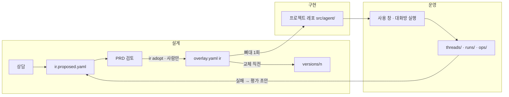
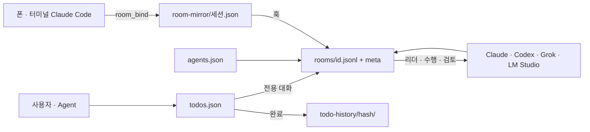

# 저장 구조

Patchbay가 만드는 파일과 폴더가 **어디에, 누가, 어떻게** 쌓이는지의 원본이다. 판이 없는 살아 있는 문서다.
구조가 바뀌면 같은 작업에서 이 문서를 고치고 맨 아래 「바뀐 기록」에 한 줄을 남긴다(`규칙/storage-layout.mdc`).

쓰임은 셋이다.

1. **RAG 앵커** — LLM이 "이 파일은 어디 있나 · 무엇을 어디에 써야 하나"를 물을 때 먼저 읽는 문서.
2. **비슷한 프로젝트 설계** — 코드 · 위키 · 원문을 나누는 방식을 그대로 옮겨 쓸 수 있게.
3. **아키텍처 수정 전 확인** — 8절의 확인 목록을 지나고 나서 바꾼다.

표기: **현행**은 지금 코드와 폴더에 있는 것(2026-10-14 실측), **예정**은 결정은 났지만 아직 하지 않은 것.

---

## 1. 층

사용자 결정(2026-10-14, 안3 3층 LLM 위키 — 기억.md 「저장소 병합」). Karpathy LLM Wiki의 원문 · 위키 · 규칙 3층을 따랐다.

| 층 | 경로 | 무엇 | 누가 쓰나 | git | 공개 | 상태 |
| --- | --- | --- | --- | --- | --- | --- |
| 코드 | `app/` | 콘솔 · 커널 · CLI · MCP · 스킬 (pnpm 모노레포) | 사람 · 코딩 에이전트 | 추적 | 공개 | 현행 |
| 위키층 | `knowledge/` | LLM이 먼저 읽는 공개 문서. `index.md` 목록(가장 먼저), `patchbay/` Patchbay 구성 문서(규칙 · 저장구조 · 사용설명서 · 디자인 · 절차 일부) | 사람 · 에이전트 (규칙을 따라) | 추적 | 공개 | 현행 (`projects/`는 예정, D) |
| 보관 판 | `archive/docs/` | 문서의 옛 판(`doc-versions.mdc`) | 새 판을 쓸 때 `git mv` | 추적 | 공개 | 현행 |
| 비공개 기록층 | `workspace/records/` | 다른 프로젝트 내용이 한 줄이라도 들어간 문서 · 기록 전부: Patchbay 기획서 · 명세 · 기억 · 대화 · 목표 · 방향 · 실행 · 아키텍처 · 용어 · 일지(`log.md`) · 절차 일부 · 옛 판 일부 · 지킬 이름 목록(`private-names.txt`). 안쪽은 `patchbay/`(문서 폴더와 같은 모양) · `archive/docs/` | 사람 · 에이전트 (규칙을 따라) | 작업 공간 백업 레포 | 비공개 | 현행 (2026-10-14 공개 정리) |
| 원문층 (작업 공간) | `workspace/` = `PATCHBAY_HOME` | 설계(IR) · 대화 · 실행 · 할일 · 스캔 원문 | 커널의 저장 함수만 | 바깥 레포는 무시, 안쪽 git = 비공개 백업 레포 `Han-Archives/patchbay-workspace` | 비공개 | 현행 (2026-10-14 A-2) |
| 파생 인덱스 | `.index/` | 그래프 · 검색 인덱스. 원본에서 언제든 다시 만든다 | 커널 | 무시 | — | 예정 (D) |
| 임시 보관 | `.trash/<날짜>/` | 지우기 전에 옮겨 두는 곳. `MANIFEST.md`에 원래 위치 · 이유 · 되돌리는 명령 | 정리 작업 | 무시 | — | 현행 |
| 규칙 · 안내 | 루트 `README.md`(프로젝트 개요) · `CLAUDE.md` · `AGENTS.md` · `llms.txt` · `access.yaml` | 에이전트가 처음 읽는 것(규칙 원본은 `knowledge/patchbay/규칙/`), 접근 등급 기본값(B 단계 전까지 기록용) | 사람 | 추적 | 공개 | 현행 |

레포 루트에 새 폴더를 만들지 않는다. 층을 더해야 하면 이 표를 먼저 고치는 결정을 받는다.

## 2. 지금 모양 (현행, 공개 정리 뒤)

```
Patchbay/
├── app/                         코드 (← dev/, 2026-10-14)
│   ├── apps/flow/               콘솔: React 화면 + HTTP 서버 (dist-client · dist-server 는 빌드 산출물)
│   ├── packages/core/           커널: 저장 · 스캔 · IR · 실행 기록 · 대화방
│   ├── packages/cli/  mcp/  skills/
│   └── docker-compose.yml       Neo4j 사이드카
├── knowledge/                   공개 위키
│   ├── index.md                 위키 목록 — LLM이 가장 먼저 읽는 곳
│   └── patchbay/                Patchbay 구성 문서 (← docs/)
│       ├── 기획/저장구조.md       이 문서
│       ├── 규칙/                 에이전트 규칙 원본 .mdc (CLAUDE.md가 @import, .cursor/rules 가 링크)
│       ├── 사용설명서/  디자인/   한 판씩
│       └── 절차/                 Patchbay 구성만 다룬 작업 기록 <주제>_<날짜>_v<n>.md
├── archive/docs/                공개 문서의 옛 판 (← docs/_archive)
├── workspace/                   작업 공간 = PATCHBAY_HOME (gitignore, ← ~/.patchbay, 2026-10-14)
│   ├── .git                     비공개 백업 레포 Han-Archives/patchbay-workspace
│   ├── records/                 비공개 기록층
│   │   ├── log.md               일지 — 큰 변경 한 줄씩, 위가 최신
│   │   ├── private-names.txt    공개 레포에 나오면 안 되는 이름 (시험 · lint가 읽음)
│   │   ├── patchbay/            Patchbay 문서 폴더(등록부 docs 칸): 기획/(기획서 · 목표 · 방향 · 실행 · 기억 · 대화 · 브리핑 · host.json · 아키텍처) · 명세/ · 구현계획/ · 진행/ · 절차/ · 규칙/portfolio-deck.mdc · 용어.md
│   │   └── archive/docs/        비공개 문서의 옛 판
│   ├── studio.yaml              등록부 (프로젝트 alias · 경로 · docs 칸)
│   ├── agents.default.json  progress.md  skills/  room-mirror/
│   └── projects/<alias>/        프로젝트별 원문 (5절)
├── .trash/2026-10-14/           임시 보관 (gitignore) — 옛 ~/.patchbay 원본 포함
├── .cursor/rules/ → knowledge/patchbay/규칙/*.mdc
└── README.md  CLAUDE.md  AGENTS.md  llms.txt  access.yaml
```

## 3. 경로를 정하는 규칙

| 무엇 | 정하는 곳 | 규칙 |
| --- | --- | --- |
| 작업 공간 뿌리 | `core/src/studio/studioStore.ts` `resolveStudioHome()` · `requireStudioHome()` | `PATCHBAY_HOME`(없으면 `~/.patchbay`). 콘솔 실행 · MCP 설정(`~/.claude.json` env) · 미러 훅(`~/.claude/settings.json`)에 같은 절대경로 `…/Patchbay/workspace`를 적는다. 콘솔 · MCP · CLI 입구는 `requireStudioHome()`으로 유효한 `studio.yaml`을 확인하고, 없으면 빈 작업 공간을 만들지 않고 멈춘다. 새로 만드는 것은 `init` · `project add` · `project new`만 |
| 프로젝트 원문 폴더 | `projectStudioDir(home, alias)` | `<작업 공간>/projects/<alias>/` |
| 프로젝트 문서 폴더 | `core/src/types/studio.ts` `projectDocs(project)` | 등록부 항목의 `docs` 칸, 없으면 `docs`. Patchbay는 `workspace/records/patchbay` (비공개 기록층 — 기획 파일 · 절차 산출물 · 아키텍처를 콘솔이 여기서 읽는다) |
| 기획 파일 | `flow/src/processMemory.ts` `planPaths(docs)` | `<문서 폴더>/기획/` 의 기억 · 대화 · 브리핑 · host.json · 목표 · 방향 · 실행 |
| 절차 산출물 | `flow/src/processArtifact.ts` `procedureDir(docs)` | `<문서 폴더>/절차/<단계 id>.artifact.json` + `.md` |
| 아키텍처 맵 | `flow/src/boardContract.ts` `architectureRel(docs)` | `<문서 폴더>/기획/아키텍처.json`. 화면은 `GET /api/board/architecture`로 받는다 |
| 작업 공간 백업 | `core/src/studio/backup.ts` `backupStudio()` · CLI `patchbay backup` | 작업 공간 안 git(비공개 레포 `Han-Archives/patchbay-workspace`)에 커밋하고 origin에 올린다. 사람이나 호스트가 부를 때만(원칙 15). `--no-push` · `--message` |
| 생성 코드 | `core` `DEFAULT_SCAFFOLD_DIR` | 프로젝트 레포의 `src/agent/` — 생성 직후 레포 소유(원칙 3) |

**공개 레포에 올리기.** 공개 레포(`Han-Archives/Patchbay`)의 이력은 2026-10-14 첫 공개 커밋 `4f41e31`에서 새로 시작했다. 이 맥에서는 `.git/hooks/pre-push`가 그 커밋에서 시작하지 않은 이력(옛 비공개 이력이 담긴 `private/*` 브랜치)을 올리지 못하게 막고, 레포 작성자는 `wh2park` · GitHub noreply 주소로 둔다(`git config user.*`). 올리기 전에 `workspace/records/private-names.txt`의 이름이 공개 트리에 없는지 본다.

코드에서 `docs/` · `~/.patchbay` 문자열을 직접 쓰지 않는다. 위 함수로만 경로를 얻는다.

스캔 제외(`core/src/scan/fileWalker.ts`): 어느 깊이든 `.trash` · `.index` · `dist-client` · `dist-server`(그리고 `node_modules` · `dist` 등 기존 목록), 스캔 뿌리에서만 `workspace` · `archive`. 깊은 곳의 같은 이름은 실제 제품 폴더일 수 있어서 뿌리에서만 뺀다.

## 4. 문서 폴더 안 — 공개 `knowledge/patchbay/` · 비공개 `workspace/records/patchbay/`

나누는 기준은 하나다: **다른 프로젝트 내용이 한 줄이라도 들어가면 비공개 기록층**(사용자 결정 2026-10-14). 두 곳은 안쪽 폴더 모양이 같다.

| 폴더 | 무엇 | 어디 | 판 | 쓰는 때 |
| --- | --- | --- | --- | --- |
| `기획/Patchbay_기획_<날짜><글자>.md` | 제품 경계 계약 | 비공개 | 한 판, 옛 판은 같은 층의 보관 폴더 | 방향이 바뀔 때 새 판 |
| `기획/목표 · 방향 · 실행 · 기억 · 대화.md` | 기획 단계의 살아 있는 문서. `기억.md`는 확정 결정 | 비공개 | 판 없음 | 결정이 날 때마다 |
| `기획/브리핑.md` · `host.json` | 콘솔이 기획 호스트를 열 때 쓰는 지시문과 단계 상태 | 비공개 | 판 없음 | 콘솔이 씀 |
| `기획/아키텍처.json` · `.md` | 런타임 · 파일 · 탭 구조 맵. `.json`이 원본 | 비공개 | 판 없음 | 구조가 바뀔 때(`architecture-map.mdc`) |
| `기획/저장구조.md` | 이 문서 | **공개** | 판 없음 | 저장 구조가 바뀔 때(`storage-layout.mdc`) |
| `명세/` · `구현계획/` · `진행/` | 채택값 · 계획 · 인수 | 비공개 | 한 판 | 계약 값이 바뀔 때 새 판 |
| `디자인/` · `사용설명서/` | 시안 · 설명서 | **공개** (요구사항설계 쉬운설명만 비공개) | 한 판 | |
| `절차/` | 작업 한 번의 기록. 첨부는 같은 이름 폴더. 콘솔 단계 산출물 `*.artifact.json`은 비공개 쪽 | 둘 다 — 기준대로 | 판 아님 | 작업이 끝날 때마다(`reflect-to-patchbay.mdc`) |
| `규칙/` | 에이전트 규칙 `.mdc`와 `README.md` | **공개** (`portfolio-deck.mdc`만 비공개) | 판 없음 | 규칙을 바꿀 때 |
| `용어.md` | 조어 사전 | 비공개 | 판 없음 | 새 이름을 만들 때(`terms.mdc`) |
| 일지 `log.md` | 큰 변경 한 줄씩 | 비공개 `workspace/records/log.md` | 판 없음 | 큰 작업이 끝날 때마다 |

## 5. 작업 공간 프로젝트 폴더 (`workspace/projects/<alias>/`)

원문은 **덧붙이기만**(`.jsonl`) 하거나 **임시 파일에 쓰고 이름 바꾸기**로 쓴다. 손으로 만들지 않고 커널의 저장 함수로만 쓴다.

| 파일 · 폴더 | 무엇 | 쓰는 곳 | 성격 | 단계 |
| --- | --- | --- | --- | --- |
| `overlay.yaml` | 승인된 설계 `ir` · 연결 `wires` · 결정 · 작업 계획 `process` | `ir adopt`(ir), 사람 · 커널 | 저작물 — 유일 백업 대상 | 1 설계 |
| `ir.proposed.yaml` · `ir.provenance.yaml` · `ir.answers.yaml` · `ir.review.yaml` · `ir.approved-provenance.json` | 초안 · 칸별 출처 · 설문 답 · PRD 검토 · 채택 때 출처 | 상담 MCP `consult_update` · 화면 | 초안 | 1 설계 |
| `versions/<n>/` | 이전 승인본 `ir.yaml` · `adopted.json` · `evals.json` | `ir adopt`가 교체 직전 복사 | 지우지 않음 | 1 설계 |
| `refs/` · `refs.yaml` | 설계가 기대는 링크 · 파일 · 이미지. 지우면 `refs/archive/` | 화면 | 원본 | 1 설계 |
| `consult/<id>.jsonl` · `consult/archive/` | 상담 원문, 끝낸 상담 | 상담 | 덧붙이기만 | 1 설계 |
| `inferred.json` · `excavation.json` · `ATLAS.md` · `ATLAS.digest.md` · `FLOW.md` | 스캔 결과 · 구조 요약 | `scan` | 파생 — 통째로 덮음 | 0 대시보드 |
| `board.yaml` | 배치도 좌표 | 사람 · 에이전트 | 저작물 | 0 |
| `progress.yaml` · `PROGRESS.md` | 요청(asked) · 결과(did) 기록 | `progress write` | 기록 | 전체 |
| `runs/<runId>.json` | 실행 기록 | 실행 | 원문 | 3 운영 |
| `threads/<threadId>.jsonl` | LangGraph 스레드 대화 | 콘솔 | 덧붙이기만 | 3 운영 |
| `ops/passed-nodes.json` · `activity.json` · `eval-results.json` | 일한 노드 · 실행 로그 · 평가 결과 | 콘솔(LangGraph 읽기) | 집계 | 3 운영 |
| `rooms/<id>.jsonl` · `rooms/<id>.meta.json` | 대화방 말 · 방 정보(제목 · 멤버 · 실행 상태) | 콘솔 · 미러 훅 | 덧붙이기만 / 임시 파일 → 이름 바꾸기 | 운영 대화 |
| `agents.json` | 이 프로젝트 Agent 목록 (없으면 `agents.default.json`) | 화면 | 설정 | 운영 대화 |
| `todos.json` | 할 일 (배열 순서 = 실행 순서) | 사용자 · Agent | 기록 | 전체 |
| `todo-history/index.json` · `todo-history/<hash>/` | 완료한 할 일: `task.json` · `summary.md` · `conversations/` | 완료 시 | 보관 | 전체 |
| `archive/structure-<시각>/` · `archive/<이름>/` | 구조 재설정 · 정리 때 옮긴 것 | 커널 · 정리 작업 | 보관 | — |

작업 공간 전체 파일: `studio.yaml`(등록부) · `agents.default.json` · `progress.md`(전체 진행) · `skills/<slug>/`(스킬 모음, 대화방이 읽음) · `room-mirror/<세션>.json`(Claude Code 세션 → 방 연결과 옮긴 위치).

예정: 접근 등급 B 단계에서 `audit.jsonl`(접근 · 허가 기록)과 `approvals/`(사람 전용 승인)가 생긴다. 단계 폴더로 묶기(scan/ design/ …)는 **하지 않기로** 했다(Codex 검토 2026-10-14).

## 6. 단계별 자료 흐름



- 설계: 상담 원문은 `consult/`, 초안과 출처는 `ir.*`, 승인은 `overlay.yaml`의 `ir`만, 이전 판은 `versions/`.
- 구현: 작업 공간에는 따로 남지 않는다. 빈 노드 수는 생성 코드에서 읽는다.
- 운영: 스레드 원문, 실행 기록, 일한 노드, 평가 결과. 설계의 노드가 모두 한 번 이상 지나야 4 · 5단계가 열린다.
- 다음 바퀴: 실패 실행 → 평가 초안(초안에만). 승인하면 v(n+1), 이전 판은 `versions/<n>/`에 평가 결과와 함께 남는다.

## 7. 할 일과 대화방



## 8. 구조를 바꾸기 전에 확인할 것

1. 이 문서 1 · 3 · 5절에서 바꾸려는 경로를 누가 쓰고 누가 읽는지 찾는다.
2. 경로 함수(3절)를 고친다. 문자열로 경로를 새로 박지 않는다.
3. 작업 공간 파일을 옮기면 **쓰는 주체를 모두 멈춘 뒤** 복사하고 목록 · 크기 · 해시를 대조한다(콘솔 · MCP · 미러 훅).
4. 레포 밖 설정(`~/.claude/settings.json` 훅, `~/.claude.json` MCP)이 옛 경로를 부르는지 본다.
5. 스캔 제외 목록과 `.gitignore`가 새 층과 맞는지 본다.
6. `아키텍처.json` · `.md`, 이 문서의 해당 절과 「바뀐 기록」, 새 이름이면 `용어.md`를 같은 작업에서 고친다.
7. 빌드 두 종류(루트 `tsc -b`, Flow `vite` + 서버) · 전체 시험 · 콘솔에서 Patchbay 탭과 다른 프로젝트 탭을 확인한다.

## 9. 예정 (결정됨, 아직 안 함)

| 단계 | 내용 | 근거 |
| --- | --- | --- |
| 정리 | 7일 운영 뒤(2026-10-21 이후) 사용자 확인을 받아 `.trash/2026-10-14/` 비우기 | `.trash/2026-10-14/MANIFEST.md` |
| B | 접근 등급(자유 · 기록 · 허가 · 차단) 집행. 사람 전용 승인, 집행 지점 7곳 | 기억.md 2026-10-14 |
| C | 공개 검토와 Docker 전체 컨테이너화 | 기억.md 2026-10-14 |
| D | 위키 RAG 조회 계약, `.index/` | 세부설계 2판 |

## 바뀐 기록

- 2026-10-14 · README: 공개 레포의 프로젝트 개요(단계 · 구조 · 파일 구조 · 시작하기). 프로세스나 파일 구조가 바뀌면 이 문서와 함께 고친다.
- 2026-10-14 · 첫 공개: 공개 레포를 지우고 새로 만들어 정리된 트리를 커밋 하나(`4f41e31`)로 올림. 옛 브랜치는 `private/*`, pre-push 훅으로 막음.
- 2026-10-14 · 공개 정리: 다른 프로젝트 내용이 들어간 문서 73개를 비공개 기록층 `workspace/records/`로(공개 레포는 이력 없이 새로 시작). Patchbay 등록 `docs` → `workspace/records/patchbay`. 공개 문서의 개인 경로 · 네트워크 주소 가림, 코드의 다른 프로젝트 예시 이름을 일반 예시로.
- 2026-10-14 · A-3: `patchbay backup`, `access.yaml`(층별 기본 등급, 기록용), `knowledge/index.md` · `llms.txt`, 일지 `knowledge/log.md`, 명세 새 판 20261014a(§2.4 작업 공간 · §2.5 문서 폴더).
- 2026-10-14 · A-2: `~/.patchbay` → `workspace/` (안쪽 `.git`은 비공개 백업 레포 `Han-Archives/patchbay-workspace`로 다시 씀, 복원 시험 통과). 원본은 `.trash/2026-10-14/home-patchbay/`. `PATCHBAY_HOME`을 콘솔 · MCP · 훅에 명시, `requireStudioHome()`.
- 2026-10-14 · A-1: `dev/` → `app/`, `docs/` → `knowledge/patchbay/`, `docs/_archive` → `archive/docs/`. 등록부 `docs` 칸과 `projectDocs()` · `planPaths()` · `procedureDir()` · `architectureRel()`, `GET /api/board/architecture`, 스캔 제외(`.trash` · `.index` · `dist-*`, 뿌리 `workspace` · `archive`). 이 문서와 `규칙/storage-layout.mdc`를 새로 만들었다.
