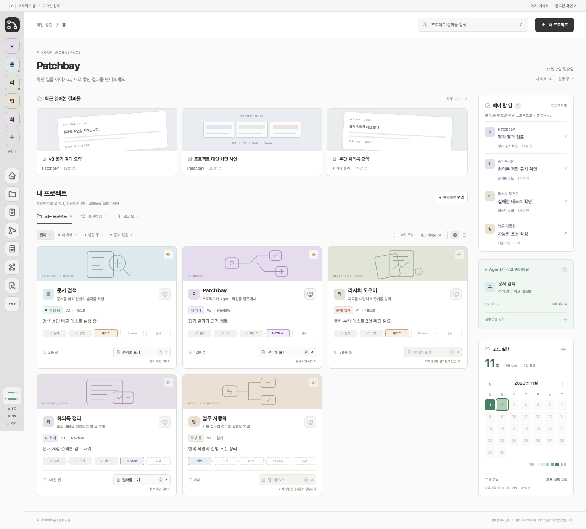

# A 메인 시안 · 사용자 수정사항 반영

- 작성일: 2026-11-02 (Asia/Seoul)
- 대상: [A 홈 시안](전체프로젝트-메인-3안_20261031_v1/a-home.html)
- 범위: 기존 A 검토 시안의 화면·이동 흐름. 예시 데이터를 사용하며 제품 적용 전이다.

## 요청과 반영

| 요청 | 시안에 반영한 동작 |
| --- | --- |
| 기존 Patchbay 왼쪽 바 유지, 로고는 메인으로 | `App.tsx`·`SidebarIcon.tsx`·`console.css`의 64px 바, 프로젝트 타일, 도구 순서·아이콘, 하단 연결 표시를 참고했다. 로고를 누르면 전체 홈으로 복귀하고 검색·필터를 초기화한다. 모바일은 기존 형태처럼 하단 가로 바다. |
| 위쪽 명칭은 Patchbay | 홈 제목을 `Patchbay`로 변경했다. |
| 오른쪽 해야 할 일 → 해당 프로젝트 할 일 | 예시 할 일 4건을 표시한다. 클릭하면 해당 프로젝트의 할 일 화면으로 이동하고 선택한 항목을 강조한다. 로고·브라우저 뒤로 가기로 복귀한다. |
| 오른쪽 아래 코드 실행 캘린더 | 월별 실행 횟수·활동 일수, 날짜별 횟수와 색 농도, 월 이동을 제공한다. 집계 단위는 실행 기록 1건을 1회로 보는 시안이며 커밋 수와 구분한다. 실제 집계는 연결하지 않았다. |
| 프로젝트 카드에서 실제 결과창 접속 | 문서 결과물 보기와 별도로 모니터·화살표 아이콘을 두었다. **앱·웹사이트 실행 화면**으로 우선 해석했다. 연결한 로컬 화면(`index.html#a`)을 새 탭으로 연다. 실행 주소가 없는 프로젝트의 아이콘은 비활성화한다. 문서가 있어도 실행 주소는 없을 수 있다. |

오른쪽 할 일은 `#project/<id>/tasks/<번호>`, 프로젝트 결과 목록은 `#project/<id>/result`로 검토한다. 이동 안내 모달 대신 별도 화면을 보여 주며 뒤로·앞으로·새로고침을 지원한다. 실제 제품에 적용할 때 앱 주소는 기존 `overlay.app.url`과 `DashboardView.app`을 재사용할 수 있다. 시안은 서버 API를 호출하지 않는다.

## 프로젝트와 Agent 명칭

현재 관리 단위는 설계·코드·할 일·결과물을 묶는 **프로젝트**다. Agent는 그 안에서 도구를 사용하며 작업하는 실행 주체로 구분한다. 프로젝트 전체를 Agent라고 바꾸면 작업 묶음과 수행 주체가 같은 이름이 되므로 프로젝트 명칭을 유지하는 것이 더 정확하다고 안내했다. 이는 구조 검토에 따른 권고이며 사용자가 명칭 변경을 확정한 것으로 기록하지 않는다.

근거: [Anthropic, Building effective agents](https://www.anthropic.com/research/building-effective-agents)는 Agent를 LLM이 수행 절차와 도구 사용을 동적으로 결정하는 시스템으로 설명한다. Patchbay의 등록된 프로젝트와 대화방의 Agent 설정이 분리돼 있는 현재 구조와 함께 판단했다.

## 확인

Chrome에서 사용자 흐름 확인 9묶음, 화면 10장을 기록했다. 데스크톱·태블릿·모바일의 로고 복귀, 할 일 4건의 소속 프로젝트 이동, 실제 로컬 화면 새 탭 열기, 결과·실행 주소 없는 상태, 결과물 열람, 캘린더 합계·날짜·월 이동, 검색·즐겨찾기·목록 전환, 기존 B·C 시안 동작을 확인했다. 브라우저 오류·외부 요청·페이지 가로 넘침은 없었다. 두 JavaScript 파일의 구문 검사도 통과했다.

- [검증 결과](전체프로젝트-메인-3안_20261031_v1/feedback-validation.json)
- [데스크톱](전체프로젝트-메인-3안_20261031_v1/a-feedback-desktop.png) · [할 일](전체프로젝트-메인-3안_20261031_v1/a-feedback-tasks.png) · [결과 화면](전체프로젝트-메인-3안_20261031_v1/a-feedback-result.png)
- [캘린더](전체프로젝트-메인-3안_20261031_v1/a-feedback-calendar.png) · [모바일](전체프로젝트-메인-3안_20261031_v1/a-feedback-mobile.png)

