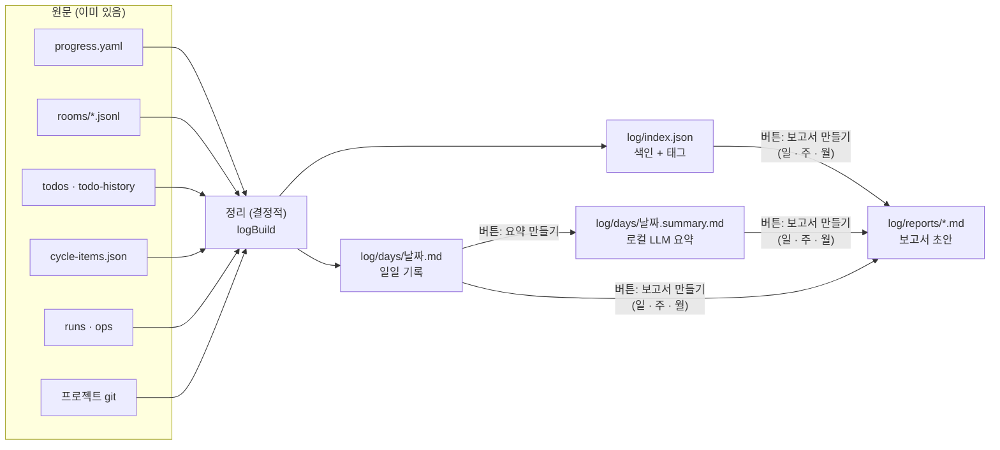
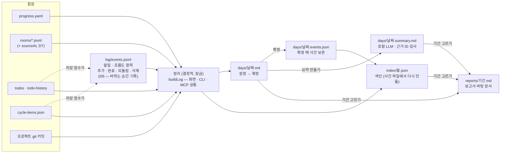

# Log 개편 — 프로젝트별 일일 기록 · 태그 색인 · 보고서 바탕 (기획)

- 작성일: 2026-10-15
- 상태: 기획 v1 + Codex 검토 반영(9절). **결정 2026-10-15: D1~D7 모두 9.3절 추천대로, 화면은 [Log 화면 4안](Log-화면4안_20261015_v1.md)의 1안 + 3안 층별 폴더**
- 대상: 프로젝트 도구 줄의 「Log · 진행 기록」 화면 (`app/apps/flow/src/ProjectLogPane.tsx`)
- 이 문서의 제안값은 구현 확정이 아니다. 9.3절의 결정 여섯 개를 사용자가 고른 뒤 구현한다 (8절은 검토 전 추천).

## 1. 사용자 요구 (2026-10-15 원문 요지)

| ID | 요구 | 이 기획에서 뜻하는 것 |
| --- | --- | --- |
| R1 | 하루 단위로 어떤 변동이 있었는지 `.md` 파일로 기록되고, 버튼으로 그 기록을 살펴볼 수 있다 | 프로젝트마다 날짜별 `일일 기록.md` 한 장. Log 화면에서 날짜를 누르면 그 장이 보인다 |
| R2 | 나중에 로컬 LLM으로 요약해서 요약본도 만들 수 있다 | 일일 기록 옆에 `요약.md`. 사람이 버튼을 눌렀을 때만 로컬 모델이 만든다 |
| R3 | 색인 표가 있어서 대화 내용과, 어떤 항목이 주로 바뀌었는지를 태그로 파악한다 | 사건 한 줄씩의 색인(날짜 · 종류 · 제목 · 태그 · 출처). 태그로 거르고, 기간별 태그 빈도를 그림으로 |
| R4 | 일일 · 주간 · 월별 작업 보고서(`.md`)를 쓸 때 바탕이 되는 문서 | 기간을 고르면 색인과 요약을 모아 보고서 초안 `.md`를 만든다. 사람이 고쳐 쓴다 |
| R5 | 프로젝트별로 Log를 관리한다 | 모든 파일은 `projects/<alias>/log/` 아래. 프로젝트를 바꾸면 Log도 바뀐다 |

## 2. 지금 상태 (실측)

- **화면.** `ProjectLogPane.tsx` 26줄. `/api/dashboard`의 `progressLog`(= `progress.yaml` current + history)와 `/api/test/activity`(테스트 실행)를 합쳐 최신순 5건씩 보여 준다. 파일을 만들지 않고, 날짜 묶음 · 태그 · 대화 · 보고서가 없다.
- **이미 남는 원문** (모두 `workspace/projects/<alias>/`, 시각이 있다):

| 원문 | 시각 칸 | 하루치로 뽑을 수 있는 것 |
| --- | --- | --- |
| `progress.yaml` | `timestamp` | 요청(asked) · 반영(did) · 요약 |
| `rooms/<id>.jsonl` · `.meta.json` | 말마다 `at` | 방 제목 · 사용자 말 · 답한 LLM · 모드 배지. 폰 · 터미널 Claude Code 세션도 `room_bind`로 묶이면 미러 훅이 여기에 옮긴다 |
| `todos.json` · `todo-history/index.json` | `at` · `completedAt` | 새 할일 · 끝낸 할일 |
| `cycle-items.json` | `at` | 흐름도 세부 항목 추가 (태그 `UI · Agent · 데이터 · 서버 · 문서`) |
| `test-runs/` · `test/activity.json` | 시작 · 끝 | 테스트 실행 |
| 프로젝트 레포 git (등록부 `path`) | 커밋 시각 | 커밋 제목 · 바뀐 파일 경로 |

- **로컬 LLM.** 대화방 호스트에 `local` 화자가 있다(LM Studio `lms`, `roomHost.ts`). 이 맥에는 LM Studio `qwen2.5-14b-instruct-mlx`(로딩됨) · `qwen3.5-9b` · `qwen2.5-7b`, Ollama `gemma4:12b` · `qwen3:8b`가 있다.
- **접근 등급.** `access.yaml`에서 `rooms/**`는 「허가」. 일일 기록에 대화 요지가 들어가면 같은 등급이어야 한다.
- 저장소 전체 일지 `workspace/records/log.md`(사람이 쓰는 큰 변경 한 줄)는 이 기획과 별개로 그대로 둔다.

## 3. 그림 — 원문에서 보고서까지



**층 셋을 섞지 않는다.**

1. **일일 기록 · 색인 — 결정적(파생).** 원문에서 규칙으로만 만든다. LLM을 부르지 않으므로 같은 원문이면 같은 파일이 나온다. 다시 만들 수 있다.
2. **요약 — LLM 산출물.** 사람이 눌렀을 때만 만든다. 어느 일일 기록(해시)을 보고 만들었는지 적어 두어, 일일 기록이 바뀌면 「낡음」으로 표시한다.
3. **보고서 — 사람의 저작물.** 초안은 만들어 주되, 이미 있는 보고서는 절대 덮지 않는다.

## 4. 파일 (작업 공간 `projects/<alias>/log/`)

| 파일 | 무엇 | 쓰는 곳 | 성격 |
| --- | --- | --- | --- |
| `days/2026-10-15.md` | 일일 기록 | 커널 `buildLogDay()` | 파생 — 임시 파일 → 이름 바꾸기. 마감(8절 D1) 뒤에는 고정 |
| `days/2026-10-15.summary.md` | 로컬 LLM 요약. 머리말에 `model` · `source`(일일 기록 해시) · `at` | Flow 호스트(로컬 모델 호출) → 커널 저장 함수 | LLM 산출물 — 다시 만들면 앞 판은 `days/archive/`로 |
| `index.json` | 색인: 사건 한 줄씩 + 날짜별 태그 집계 | `buildLogDay()` | 파생 — 언제든 다시 만든다 |
| `config.yaml` | 태그 규칙(경로 → 태그, 낱말 → 태그) · 요약 모델 · 하루 경계 시간대 | 사람 · 화면 | 설정. 없으면 기본값 |
| `reports/day-2026-10-15.md` · `week-2026-W42.md` · `month-2026-10.md` | 보고서 초안 → 사람이 고친다 | 커널 `draftLogReport()`(처음만) · 사람 | 저작물 — 덮지 않음 |

작업 공간은 비공개이고 `patchbay backup`으로 비공개 레포에 올라간다. 프로젝트 레포(다른 사람에게 공개될 수 있는 곳)에는 쓰지 않는다. `access.yaml`에 `workspace/projects/*/log/**` = 「허가」 줄을 더한다(대화 요지가 들어가므로).

### 4.1 일일 기록 한 장의 모양

```markdown
---
project: patchbay
date: 2026-10-15
tz: Asia/Seoul
built: 2026-10-16T00:12:03+09:00
closed: true            # 마감되면 다시 쓰지 않는다
counts: { 진행: 6, 대화: 4, 할일: 3, 커밋: 0, 실행: 0, 파일: 41 }
tags: { UI: 14, 데이터: 6, 서버: 3, 문서: 9, Agent: 2 }
---

# patchbay · 2026-10-15 (목)

## 한눈에
진행 6 · 대화방 4 · 끝낸 할일 3 · 바뀐 파일 41 — 가장 많이 바뀐 곳: UI 14 · 문서 9

## 진행 (progress)
- 14:02 **체력바 Claude % 를 서버 사용률로** `UI` `데이터`
  - 요청: 내가 원하는 건 얼마나 남았는지 % …
  - 반영: 상태줄 rate_limits → llm-quota-claude.json …

## 대화
| 시각 | 방 | 말 | 사용자 요지 | 태그 |
| --- | --- | --- | --- | --- |
| 13:40–15:10 | 체력바 확인 (`2026-10-15-ab12cd34`) | 사용자 9 · Claude 9 | 왼쪽 하단 토큰 사용량 확인 / % 를 체력바로 … | `UI` |

## 할일
- 끝냄: 대시보드 에이전트 칸 제거 (10:20 등록 → 16:05 완료) `UI`
- 새로: …

## 바뀐 파일 (git)
| 태그 | 파일 수 | 대표 경로 |
| --- | --- | --- |
| UI | 14 | app/apps/flow/src/LlmHealthRail.tsx · console.css … |
커밋 안 된 변경 41파일 (오늘 장만 — 마감 때의 상태)

## 출처
progress 6건 · rooms 4개 · todos 3건 · git HEAD 0763d6f
```

- **대화는 요지만.** 방마다 사용자 말 앞부분(한 말당 120자, 방당 10개까지)과 말 수 · 화자만 넣고, 원문은 방 링크로 연다. LLM 답 본문은 넣지 않는다.
- 사건이 하나도 없는 날은 파일을 만들지 않는다.

### 4.2 색인 `index.json`

```jsonc
{
  "version": 1,
  "builtAt": "…",
  "entries": [
    { "id": "progress:2026-10-15T05:02:11Z", "date": "2026-10-15", "at": "…", "kind": "진행",
      "title": "체력바 Claude % 를 서버 사용률로", "tags": ["UI","데이터"],
      "tagFrom": { "UI": "경로", "데이터": "낱말" },
      "ref": { "type": "progress", "timestamp": "…" } },
    { "id": "room:2026-10-15-ab12cd34", "kind": "대화", "title": "체력바 확인", "tags": ["UI"],
      "ref": { "type": "room", "roomId": "…", "fromSeq": 1, "toSeq": 18 } },
    { "id": "git:0763d6f", "kind": "커밋", "files": ["app/apps/flow/src/App.tsx"], "tags": ["UI"], "ref": { "type": "commit", "sha": "0763d6f" } }
  ],
  "days": { "2026-10-15": { "counts": { … }, "tags": { "UI": 14, … }, "closed": true, "summary": "fresh" } }
}
```

종류(`진행 · 대화 · 할일 · 흐름도 · 커밋 · 실행`)는 태그와 다른 축이다 — 표의 칸으로 둔다.

### 4.3 태그를 붙이는 법

| 순서 | 규칙 | 예 (Patchbay 기본값) | 표시 |
| --- | --- | --- | --- |
| 1 | 연결된 흐름도 항목 · 할일의 태그를 물려받는다 | 흐름도 항목 `UI` → 그 할일 · 방도 `UI` | 확정 |
| 2 | 바뀐 파일 경로 → 태그 (`config.yaml` `paths`) | `app/apps/flow/src/**/*.{tsx,css}` → UI, `app/apps/flow/src/server.ts` → 서버, `app/packages/core/**/*Store.ts` → 데이터, `app/packages/mcp/**` → Agent, `**/*.md` → 문서 | 확정 |
| 3 | 글의 낱말 → 태그 (`config.yaml` `words`) | 「화면 · 버튼 · 레일」 → UI, 「저장 · 스키마」 → 데이터 | 확정 |
| 4 | 로컬 LLM 요약이 태그를 제안 | 「체력바」 「훅」 같은 주제 태그 | **추정** — 점선 칩, 사람이 「채택」하면 `config.yaml` 낱말 규칙으로 들어간다 |

- 기본 태그 낱말은 흐름도와 같은 `UI · Agent · 데이터 · 서버 · 문서` 다섯 개로 시작한다. 프로젝트가 `config.yaml`에서 더한다.
- 진행 · 대화처럼 파일이 없는 사건은 규칙 1 · 3, 그리고 같은 시간대(±30분) 커밋 · 변경 파일의 경로 태그로 붙인다 — 이 경우는 「근처 변경」으로 표시한다.

## 5. 언제 만드나 (감시 없음 — 원칙 10)

파일을 지켜보는 감시자를 두지 않는다. 원문에 시각이 남아 있으므로 **부를 때 몰아서** 만든다.

| 계기 | 하는 일 |
| --- | --- |
| Log 화면을 열 때 | 마지막 정리 이후 날짜 중 아직 마감 안 된 날과 오늘을 정리 (보통 1~2장, 수백 ms) |
| `patchbay log build --project <alias> [--date] [--since]` · MCP `log_build` | 같은 일. 폰에서 「오늘 기록 정리해 줘」도 이걸로 |
| `progress write` 끝 | 오늘 장만 다시 정리 (가벼움) |
| 「다시 정리」 버튼 | 마감된 날도 사용자가 눌렀을 때만 다시 만든다 (앞 판은 `days/archive/`) |

**마감.** 그날이 지나고 처음 정리될 때 `closed: true`가 되고 이후 자동으로는 다시 쓰지 않는다 — 할일이 지워지거나 레포 이력이 바뀌어도 그날 기록이 사라지지 않게. 하루 경계는 `config.yaml` `tz`(기본 `Asia/Seoul`) 자정.

## 6. 화면

`visual-first`에 따라 표보다 먼저 **달력 열지도**와 **태그 막대**를 둔다. 표(색인)는 거르고 찾는 도구.

```
┌ Log · patchbay ─────────────────────── [일|주|월] ◀ 2026년 10월 ▶ ┐
│ 달력 열지도: 칸 색 = 사건 수, 칸 아래 점 = 가장 많은 태그 색          │
│  월 화 수 목 금 토 일                                                 │
│  ▢ ▢ ▣ ■ ■ ▢ ▢   ← 15일 선택                                         │
├──────────────────────┬──────────────────────────────────────────────┤
│ 태그 막대 (기간)      │ 2026-10-15 (목)   [기록|요약]                   │
│ UI     ██████████ 14 │  [다시 정리] [요약 만들기 · qwen2.5-14b]        │
│ 문서   ██████ 9      │  [보고서: 오늘 · 이번 주 · 이번 달]              │
│ 데이터 ████ 6        │  ── 일일 기록 .md 렌더 ──                        │
│ 서버   ██ 3          │                                                │
├──────────────────────┴──────────────────────────────────────────────┤
│ 색인  [태그 칩: UI 문서 데이터 …] [종류: 진행 대화 할일 커밋]  검색   │
│ 날짜 | 시각 | 종류 | 제목 | 태그 | 출처(열기)                          │
└────────────────────────────────────────────────────────────────────┘
```

- 태그 칩을 누르면 열지도 · 막대 · 색인이 함께 걸러진다.
- 「출처」를 누르면 대화방(그 seq 범위) · 할일 · 커밋을 연다.
- 요약 탭: 요약이 없으면 「요약 만들기」, 낡았으면 「일일 기록이 바뀌었습니다 · 다시 요약」.
- 보고서 버튼: 그 기간 보고서가 있으면 연다, 없으면 초안을 만든 뒤 연다. 화면에서는 읽기 + 「파일 위치 복사」 · 「내려받기」. 편집은 사용자의 편집기에서(v1).
- 시안: 같은 이름 폴더의 `index.html` · 이미지.

## 7. 로컬 LLM 요약 · 보고서 초안

### 7.1 요약 (`요약 만들기`)

- 호출: 대화방 호스트의 `local` 경로(LM Studio `lms`)를 쓴다. 모델은 `config.yaml` `summary.model`, 비우면 LM Studio에 로딩된 첫 대화 모델. 로컬 모델이 없으면 버튼이 꺼지고 까닭이 보인다. **클라우드 LLM으로 넘기지 않는다** (대화 요지가 들어 있으므로, 사용자가 config에서 바꿀 때만).
- 입력: 그날 일일 기록 본문만. 1만 2천 자를 넘으면 절별로 나눠 요약한 뒤 합친다.
- 출력 형식 (고정 절): `한 줄 요약` · `한 일` · `결정` · `막힌 것 · 남은 일` · `태그 제안`. 원문에 없는 사실을 쓰지 말라고 지시하고, 각 줄에 근거 사건 id를 단다 → 화면에서 근거를 누르면 색인 줄로 간다.
- 비동기: 버튼 → 진행 표시 → 끝나면 요약 탭 갱신. 실패는 그 자리에 오류로.

### 7.2 보고서 초안 (`보고서: 오늘 · 이번 주 · 이번 달`)

결정적으로 뼈대를 만들고, 요약이 있는 날은 그 문장을 쓴다(없으면 진행 `did`).

```markdown
---
project: patchbay
period: week
range: 2026-10-12 ~ 2026-10-18
drafted: 2026-10-18T18:00+09:00
sources: { days: 5, summaries: 3 }
---
# patchbay 주간 보고 · 2026-W42 (10/12–10/18)

## 한 줄 요약
(사람이 쓴다 — 아래 근거를 보고)

## 주요 성과
- 10/15 체력바 Claude % 를 서버 사용률로 — 상태줄 rate_limits … [근거: progress:…]

## 바뀐 영역
| 태그 | 사건 | 파일 | 지난 기간 대비 |
| UI | 31 | 58 | +12 |

## 끝낸 할일 · 결정
## 막힌 것 · 남은 일
## 다음 계획
(사람이 쓴다)

## 근거
일일 기록 5장 링크 · 색인 필터 조건
```

- 이미 있으면 덮지 않는다. 「새로 만들기」는 `-b`, `-c` 판으로.
- 「로컬 LLM으로 문장 다듬기」는 v1 범위 밖.

## 8. 사용자가 정할 것

| ID | 결정 | 추천 | 다른 안과 대가 |
| --- | --- | --- | --- |
| D1 | 지난 날 기록을 마감(고정)할까 | **마감** — 다음 날 처음 정리 때 고정, 다시 만드는 건 버튼으로만 | 매번 다시 만들기: 단순하지만 할일 삭제 · 레포 이력 변경 때 지난 기록이 바뀐다 |
| D2 | 대화를 일일 기록에 얼마나 넣을까 | **사용자 말 요지 + 방 링크** | LLM 답까지: 보고서 근거는 풍부해지나 파일이 커지고 민감 정보가 퍼진다 |
| D3 | 요약 모델 | **LM Studio(이미 대화방 `local` 경로) · qwen2.5-14b** | Ollama gemma4:12b: 새 호출 경로가 하나 더 생긴다 |
| D4 | 보고서를 어디에 둘까 | **작업 공간 `log/reports/`(비공개 · 백업됨)** + 내려받기 | 프로젝트 레포 문서 폴더: 편집기로 바로 보이지만 공개 레포에 섞일 수 있다 |
| D5 | 묶이지 않은 Claude Code 세션 대화도 넣을까 | **v1은 뺀다** — `room_bind`로 묶인 대화만 | `~/.claude/projects` 기록을 경로로 맞춰 읽기: 빠짐이 없지만 다른 프로젝트 대화가 섞일 위험 |

## 9. Codex 검토 (2026-10-15, `codex exec --sandbox read-only`)

원문: 같은 이름 폴더의 `codex-review.md`. Codex는 읽기만 했다. 요지: **「기록된 사건을 모아 보기」와 「실제로 일어난 모든 변동을 보존하기」를 섞었다 — 원문이 사라진 뒤에도 과거 기록을 만들 수 있다는 가정부터 고쳐야 한다.**

### 9.1 지적과 판단

| # | 지적 (심각도) | 확인 | 판단 · v2에서 바꿀 것 |
| --- | --- | --- | --- |
| 1 | 할일 · 흐름도 항목의 **삭제 · 수정 · 되돌린 완료**는 원문에 시각이 없어 나중에 복원할 수 없다 (높음) | `todoStore.ts` 16–27 · 108–117 — `at` · `completedAt`만, 미완료로 되돌리면 `completedAt` 지움 | **수용.** 「변동」을 보장하려면 바뀌는 순간에 남겨야 한다 → 9.3 D6 |
| 2 | 미러로 옮긴 대화의 `at`은 **옮긴 시각**이지 말한 시각이 아니다 (높음) | 직접 확인 — `mirror.ts` 207–223이 `now()`를 넘기고 `store.ts` 117이 그걸 `at`으로 | **수용.** v1은 「방에 기록된 시각 기준」이라고 표시. 원래 시각으로 묶으려면 메시지에 `sourceAt`을 더하는 원문 계약 변경(작음 — 미러가 이미 `line.timestamp`를 읽는다) |
| 3 | 커밋 안 된 변경은 「오늘 변경」이 아니다 (며칠 묵은 것 포함). ±30분 근처 변경 태그는 오탐 (높음) | 맞음 | **수용.** 커밋은 커밋 시각 사건, 미커밋은 「조회 시점 작업 트리 상태」 칸으로 분리. 근처 변경 규칙은 뺀다 |
| 4 | 자동 마감한 일일 기록은 더 이상 파생물이 아니다 — 색인을 원문에서 다시 만들면 마감본과 어긋난다 (높음) | 설계 모순 맞음 | **수용.** 확정할 때 그날의 정규화된 사건을 `days/<날짜>.events.json`으로 함께 보존하고, 색인은 이 사건 파일들에서 다시 만든다 |
| 5 | 「다음 날 처음 정리 때 마감」은 미러 지연 · 화면을 안 연 날 때문에 덜 모인 자료를 확정한다 (높음) | 맞음 | **수용.** 잠정 기록 → 사용자가 「확정」. 확정 때 수집 범위 · 빠진 출처 · 기준 시각을 함께 적는다 (D1 추천 변경) |
| 6 | 사건 ID가 Markdown에 없어 요약 근거를 검증할 수 없다. 방 ID만으로는 여러 날에 걸친 방이 겹친다 (높음) | 맞음 | **수용.** 사건 ID를 일일 기록 본문에도 넣는다. 대화 사건 ID = `room:<방>:<날짜>:<seq 범위>`. 요약의 근거 ID는 입력에 있는지 검사 |
| 7 | rename만으로 동시 쓰기를 막지 못한다 (Flow · CLI · MCP). 보고서 「없으면 만들기」도 경쟁 (높음) | `rooms/store.ts` 30–58에 프로세스 간 잠금 선례 | **수용.** 프로젝트별 build 잠금 재사용, 보고서는 배타적 생성(`wx`) |
| 8 | `access.yaml`은 처음 맞는 규칙 — 새 줄을 `workspace/**` 뒤에 두면 소용없다. 그리고 지금은 기록용일 뿐 집행이 없다 (높음) | 직접 확인 — `workspace/**`가 39행 | **수용.** 새 줄은 `workspace/**` 앞에. 집행은 B 단계 몫이라고 문서에 명시 |
| 9 | 로컬 모델도 실패 · 환각 · 입력 속 지시문 위험. 1만 2천 자는 토큰 한도 보장이 아님. 낡은 요약이 보고서로 새면 안 됨 (높음) | 맞음 | **수용.** 자료는 인용 데이터로 감싸 넘기고, 시간 초과 · 취소 · 형식 검사, 실패하면 앞 요약 유지, 낡은 요약은 보고서 바탕에서 뺀다 |
| 10 | MCP `log_build`는 계기 표에만 있고 L6엔 `log_read`만 (높음) | 맞음 | **수용.** 공통 build 함수 하나를 화면 · CLI · MCP · 보고서가 부른다. L6에 `log_build` 포함 |
| 11 | R3 「무엇이 주로 바뀌었나」를 태그 빈도로만 대신했다. 사건 수 · 파일 수가 섞인다 (높음) | 맞음 | **수용.** 사건마다 `대상 종류 · 대상 ID · 변경 종류`(추가 · 완료 · 삭제 · 커밋 …). 태그 집계는 사건 수와 고유 파일 수를 따로 |
| 12 | 사용자 말 앞 120자로는 결정 · 결과를 요약할 수 없다 (중간) | 맞음 | **수용.** 이름을 「사용자 말 발췌」로, 생략한 수 표시. 결과 근거는 progress `did` · 끝낸 할일 |
| 13 | progress `timestamp`는 일한 시각이 아니라 **보고한 시각** (중간) | `progressStore.ts` 95–106 | **수용.** 「진행 보고가 기록된 날」로 정의 |
| 14 | 방 제목 · 멤버는 지금 값이지 그날 값이 아니다. 미러 메시지에는 모드가 없다 (중간) | 맞음 | **수용.** 「현재 제목」으로 표기, 모드는 메시지에 있을 때만 |
| 15 | 흐름도 태그 물려받기는 `cycleItem.todoId → todo.roomId` 조인이 필요 (중간) | 맞음 | **수용.** 명시적 연결에서만, 여러 항목이면 합집합 |
| 16 | `built` 시각이 파일에 있으면 「같은 원문 → 같은 바이트」가 불가 (중간) | 맞음 | **수용.** 결정성 입력 = 원문 · 설정 · 생성기 버전. 실행 시각은 색인 쪽에만 |
| 17 | 날짜는 방 ID(UTC 날짜)가 아니라 timestamp로, `[자정, 다음 자정)` (중간) | `rooms/store.ts` 62–63 | **수용** |
| 18 | 모든 입구에서 등록된 alias 확인 · 날짜/보고서 이름 경로 이탈 막기 · 두 프로젝트 격리 검사 (중간) | 맞음 | **수용.** L1 완료 기준에 넣음 |
| 19 | LM Studio 재사용은 좋으나 「로딩된 첫 모델 자동 선택」은 새 기능 (중간) | `roomHost.ts` 399 — 빈 모델 ID 거절 | **수용.** 사용자가 고른 모델 ID를 저장하고 실행 때 있는지 확인 |
| 20 | 보고서 초안 생성 · `-b`판 관리는 요구보다 크다. v1은 기간별 근거 모음 + 내보내기로 충분 (중간) | 요구 원문이 「보고서 작성 때 **바탕이 되는 문서**」 | **일부 수용.** v1 = 기간(일 · 주 · 월)을 고르면 **보고서 바탕 문서**(근거 모음 `.md`)를 만든다. 사람이 쓰는 칸은 남기되 판 관리(`-b`)는 뺀다. 같은 이름이 있으면 열기만 |
| 21 | 열지도 · 태그 막대 · 기간 비교를 첫 단계에 다 넣을 필요 없음 (낮음) | — | **일부 수용.** 열지도(날짜 고르기)와 태그 막대는 `visual-first`대로 첫 단계에 둔다. 「지난 기간 대비」와 복합 필터 연동만 뒤로 |

빠뜨린 건 「크기」 지적(전체 색인 반복 재작성, 큰 방 JSONL 전체 읽기)이다 — **수용**, 색인을 월별 파일(`index/2026-10.json`)로 나누고, 처음 정리할 때 과거 범위를 사용자가 고르게 한다. 「빈 날 · 미수집 · 수집 실패」를 구분해 표시한다.

### 9.2 v2에서 바뀌는 그림



### 9.3 정할 것 (검토 반영 — 8절을 대신함)

| ID | 결정 | 추천 (검토 뒤) | 다른 안과 대가 |
| --- | --- | --- | --- |
| D1 | 지난 날 기록을 어떻게 고정할까 | **잠정 → 사용자가 「확정」** (확정 때 사건을 함께 보존). *검토 전 추천 「자동 마감」에서 바꿈* | 자동 마감: 손이 안 가지만 덜 모인 자료(미러 지연, 화면 안 연 날)를 확정한다 |
| D2 | 대화를 얼마나 넣을까 | **사용자 말 발췌(생략 수 표시) + 방 링크** — 결과 근거는 `did` · 끝낸 할일로 따로 | LLM 답까지: 근거는 풍부하나 파일이 커지고 민감 정보가 퍼진다 |
| D3 | 요약 모델 | **LM Studio 경로 재사용, 모델은 사용자가 고른 ID를 저장** | 고정 모델명: 모델을 바꾸거나 내리면 깨진다 |
| D4 | 보고서 바탕 문서 위치 | **작업 공간 `log/reports/`** — 사람이 고쳐 쓰는 칸이라 덮지 않음을 저장구조에 명시, 내려받기 제공 | 프로젝트 레포: 편집기로 바로 보이지만 공개 레포에 섞일 수 있다 |
| D5 | 묶이지 않은 Claude Code 대화 | **뺀다** (Codex 동의). 빠질 수 있는 범위를 화면에 한 줄로 | 경로로 맞춰 읽기: 다른 프로젝트 대화가 섞인다 |
| D6 | **(새)** 할일 · 흐름도 항목의 삭제 · 되돌림까지 남길까 | **남긴다** — 저장 함수(`updateTodos` · `updateCycleItems`)가 바뀐 줄을 비교해 `log/events.jsonl`에 한 줄씩. 그날부터만 보장 | 안 남김: 코드는 그대로지만 「변동」 중 삭제 · 수정이 영영 빠진다 |
| D7 | **(새)** 미러 대화를 말한 날짜로 묶을까 | **묶는다** — 메시지에 선택 칸 `sourceAt` 추가(미러가 이미 원문 시각을 읽음), 없으면 `at` | 안 묶음: 늦게 묶은 세션의 지난 대화가 오늘 기록에 잡힌다 |

## 10. 구현 단계 (결정 뒤 · Codex 검토 반영)

| 단계 | 내용 | 완료 기준 |
| --- | --- | --- |
| L0 | (D6 · D7을 고르면) 저장 함수가 `log/events.jsonl`에 할일 · 흐름도 항목 변동을 남김, 미러 메시지 `sourceAt` | 추가 · 완료 · 되돌림 · 삭제가 한 줄씩, 동시 쓰기에서 빠짐 없음, 기존 원문 읽기 그대로 |
| L1 | `core/src/studio/logStore.ts`: 사건 계약(ID · 대상 · 변경 종류 · 기록 시각 · 출처 시각) · 공통 `buildLog()` · 잠금 · 잠정/확정 · 월별 색인 · 기본 `config.yaml`. CLI `patchbay log build` | demo 고정자료로: 같은 입력 → 같은 바이트, 현재/보관 할일 중복 제거, 늦게 온 미러, 지워진 원문, 깨진 JSONL 줄, git 아닌 폴더, 동시 실행 · 중단 복구, 두 프로젝트 격리, 날짜 경로 이탈 거절, 빈 날 · 미수집 · 실패 구분 |
| L2 | 태그: 명시적 연결 · 경로 · 낱말 세 가지 (근처 변경 없음), 미분류 허용 | 겹칠 때 순서, 프로젝트가 더한 태그, 사건 수와 고유 파일 수 분리 |
| L3 | Flow API (읽기와 정리 요청 분리) + 화면(열지도 · 태그 막대 · 색인 · 기록 렌더 · 확정 버튼), `access.yaml` 줄(`workspace/**` 앞), 저장구조 · 아키텍처 문서 | 프로젝트 전환 중 응답 경합, 지워진 출처 링크, 방 seq 이동, Markdown 안전 렌더, Playwright로 태그 거르기 |
| L4 | 보고서 바탕 문서(일 · 주 · 월) — LLM 없이 완성, 정리 후 생성, 배타적 생성 | `did` 없는 날 대체 규칙, 진행 중 기간 표시, 주 · 월 · 해 경계, 있는 파일 안 덮음 |
| L5 | 로컬 LLM 요약 — 인용 데이터로 감싸기, 근거 ID 검사, 낡음 표시, 태그 제안은 그 사건에만 (전역 규칙 자동 추가 없음) | 모델 없음 · 중간에 내려감 · 시간 초과 · 취소 · 빈 출력 · 형식 오류 · 가짜 근거 ID · 생성 중 원문 변경 → 앞 요약 유지, 낡은 요약은 보고서 바탕에서 빠짐 |
| L6 | MCP `log_build` · `log_read` (기간 · 태그, 응답 크기 제한) | 프로젝트 격리, 쪽 나눔 |

함께 고칠 문서: `저장구조.md` 5절(`log/`) · `access.yaml` · `아키텍처.json`/`.md` · `용어.md`(일일 기록 · 색인 · 확정 · 보고서 바탕 문서) · 일지.

검사는 demo 고정자료로만 한다 (수락 프로젝트를 끌어오지 않는다).
