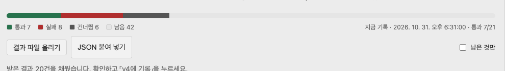

# Review 칸 · 평가 결과 받기 · 2026-10-31

사용자 요청: 「결과를 받는 걸 Patchbay 검토 창에서 받을 수 있게 하는 기능을 만들어줘」. 바깥 채점 화면에서 내려받은 결과 JSON이 다운로드 폴더에 남지 않아 CLI `evals record`로 넘기지 못한 것이 계기다.

## 만든 것

- 대시보드 Workflow에서 Review 칸을 고르면 머리에 「평가 결과 받기」가 생긴다. 누르면 판 전체를 덮는 창이 열린다.
- 창: 승인된 판의 평가 전부(요구사항 번호 · 짧은 설명 · 기대), 건마다 통과 · 실패 · 건너뜀과 메모, 위에 통과 · 실패 · 건너뜀 · 남음 막대.
- 결과 파일 올리기 · JSON 붙여 넣기 → 건마다 채운다. 판이 다르면 채우기 전에 거절한다. 채운 뒤 화면에서 고치고 「v<n>에 기록」.
- 이미 기록된 결과가 같은 판이면 열 때 채워져 있다.

## 판단

- 쓰기 길을 하나로: CLI `evals record`에 있던 판 대조를 Core `fitEvalRun`으로 옮기고 CLI와 `POST /api/evals/record`가 같이 쓴다. 콘솔이 따로 판단하지 않는다 (원칙 8).
- Patchbay는 여전히 평가를 돌리지 않는다. 창은 바깥에서 낸 결과(실행 · 사람 채점)를 받는 자리다. 「어떻게 냈나」 칸이 `how`로 같이 남는다.
- 검토 화면(R4.1a 승인 · 반려)은 아직 아니다. Review 칸에 붙인 첫 화면이 결과 받기다.

## 실측

- 테스트 1375 통과 · 3 건너뜀 (새 4건: 기록 · 다른 판 거절 · 형식 거절 · JSON 채우기).
- 샌드박스 콘솔(:4327, 승인 v4)에서: v3 파일 → 「결과는 v3 인데 승인된 설계는 v4」 거절, v4 파일 20건 채움 → 한 건 화면에서 실패 + 메모 → 기록 21건, 메모 저장 확인. 390px 폭 가로 넘침 0.
