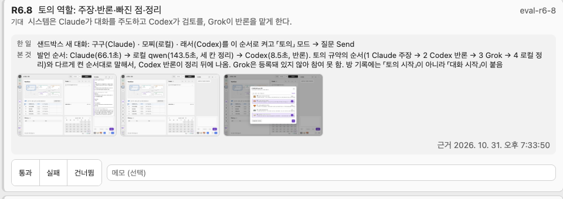

# Review 칸 · 평가 근거와 지금 화면 링크 · 2026-10-31

사용자 요청: 「평가 시에 실제 그걸 사람이 볼 수 있게 평가 대상을 화면에 띄워서 보여 주는 게 필요할 것 같다」. 세 안(A 근거 붙여 보이기 · B 실제 화면 열기 · C 창에서 실행) 중 「A로 진행하고 B 링크도 같이」로 결정.

## 만든 것

- 저장: `projects/<alias>/eval-evidence/v<n>/<evalId>/` — `evidence.json`(한 일 · 본 것 · 지금 화면 위치 · 첨부 목록) + 첨부(이미지 · 텍스트, 10MB 안). 판 번호로 나뉘어 채택 때 옮기지 않는다.
- 넣는 길: `patchbay evals evidence --project <alias> --eval <id> --how … --observed … --file a.png --file out.txt [--screen test|room:<id>]`. 승인된 설계에 없는 평가 id는 거절. 다시 붙이면 같은 이름 첨부만 바뀌고 나머지는 남는다.
- 보이기(A): 「평가 결과 받기」 카드마다 기대 밑에 한 일 · 본 것 · 스크린샷 썸네일(누르면 크게) · 텍스트 첨부 링크 · 근거 시각. 근거가 없으면 붙이는 명령을 알려 준다.
- 링크(B): 「지금 화면 열기 · <화면>」 — 작업 화면이면 그 화면으로 이동, 대화방이면 그 방을 연다. 평가한 그때가 아니라 지금 모습이라고 툴팁에 적었다.
- 다른 화면에 다녀와도 기록 전 채점은 이 탭(sessionStorage)에 남아 창을 다시 열면 이어 보인다. 기록하면 지운다.

## 판단

- 사람이 판정하는 근거는 평가한 그 순간의 모습이어야 한다. 지금 화면은 그사이 코드 · 데이터가 바뀌었을 수 있다 → A가 기본, B는 비교용 링크.
- C(창에서 실행)는 「Patchbay는 평가를 돌리지 않는다」 원칙을 바꾸는 일이라 하지 않았다.
- 첨부 파일 경로는 `evidence.json`에 적힌 이름만 내준다. HTML은 받지 않는다(콘솔 출처에서 열리면 스크립트가 돈다).

## 실측

- 테스트 1380 통과 · 3 건너뜀 (새 5건: 근거 쓰기 · 경로 차단 · 형식 거절 · 근거 실어 보내기 · 화면 링크).
- 샌드박스 콘솔(:4327): 근거 63건 붙임 → 카드 근거 · 썸네일 크게 보기 · 「지금 화면 열기 · 설계」 이동 · 대시보드로 돌아와 다시 열면 고르던 「실패」가 남아 있음 확인.
- 실제 작업 공간 v3: 이번 외부 평가 때 모은 근거 63건(스크린샷 96장, 19MB)을 `evals evidence`로 붙임.
