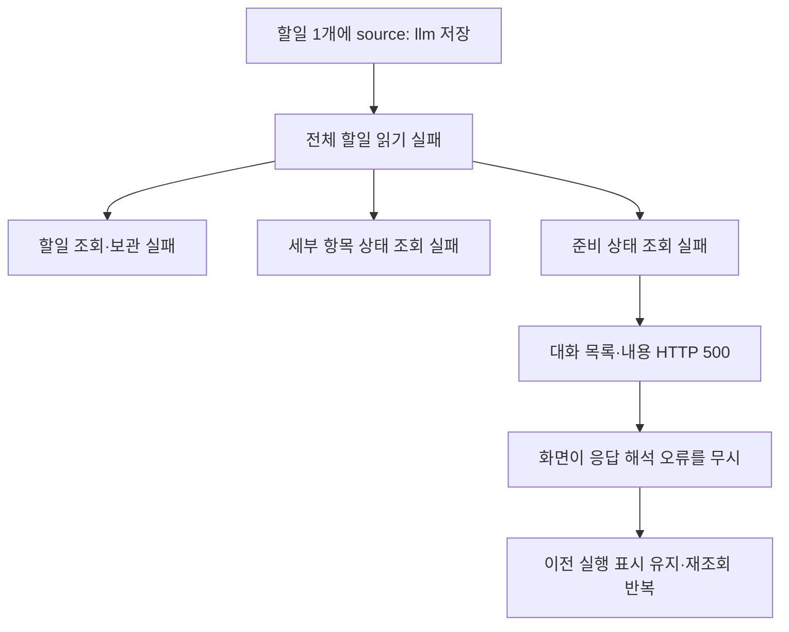

# 대화·할일 연쇄 오류 원인 진단

- 요청: 대화창의 분석 중 표시가 계속 남고 세부 항목 조회·할일 기록·대화 조회가 실패하는 원인 확인.
- 확인일: 2026-10-20, KST.
- 범위: 실행 중인 4318 서버의 조회 응답, 현재 원문, 소스와 빌드 결과 비교. 제품 코드·할일·대화 원문 수정과 서버 재시작은 하지 않았다.

## 직접 원인

`workspace/projects/patchbay/todos.json`의 44번째 항목(배열 인덱스 43)에 스키마가 허용하지 않는 `source: "llm"`이 들어갔다.

- 항목 ID: `t-20261020-r72a-midrun-stop`.
- 제목: R7.2a 둘째 경우 — 수행 중 보류한 할일의 결정이 필요하다고 드러나면 그때 중지.
- 등록 시각: 2026-10-20 21:44:08.897 KST (`2026-10-20T12:44:08.897Z`).
- 연결 대화: `2026-10-20-bebb32c3`.
- `todoItemSchema`는 `source` 생략 또는 `stage`·`attention`만 허용한다(`app/packages/core/src/studio/todoStore.ts:28`). 소스와 현재 빌드 결과가 모두 같은 제한을 가진다.
- `readTodos()`는 항목 하나가 잘못돼도 배열 전체를 `parse()`에서 거절한다(`todoStore.ts:54`). 44개 중 스키마 오류는 이 한 항목뿐이다.

원본을 바꾸지 않고 메모리에서 이 항목의 `source`만 생략했을 때 44개 모두 스키마 검사를 통과했다. 이는 필드 단위 원인 확인이며, 실제 복구 후 API 검증은 아직 하지 않았다.

## 실제 오류 재현

4318에서 다음 응답을 확인했다.

| 조회 | HTTP | 결과 |
| --- | --- | --- |
| `/api/todos?alias=patchbay` | 500 | 할일 기록 저장 실패, `todos[43].source` 검증 오류 |
| `/api/cycle-items?alias=patchbay` | 500 | 세부 항목 조회 실패, 같은 검증 오류 |
| `/api/rooms?alias=patchbay` | 500 | `Internal Server Error` |
| `/api/room?alias=patchbay&id=2026-10-20-bebb32c3` | 500 | `Internal Server Error` |
| `/api/todo-preparations?alias=patchbay` | 500 | 같은 검증 오류 |
| `/api/running` | 200 | `{"aliases":[]}` — 확인 시점 실행 중인 LLM 없음 |

`workspace/flow-console.log`는 진단 중 첫 집계에서 같은 `ZodError`를 1,028회 기록하고 있었다. 모두 대화 목록·상세 경로에서 준비 상태를 조회하다 발생한 동일 검증 오류였다. 진단 요청과 화면 재조회로 횟수는 이후 증가할 수 있다.

## 여러 기능으로 번지는 이유

1. 할일 조회는 `updateTodos()`를 호출하며 먼저 전체 할일을 읽는다. 읽기에서 실패했지만 API의 공통 예외 문구가 「할일 기록 저장 실패」여서 쓰기 장애처럼 보인다(`server.ts:1453`).
2. 흐름도 세부 항목은 연결 할일의 상태를 계산하려고 `readTodos()`를 함께 호출한다(`cycleItemActions.ts:44`). 이 읽기가 실패하면서 세부 항목 전체 조회도 실패한다.
3. 대화 목록과 상세는 원문을 정상으로 읽은 뒤 부가 정보인 준비 상태를 추가하려고 `todoPreparation.list()`를 호출한다. 이 함수도 전체 할일을 읽는다. 부가 정보 오류가 대화 원문 응답까지 막는다(`server.ts:1249`, `server.ts:1269`, `todoPreparation.ts:86`).
4. 대화 API의 이 예외는 JSON 응답으로 처리되지 않아 일반 문자열 `Internal Server Error`가 반환된다. 화면은 `res.json()` 실패를 `.catch(() => undefined)`로 무시하고 이전 `room`·`rooms` 상태를 유지한다(`RoomPanel.tsx:412`, `RoomPanel.tsx:429`).
5. 화면이 직전 `running: true` 또는 `status: waiting`을 갖고 있었다면 그 값으로 대기 표시와 1.5초 재조회를 계속한다(`RoomPanel.tsx:446`). 사용자가 본 브라우저 메모리 자체를 캡처하지는 않았으나, 실제 API 오류와 이 코드 경로가 지속 표시를 설명한다.

## 작업 완료와 원문 보존 확인

대화 원문에는 메시지 13개가 정상으로 읽힌다.

- 21:42:57.295: Codex의 구현 결과 응답.
- 21:44:31.759: Claude의 검토 결과 응답. R7.2a 후속 할일을 맨 아래에 추가했다고 기록.
- 21:44:31.760: 호스트의 「할일 기록 보관 실패」 메시지. 같은 `todos[43].source` 오류.

따라서 이 대화의 모델 응답은 완료되어 저장돼 있다. 대화 내용이 사라진 것으로 판단할 근거는 없다. 현재 원문 기준 `roomStatus()`는 마지막 보관 오류 때문에 `failed`다. 현재 `/api/running`도 빈 배열이다.

## 재발을 허용하는 구조

`roomHost.ts:681`의 실행 지시는 LLM에게 할일 JSON 파일 경로와 직접 갱신 방법을 전달한다. 이는 저장 함수에서 검증한 뒤 쓰도록 한 저장 구조 규칙과 어긋난다. 할일 `source`의 허용값은 명시하지 않으면서, 같은 지시의 바로 뒤 세부 항목 JSON 예시에는 `source: "llm"`을 넣으라고 한다(`roomHost.ts:691`).

잘못된 할일은 Claude 검토 차례 중 추가됐으며, 직접 파일 갱신이 저장 검증을 우회한 것이 확인된 구조적 문제다. 세부 항목의 출처 값을 할일에도 적용했을 가능성은 높지만, 모델 내부 판단까지 확인한 것은 아니므로 혼동 경위는 추정이다.

## 필요한 수정

1. 원문 보존을 전제로 해당 할일의 잘못된 `source`만 교정하는 복구 경로를 마련한다. 일반 후속 할일은 `source`를 생략한다. `stage`나 `attention`으로 임의 분류하지 않는다. 현재 `writeTodos()`도 기존 파일을 먼저 읽으므로 그대로 호출하면 같은 오류가 난다. 검증 가능한 복구 절차가 필요하다.
2. LLM의 할일 직접 파일 쓰기를 저장 함수·CLI·MCP의 검증된 변경으로 전환하고, 할일과 세부 항목의 서로 다른 형식을 명확히 한다.
3. 준비 상태 등 부가 정보 오류가 대화 원문 조회를 막지 않도록 대화 API의 실패 범위를 분리한다.
4. 화면에서 HTTP 상태·응답 형식 오류를 표시하고, 갱신 실패를 이전 실행 상태와 구별한다.

단순 서버 재시작으로는 저장된 잘못된 값이 바뀌지 않는다. 이번 작업은 원인 진단까지이며 수정·복구는 수행하지 않았다. 앞선 작업의 파일 감시 `EMFILE` 이력은 이번에 재현한 조회 오류의 직접 원인이 아니다.
