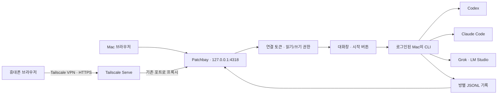

# 대화창 LLM 호출과 휴대폰 연결 · 2026-10-10

사용자 요청: 채팅창에서 LLM을 호출할 수 있도록 연결하고 휴대폰 접속을 구현하거나 안내한다. 기존 Patchbay 포트 4318 유지. SQLite 도입은 검증 단계에서 별도 논의한다.



## 이번에 구현한 것

- 입력 아래 `기록하기`, `대화 시작`, `토의 시작` 버튼. 기록하기는 기존처럼 내용을 저장한다. 시작 버튼은 입력한 내용을 먼저 저장하고 켜진 LLM을 순서대로 한 번씩 호출한다. 빈 입력에서는 기존 기록을 이어간다. 대화는 각자의 답, 토의는 앞선 답의 검토다.
- `POST /api/room/send`의 선택 필드 `round: talk | discuss`. 잘못된 값은 400. 기존 시작 문구 방식도 지원한다.
- `GET /api/rooms/hosts`에 Claude/Codex 로그인 여부와 로그인 안내를 추가했다. 설치 여부와 로그인 여부를 구분해 LLM 설정에서 표시한다. Grok/로컬 모델의 계정·로드 상태는 호출 시 확인한다.
- 네트워크 요청 실패를 채팅창에 표시한다. 상담의 요구사항 판단·Plan과 기록 분리는 유지한다.

## 실제 연결 확인

- Claude Code 2.1.289: 로그인됨. 실제 읽기 전용 호출은 주간 사용 한도에 도달했다는 응답으로 실패했다. CLI 안내상 Asia/Seoul 오후 10시 초기화. 지금은 Codex를 선택하고, Claude는 한도 초기화 후 재시도한다.
- Codex 0.162.1: 로그인됨. 콘솔의 `defaultRoomRunner`로 실제 호출하여 `PATCHBAY_CONNECTED` 응답을 받았다. 모델은 CLI 기본, 강도 low, 읽기 전용, 임시 디렉터리에서 파일/도구 사용 금지 요청으로 검증했다.
- Tailscale Mac: Running. 장치 DNS `<장치>.<tailnet>.ts.net`, IPv4 `<tailnet IP>`. Serve 설정은 비어 있다. HTTPS 공유는 아직 활성화하지 않았다.
- 관련 자동 테스트 19개, 클라이언트·서버 TypeScript 검사와 Vite 빌드 통과. 이번 실제 호출 검증은 CLI 연결 검증이며 물리 휴대폰 접속 검증은 아직 하지 않았다.

## PC에서 사용

1. `http://127.0.0.1:4318`에서 프로젝트 → 대화를 연다.
2. LLM 아이콘 또는 `LLM 연결하기` → Codex → 모델 버전은 비워 CLI 기본 모델 사용 → 강도 low/medium/high → 역할 입력 → 켜기.
3. Chat으로 돌아와 질문 입력 → `대화 시작`. 여러 담당을 켜고 `토의 시작`을 누르면 앞선 답을 읽고 차례대로 검토한다.
4. 다른 기기에서는 같은 방 링크를 열어 같은 기록을 본다. Claude/Codex 앱의 자체 대화 기록으로 자동 복제되는 기능은 이번 연결에 포함되지 않는다.

## 휴대폰에서 사용: Tailscale Serve

Mac과 휴대폰의 Tailscale이 같은 네트워크(tailnet)에 연결되어야 한다. Serve는 그 네트워크 안에서 로컬 서비스를 공유하고 HTTPS 설정이 필요하다. 처음 실행할 때 표시되는 설정 링크에서 HTTPS를 활성화할 수 있다. [공식 Serve 설명](https://tailscale.com/docs/features/tailscale-serve), [명령 설명](https://tailscale.com/docs/reference/tailscale-cli/serve).

먼저 현재 4318 콘솔을 종료한 뒤, 같은 작업 공간·LangGraph·Neo4j 환경 설정을 유지한 터미널에서 연결 토큰을 설정하고 같은 포트로 다시 시작한다. 토큰은 비밀번호 관리자에 보관하고 소스·주소·채팅에 넣지 않는다. 이미 토큰을 관리하고 있다면 기존 값을 사용한다.

```sh
cd /path/to/Patchbay
export PATCHBAY_FLOW_TOKEN="$(openssl rand -hex 24)"
export PATCHBAY_FLOW_READ_TOKEN="$(openssl rand -hex 24)"
```

같은 터미널에서 필요한 토큰을 비밀번호 관리자에 저장한 후 실행한다. 생성값은 서버가 재시작될 때도 같은 값을 공급해야 기존 로그인이 유지된다.

```sh
node dev/packages/cli/dist/index.js flow --project patchbay --port 4318 --host 127.0.0.1
```

다른 터미널에서 공유를 시작한다. Mac의 Tailscale 앱은 설치되어 있으므로 전체 실행 경로를 사용한다.

```sh
/Applications/Tailscale.app/Contents/MacOS/Tailscale serve status
/Applications/Tailscale.app/Contents/MacOS/Tailscale serve --bg http://127.0.0.1:4318
```

휴대폰:

1. Tailscale 앱에 Mac과 같은 계정/네트워크로 로그인하고 VPN을 켠다.
2. Safari/Chrome에서 Serve가 출력한 주소를 연다. 현재 장치 이름 기준 예상 주소는 `https://<장치>.<tailnet>.ts.net`이다. **공유 설정을 완료해야 접속된다.**
3. Patchbay 로그인 화면에 쓰기 토큰을 입력하면 채팅·LLM 호출이 가능하다. 조회 토큰은 기록 확인만 가능하다.
4. 프로젝트 → 대화 → 원하는 방을 연다. 브라우저의 홈 화면에 추가 기능으로 앱처럼 실행할 수 있다.

공유 종료는 이번 Serve 경로만 끈다. 다른 서비스 설정까지 지우는 reset은 사용하지 않는다.

```sh
/Applications/Tailscale.app/Contents/MacOS/Tailscale serve --https=443 off
```

Mac이 켜져 있고 Patchbay 서버와 Tailscale이 실행 중이어야 한다. 잠자기 상태에서는 연결이 끊길 수 있다. 휴대폰의 `localhost`는 휴대폰 자신이므로 Mac 접속 주소로 사용하지 않는다. 전화기의 실제 로그인·호출·다른 네트워크 접속은 설정 후 확인해야 한다.

## 연결 범위

지금 연결은 휴대폰 브라우저에서 Patchbay 기록을 읽고 Mac의 LLM CLI를 호출하는 방식이다. Claude/Codex 모바일 앱의 자체 채팅과 양방향 동기화하지 않는다. Discord/Telegram은 기존 환경변수를 설정하면 운영 단계 알림과 방 링크를 전송하는 경로이며, 아직 실제 채널 자격 증명은 설정되어 있지 않다.
