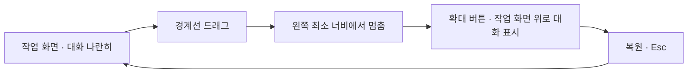

# 대화창 너비 조절 · 왼쪽 작업 화면 보호 방안 검토

- 작성일: 2026-11-02 (Asia/Seoul)
- 요청: 대화창을 좌우로 넓힐 때 왼쪽 창이 무너지지 않는 방책을 조사한다.
- 범위: 현재 코드와 공식 자료 조사, 임시 브라우저의 CSS 변경을 통한 배치 측정. 제품 코드·실제 서버·사용자 작업 공간 원문 변경은 없다.
- 결론: **최소 너비를 보장하는 분할 조절 + 대화 확대/복원 + 작업 화면 자체 너비에 따른 배치 전환**을 조합하는 것을 권고한다. 제안이며 구현 승인은 아직 받지 않았다.

## 현재 구조의 위험

`console.css:5943`은 오른쪽 대화 열을 기본 340px로 두고, 왼쪽은 `minmax(0, 1fr)`로 남은 공간을 쓴다. 1250px 이하에서는 대화 열을 310px로 바꾸는 별도 규칙도 있다.

왼쪽 대시보드는 Workflow와 Tasks를 두 열로 두며 Tasks가 320~400px를 차지한다(`console.css:6402`). 한 열 전환 기준은 왼쪽 칸 너비가 아니라 브라우저 전체 너비 900px다(`console.css:6541`). 따라서 큰 브라우저에서 대화만 넓히면 왼쪽이 좁아져도 2열 배치가 남아 Workflow를 심하게 압축한다. `overflow:hidden` 때문에 전체 페이지 가로 넘침이 없더라도 내용은 잘리거나 한 글자씩 줄바꿈될 수 있다.

`RefitOnChange.tsx`는 노드 signature 변화 때 `fitView`를 실행한다. 분할선만 이동해 그리기 영역 너비가 달라진 경우의 재맞춤을 보장하는 구조는 아니다. DashboardPane에 있는 ResizeObserver는 높이·정렬 계산을 위한 것이어서 너비 조절 정책과 별개다.

## 브라우저 실측

실제 빌드된 React 화면에 임시 예시 프로젝트·할 일 6건을 연결해 읽기 전용으로 확인했다. 프로덕션 데이터는 쓰지 않았다. 측정한 대화 너비는 바깥 열 전체이며 안쪽 패딩은 별도다. 경계 손잡이는 아직 없으므로 아래 값에는 그 너비를 넣지 않았다.

| 브라우저 너비 | 방식 | 대화 열 | 왼쪽 칸 | Workflow 카드 | Tasks 카드 |
| --- | --- | --- | --- | --- | --- |
| 1536px | 대화 340px | 340px | 1132px | 676px | 400px |
| 1536px | 제한 없이 확대 | 640px | 832px | 376px | 400px |
| 1280px | 대화 340px | 340px | 876px | 420px | 400px |
| 1280px | 제한 없이 확대 | 640px | 576px | 120px | 400px |
| 1280px | 왼쪽 최소 800px로 제한 | 416px | 800px | 344px | 400px |
| 1280px | 전체 작업 폭 위로 겹쳐 확대 | 640px | 1216px | 760px | 400px |
| 1024px | 제한 없이 확대 | 640px | 320px | 레이아웃 열 0px | 320px |
| 1024px | 전체 작업 폭 위로 겹쳐 확대 | 640px | 960px | 504px | 400px |

총 11가지 조합을 측정했으며 브라우저 스크립트 오류는 없었다. 1024px 무제한 확대에서는 대시보드 내부 가로 넘침도 발생했다. **800px는 구조 보호를 실험한 시작값이며 모든 화면의 가독성을 검증한 최종 최소값이 아니다.** 344px Workflow에서도 기존 그래프 위치·배율을 그대로 두면 일부가 잘리므로 화면별 배치 전환과 필요 시 그래프 재맞춤이 함께 필요하다.

[측정 원문](대화창-너비조절-검토_20261102_v1/measurements.json) · [기본](대화창-너비조절-검토_20261102_v1/baseline.png) · [무제한 확대의 문제](대화창-너비조절-검토_20261102_v1/unbounded.png) · [최소 너비 제한](대화창-너비조절-검토_20261102_v1/guarded.png) · [겹쳐 여는 확대](대화창-너비조절-검토_20261102_v1/overlay.png)

## 권고 동작

1. **안전 범위에서 나란히 조절**: 작업 칸의 실제 가용 너비로 상한을 계산한다. 시작값은 왼쪽 최소 약 800px, 대화 약 320~640px를 제안한다. 화면별 검증으로 보정하며 분리선·패딩도 계산에 포함한다. 경계에서 멈추고 더 큰 보기는 확대 버튼으로 제공한다. 드래그 도중 갑자기 모드를 바꾸지 않는다.
2. **별도 확대/복원**: 긴 문서·코드·이미지는 대화를 작업 화면 위로 겹쳐 크게 연다. 닫으면 이전 분할 폭과 왼쪽 화면 위치로 돌아간다. 좁은 창은 겹쳐 열거나 전체 화면으로 대화한다. 별도 브라우저 창은 세션·포커스·상태 동기화 부담이 있어 첫 구현의 필수 범위로 권하지 않는다.
3. **왼쪽 실제 폭으로 배치 전환**: 브라우저 너비 대신 작업 칸의 `container queries`로 2열/1열, 헤더 줄바꿈과 표·카드 배치를 전환한다. 그래프·긴 표만 내부 스크롤이나 줌을 허용하며 전체 UI를 축소하지 않는다.
4. **대화 상태 보존**: 분할·확대 전환에서 같은 RoomPanel을 유지한다. 대화방 ID·입력 중 문장·첨부·메시지 스크롤·실행 상태를 보존한다. 보기 변경으로 모델 호출·실행을 다시 시작하지 않는다.
5. **조작과 성능**: 경계에 잡을 수 있는 영역을 두고 방향키 조절·더블클릭 초기화를 제공한다. 드래그 렌더는 프레임당 한 번으로 제한하고, 폭 저장은 조절을 마칠 때만 한다. 그래프 영역 크기를 다시 측정하되 사용자가 바꾼 줌·위치를 매 프레임 초기화하지 않는다. 자동 맞춤 상태일 때 드래그 종료 뒤 한 번 재맞춘다.

## 공식 자료

- [VS Code Custom Layout](https://code.visualstudio.com/docs/configure/custom-layout): 분할 경계 조절, 패널 확대/복원, 보기 위치·레이아웃 보존을 별개 기능으로 제공한다. 이 조합을 Patchbay의 작업 화면·대화 구분에 적용하는 것은 이번 검토의 제안이다.
- [MDN CSS container queries](https://developer.mozilla.org/en-US/docs/Web/CSS/CSS_containment/Container_queries): viewport 기준 media queries와 달리 컨테이너 자체 크기에 맞춰 내부 스타일을 바꿀 수 있다. 대화만 늘어났을 때 왼쪽 배치가 반응하도록 하는 근거다.
- [W3C APG Window Splitter](https://www.w3.org/WAI/ARIA/apg/patterns/windowsplitter/): 허용 범위 안에서 움직이는 분리선, 방향키 조절, 최소·최대·현재값과 영역 이름을 설명한다. 이 패턴 페이지 자체는 예제·검토가 진행 중이라고 명시하므로 완결된 규범으로 단정하지 않는다.

구현 시에는 대시보드뿐 아니라 요구사항/상담·PRD·아키텍처 그래프·파일 편집기·Log를 1536/1366/1280/1024px와 확대 배율에서 확인해야 한다. 본 검토의 실측은 예시 대시보드 배치에 한정된다.
