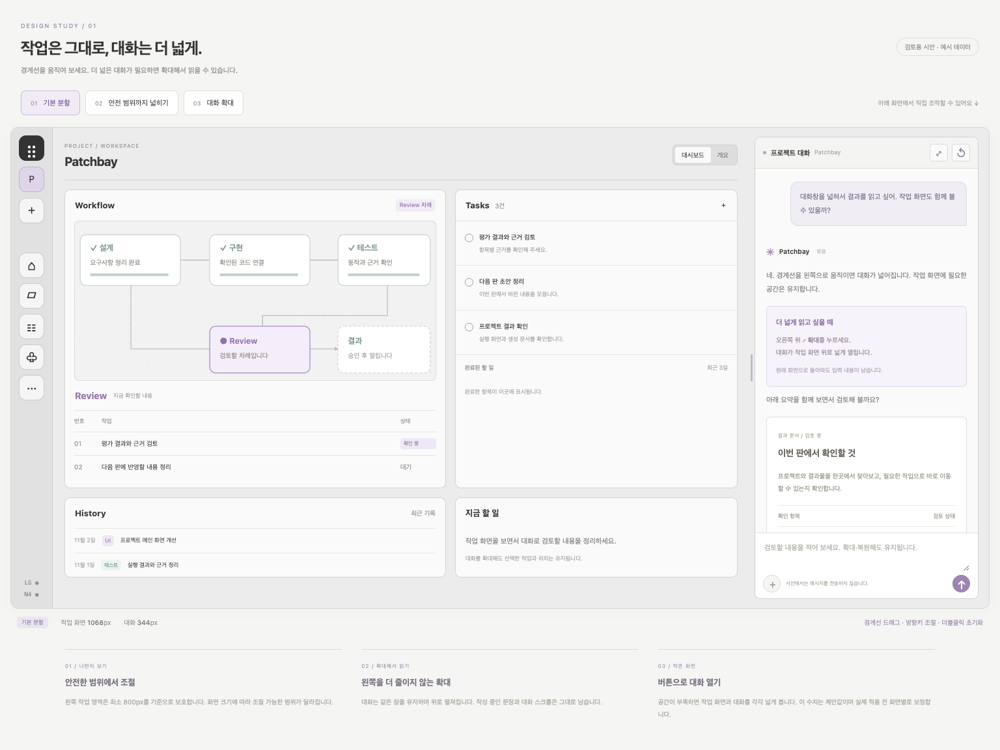
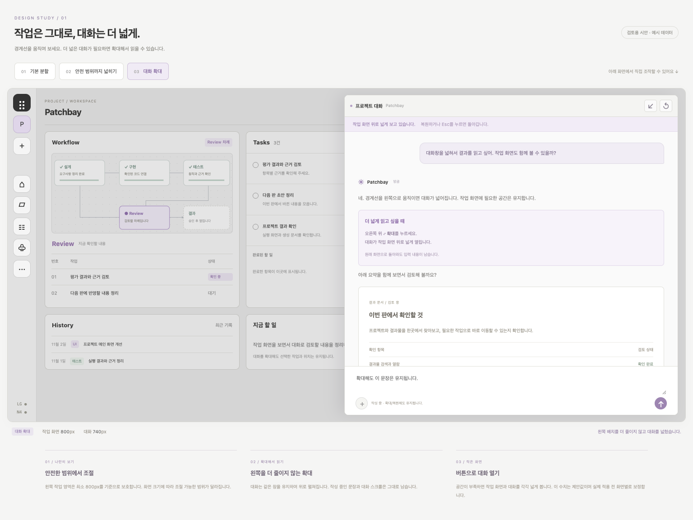

# 대화창 너비 조절 · 검토용 인터랙션 시안

- 작성일: 2026-11-02 (Asia/Seoul)
- 사용자 요청: 최소 너비 보호·드래그 조절·확대/복원 방식으로 설계해서 보여 준다.
- 상태: 검토용 독립 시안. 실제 제품 코드는 변경하지 않았다. 프로젝트·할 일·대화·실행 상태는 예시이며 메시지를 전송하거나 모델을 호출하지 않는다.

[시안 열기](대화창-너비조절-시안_20261102_v1/index.html)

## 직접 확인하는 흐름

1. 상단 `01 기본 분할`에서 작업과 대화를 나란히 본다.
2. 사이 경계선을 좌우로 드래그하거나 `02 안전 범위까지 넓히기`를 누른다. 작업 영역 최소 800px, 대화 열 320~640px를 기준으로 제한한다. 10px 분리선과 바깥 레일 너비를 계산에 포함한다. 실제 적용 전 페이지별로 기준을 보정한다.
3. 대화 머리의 `⤢` 또는 `03 대화 확대`를 누른다. 같은 대화 패널이 작업 화면 위로 최대 740px까지 펼쳐지며, 왼쪽 작업 칸의 현재 폭을 더 줄이지 않는다.
4. `↙`, `Esc`, 배경 클릭으로 직전 분할로 복원한다. `↺` 또는 분리선 더블클릭은 기본 360px로 초기화한다.
5. 입력창에 문장을 적고 확대·복원해 본다. 같은 입력 요소와 메시지 스크롤을 유지한다. 시안의 입력은 전송되지 않는다.
6. 공간이 부족한 창에서는 분리선을 숨기고 `대화 열기` 버튼을 제공한다. 모바일 확대는 작업 영역 위를 모두 사용한다. 작업 칸 내부는 컨테이너 자체 너비에 따라 1열로 전환하고 그래프는 SVG 영역에 맞춰 보인다.

분리선은 키보드 방향키로 16px, Shift+방향키로 40px 이동하며 Home/End로 최소/최대까지 조절한다. 확대 때 배경 작업 영역은 조작을 막고 대화 안에서 Tab 포커스를 순환한다. 복원 뒤에는 이전 조작 위치로 돌아간다.

## 화면

[안전 범위까지 확대](대화창-너비조절-시안_20261102_v1/wide.png) · [모바일](대화창-너비조절-시안_20261102_v1/mobile.png) · [모바일 대화 확대](대화창-너비조절-시안_20261102_v1/mobile-expanded.png)

## 검증 범위

Chrome에서 드래그의 최소 너비 제한, 키보드 조절, 확대 전후 작업 폭·입력 문장 보존, Esc 복귀, 좁은 창 전환, 390px 모바일과 가로 넘침, 실제 Patchbay 파일 열람 주소의 로드·동작을 확인한다. [검증 결과](대화창-너비조절-시안_20261102_v1/validation.json)에 실측 시각과 확인 항목을 기록했다. JavaScript 구문 검사 통과.

이 시안의 그래프는 화면 배치를 보여 주는 SVG다. 제품에 적용할 때는 실제 React Flow의 사용자 줌·시점과 자동 맞춤 정책을 별도로 검증해야 한다. 실제 모델 스트리밍·첨부·진행 중 실행의 상태 보존 역시 제품 구현 단계의 확인 사항이다.

이전 조사: [대화창 너비 조절 검토](대화창-너비조절-검토_20261102_v1.md).
