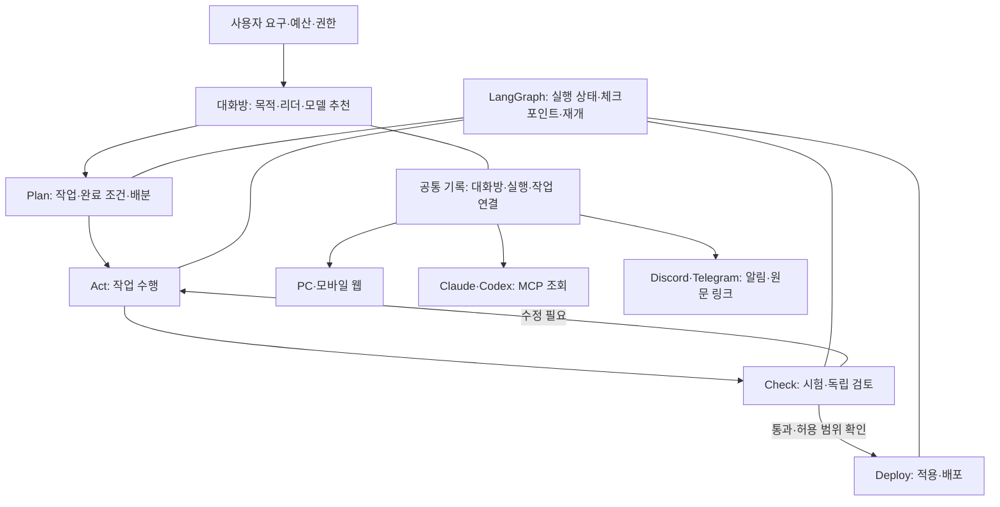

# 대화창 다중 LLM · 외부 조회 · 모델 추천 검토

상태: 구현 전 초기 제안. 이후 사용자 정정으로 Plan은 상담 전용이며 운영 대화는 Act·Check·Deploy만 수행하도록 수정했다. 아래의 대화방 Plan과 단일 공통 기록 설명 대신 최신 [상담·실행 분리](대화창-상담실행분리_20261010_v1.md)를 따른다. 기능 구현 완료가 아니다.
기준: 현재 작업 트리(미커밋 대화방 변경 포함), 기획 20261008a, 명세 20261006a.

## 요청

사용자는 대화 목적별 leader LLM과 다른 LLM으로 Plan → Act → Check → Deploy를 수행하고 배분·수행을 기록하며, 휴대폰·컴퓨터 및 Claude·Codex·Discord·Telegram에서 내용을 확인하고, 복잡도에 따른 모델·추론 강도를 리더가 권고하는 기능의 수정 방향과 검증을 요청했다. `chect`는 Check로 해석한다.

## 확인한 현재 기능

- `dev/apps/flow/src/roomHost.ts`: Claude Code·Codex·Grok·LM Studio CLI 호출. 사용자가 로그인한 CLI 사용. 활성 멤버 순서대로 한 바퀴 수행. 정확히 「대화 시작」 또는 「토의 시작」일 때 호출하고 다른 입력은 기록한다. 매번 방의 기록을 전달하며 공급자 세션을 이어 가지 않는다.
- `dev/packages/core/src/rooms/types.ts`, `store.ts`: 멤버의 공급자·모델·자유문장 역할·이름·활성화·medium/high 저장. 리더, 작업 배정, 단계, 완료 조건은 없다. 방 기록은 JSONL, 설정은 meta JSON. 메시지에는 모델·소요 시간·반환된 토큰 양이 있지만 추론 강도 및 실행 연결 식별자는 없다.
- 강도는 Claude의 `--effort`에만 반영된다. Codex 대화방 호출은 `exec --sandbox read-only`이며 현재 강도를 전달하지 않는다. 따라서 설정 UI와 실제 호출을 공급자별로 맞춰야 한다. 단순히 Act라는 프롬프트를 붙여도 코드 수정 권한이 생기지 않는다.
- `dev/packages/core/src/threads/types.ts`, `dev/packages/mcp/src/tools/threads.ts`: LangGraph thread_id 기반 실행 대화, interrupt 요청, MCP 답변, 재개 경로가 있다. `get_thread`는 실행 대화만 읽으므로 대화방 조회에는 별도 도구 또는 통합 조회 계약이 필요하다.
- `dev/apps/flow/src/serve.ts`, `serveContract.ts`, `writeGuard.ts`: 기본 loopback, 명시적인 원격 바인딩 가능. 로그인 없음. JSON/Origin 쓰기 보호는 사용자 인증을 대체하지 않는다. 프로세스가 내려가면 조회·실행도 멈춘다.
- 기획 20261008a §6: 메신저는 알림 아웃바운드 전용. 이번 요구의 조회·알림은 이 범위로 시작할 수 있다. 메신저에서 작업 지시·배포 승인을 받는 것은 추가 범위다.

## 권고 구조

제품의 0~5 단계와 이번 대화 내 4단계는 구분해서 표시한다. 제품 단계 번호를 대화 단계로 교체하지 않는다. 기존 일반 대화·토의는 유지하고 작업 수행 모드를 추가한다.

### 리더와 4단계

1. 멤버마다 안정적인 memberId를 부여한다. 역할·모델·강도가 같아도 작업자 식별이 유지돼야 한다. 목적별 리더 기본값과 방별 변경을 지원한다. 목적 변경이나 리더 교체도 기록한다.
2. 리더 결과를 구조화한다: 작업 id, 담당 memberId, 지시, 의존 작업, 완료 조건, 추천 모델·강도, 이유. 실행 전 허용된 멤버·권한·예산에 맞는지 검증한다. 리더의 자유문장으로 임의 실행을 허용하지 않는다.
3. Plan은 목표·작업·검증 방법을 정한다. Act는 승인된 범위에서 작업하고 산출물을 남긴다. Check는 시험 로그·변경 diff·요구 충족 근거를 남기고 실패하면 Act로 돌린다. 별도 검토자와 자동 시험을 조합하되 다른 LLM의 동의만으로 통과시키지 않는다.
4. Deploy는 대상에 따라 문서 적용·PR·스테이징·프로덕션 배포로 구체화한다. 실행 전 허용 범위를 확인하고 필요한 승인만 요청한다. 대상 변경이면 기존 승인은 재사용하지 않는다. 실패 상태·배포 버전·복구 경로를 기록한다.
5. LangGraph가 상태 전이·checkpoint·interrupt/resume를 담당한다. 호스트/공급자 어댑터가 호출한다. core는 스키마·저장·검증 담당으로 유지한다. 설계 상담(`consultHost.ts`)은 별도 목적을 유지한다.
6. 방과 실행은 `roomId ↔ threadId/runId`로 연결한다. 기존 저장소를 한꺼번에 합치거나 과거 기록을 다시 쓰지 않는다. 화면은 연결된 기록을 함께 보여준다. 공통 eventId, 작업 id, 단계, replyTo/causedBy, memberId, 요청 모델·강도, 확인 가능한 실제 모델·강도, 결과·근거·토큰·시간을 기록한다. 실제 모델을 확인할 수 없으면 미확인으로 표시한다.
7. 현재 메모리 내 running Set은 재시작 복구를 보장하지 않는다. 체크포인트와 작업 상태를 조회해 중단 상태를 표시하고, 외부 효과가 있는 작업에는 중복 실행 방지 키와 결과 확인을 둔다. JSONL 순번도 다중 쓰기 전에 단일 기록 경로/직렬화가 필요하다.
8. 전체 기록 재전달 대신 목표·결정·해당 작업·필요한 원문 참조를 전달한다. 요약에는 원문 eventId를 유지한다. 리더 판단 이유와 도구 실행을 기록하며 비공개 내부 추론 전문을 기록 대상으로 삼지 않는다.

### PC·휴대폰·외부 앱

- 공통 원본은 Patchbay 기록. 모바일 웹은 전체 기록·산출물·단계 상태를 조회한다. Tailscale 등 제한된 접근 또는 인증된 HTTPS 경로와 조회/실행 권한 분리가 필요하다. 파일 조회 API까지 열리므로 무인증 공개 바인딩을 기본 경로로 삼지 않는다.
- 첫 범위는 컴퓨터가 켜져 있고 Patchbay 서버가 실행 중일 때 조회. 꺼진 뒤에도 조회하려면 암호화된 원격 저장소/동기화 서비스와 보관 정책이 추가로 필요하다. 초기 모바일 기본값은 조회만 허용한다.
- MCP에 `list_rooms`, `get_room` 또는 동등한 공통 조회를 추가한다. 증분 조회·원문 이벤트 주소·권한 검사를 제공한다. Claude/Codex는 연결된 MCP를 통해 기록을 가져오고 자기 대화에 보여준다. 외부 앱의 기존 채팅 목록에 Patchbay 기록이 자동 복제되는 것으로 약속하지 않는다.
- Claude Remote Control은 로컬 Claude Code 세션의 웹/모바일 창이다. Patchbay 전체 대화방을 복제하는 기능은 아니다. 해당 세션에서 Patchbay MCP를 조회하는 경로를 시험한다.
- Codex app-server는 통합 제품의 thread/turn·이벤트·승인·모델 선택을 위한 인터페이스다. 이를 쓰면 임의 Patchbay 방이 Codex 앱의 대화 목록과 자동 동기화된다고 가정하지 않는다. 현재 사용자 앱/계정에서 MCP 조회와 세션 접근을 별도로 확인한다.
- Discord webhook·Telegram Bot API로 단계 완료·실패·추천·승인 대기 요약과 접근 가능한 원문 링크를 전달한다. 전체 기록은 모바일 웹으로 확인하고 선택적으로 파일 내보내기를 제공한다. 전송 허용 범위와 민감도, 토큰 비밀 저장, 재시도·중복 방지·전송 실패 표시를 둔다. 과거 Telegram 네트워크 장애를 현재도 동일하다고 단정하지 않고 실제 환경에서 재시험한다.

### 복잡도에 따른 모델·추론 강도 추천

- 작업의 명확성, 의존성·변경 범위, 필요한 문맥·도구, 검증 가능성, 실패 영향, 사용자 예산·시간을 근거로 판단한다. 문장 길이만으로 분류하지 않는다.
- 사용자 선택이 우선한다. 자동 추천·추천 적용·직접 선택을 구분하고, 사용자 설정을 바꾸는 경우 변경 이유를 기록한다. Plan/Act/Check별로 다른 모델을 추천할 수 있다. 목적은 리더 선택에, 복잡도는 작업별 모델·강도 선택에 사용한다.
- 초기 정책 예: 짧은 설명·명확한 수정은 경량 모델/낮은 강도 후보, 일반 기능은 표준 모델/중간 강도 후보, 설계·난해한 오류·큰 변경은 상위 모델/높은 강도 후보. 이는 검증할 출발점이며 특정 공급자 또는 모델의 품질 보장이 아니다.
- 공급자별 모델 목록·설치/로그인·도구·지원 강도를 조회한다. Codex는 app-server `model/list`의 supportedReasoningEfforts를 사용하고 턴에 effort를 전달한다. Claude CLI는 설치 버전의 옵션을 확인한다. Claude API 문서를 CLI 옵션 지원의 증거로 쓰지 않는다. 로컬/Grok에서 지원을 확인하지 못한 강도는 지원 안 함 또는 모델 기본으로 표시한다.
- low/medium/high를 전 공급자의 동일 성능이라고 표현하지 않는다. 내부 추천 등급과 공급자 실제 설정을 분리한다. 미지원 값은 조용히 무시하지 않고 대안을 권고한다.
- 추천 카드: 목적, 리더, 단계별 모델·강도, 선택 이유, 대안, 예상 소요/비용의 근거와 불확실성, 변경 버튼. CLI 구독 한도와 API 과금을 구분하고 토큰 정보 없는 금액은 지어내지 않는다.
- 낮은 강도에서 완료 조건이 실패한 경우 한도 안에서 재시도/상향한다. 리더도 초기 호출이 필요하므로 연결된 기본 리더·규칙 기반 초기 분류를 두고 비싼 리더 호출을 무한 반복하지 않는다. 재시도 횟수·총시간·토큰/비용 한도를 둔다.
- 실제 사용자 작업으로 모델×강도별 성공률·수정 횟수·응답 시간·관측 비용을 평가해 추천 정책을 조정한다.

## 수정 위치·순서

1. `rooms/types.ts`, `rooms/store.ts`, `RoomPanel.tsx`: memberId·leader·목적·일반 대화/작업 모드·단계·연결 식별자. 과거 JSONL 호환과 설정 마이그레이션.
2. 공급자 어댑터와 모델 목록/추천: `roomHost.ts`의 CLI 분기를 분리하고 요청/실제 모델·강도 기록. 자유문장 추천을 스키마와 정책으로 검증.
3. LangGraph 작업 실행 연결: `langgraphAdapter.ts`, threads 기록, server 라우트. 기존 실행 대화 메커니즘 위에 리더 배분·단계별 근거·interrupt를 연결. 먼저 Plan/Check, 다음 제한된 Act, 마지막 Deploy.
4. `RoomPanel.tsx`: 상단 단계 띠, 리더 및 작업자 표시, 배분→수행→검증 연결 카드, 근거 펼치기. 모바일에서는 상태·결정·원문 접근부터 구현.
5. MCP 대화방 조회와 모바일 접근 제어를 만든 뒤 Discord/Telegram 알림 추가. 네 앱 동시 자동 동기화는 첫 구현 범위로 잡지 않는다.
6. 구현 시 기획/명세의 기존 최신판을 보관하고 계약을 갱신한다. 아키텍처 JSON/MD 및 필요한 용어·실행 계획도 실제 구현과 함께 갱신한다. 이번 검토로 기존 계약을 확정 변경하지 않는다.

## 검증

2026-10-10 현재 실행:
`cd dev && pnpm exec vitest run apps/flow/src/roomHost.test.ts packages/core/src/rooms/store.test.ts packages/core/src/threads/threads.test.ts packages/mcp/src/tools/threads.test.ts apps/flow/src/langgraphAdapter.test.ts apps/flow/src/writeGuard.test.ts`

결과: 6개 파일, 36개 시험 통과. 기존 동작의 확인이며 새 기능 또는 실제 모델/외부 앱 연동의 완료 검증이 아니다. 코드 기능 변경 없음. 기존 미커밋 변경 보존.

새 기능 합격 기준:

- 리더가 두 작업자에게 실제 배정, 답변·근거·단계를 원문 이벤트로 추적.
- Check 실패 시 Deploy 차단, Act 복귀. 실제 시험 실패와 LLM 검토 의견을 분리.
- 서버 재시작·실패·리더 교체 이후 상태 복구, 배포/외부 효과 중복 실행 방지.
- unsupported effort/model 거부 또는 명시적 대안, 사용자 직접 선택 유지, 실제 호출 설정과 기록 일치.
- PC/휴대폰에서 같은 eventId와 산출물 확인. 권한 없는 조회·실행 차단.
- Claude/Codex MCP로 동일 방 조회. Remote Control과 app-server의 제공 범위는 각 실제 계정에서 확인.
- Discord/Telegram 알림 지연·실패·중복·민감정보 제외·원문 링크 접근을 실제 기기에서 확인.
- 대표 쉬운/중간/어려운 작업에서 추천 정책의 성공률·시간·비용 비교. 테스트 대역만으로 품질을 확정하지 않음.

## 공식 자료

- OpenAI Docs: https://learn.chatgpt.com/docs/app-server (`model/list`, thread/turn, effort, 이벤트·승인)
- OpenAI 추론 설정: https://developers.openai.com/api/docs/guides/reasoning
- Claude Remote Control: https://code.claude.com/docs/en/remote-control
- Claude API effort: https://platform.claude.com/docs/en/build-with-claude/effort (CLI와 구분)
- Telegram Bot API: https://core.telegram.org/bots/api#sendmessage
- Discord webhook: https://docs.discord.com/developers/resources/webhook#execute-webhook
