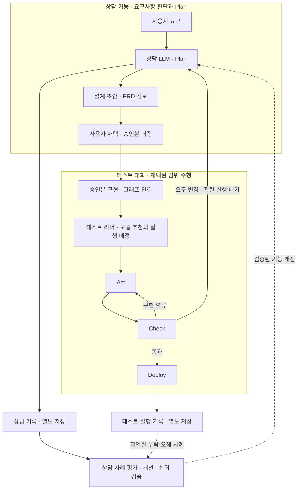

# 상담 Plan과 테스트 실행 분리 · 2026-10-10

사용자 정정: Patchbay는 테스트 전 요구사항을 상담에서 판단하고 LangGraph로 전달한다. Plan은 다른 파트인 상담에서 진행한다. 상담 기능과 그 기록은 상담 쪽에만 두어 별도 개선 작업으로 향상시킬 수 있어야 한다.

## 확인한 기존 경로

- 명세 20261006a §12~14, `ConsultPane.tsx`, `consultHost.ts`: 상담 → 설계 초안 → PRD 검토 → 사용자 채택.
- `PrdPane.tsx`: PRD 수정 요청은 상담으로 돌아가며 채택된 버전이 표시된다.
- `BuildPane.tsx`, `buildView.ts`, `core/src/ir/generate.ts`: 승인본으로 구현 뼈대를 생성하고 설계 노드·코드·LangGraph 흐름을 연결한다. 상담 원문을 실행에 직접 전달하는 방식이 아니다.
- `core/src/consult/types.ts`: 상담은 `consult/`에 별도 기록. `threads/`의 LangGraph 재개 경로에 섞지 않는 것이 기존 계약이다.
- `core/src/ir/consult/provenance.ts`: 상담 id와 원문 턴을 초안 칸의 출처로 연결한다.

## 수정된 책임

- 상담만 요구 판단·Plan·설계 변경을 담당한다. 테스트 Chat은 상담을 반복하거나 초안을 수정하지 않는다. Plan은 승인본의 읽기 전용 참조로 표시한다.
- 테스트 리더의 작업 분해는 승인된 요구의 수행 단위로만 허용한다. 담당·도구·모델·강도 추천은 실행 배정이며 요구나 완료 조건을 새로 결정하는 Plan이 아니다. 상담 단계의 모델 선택·추천은 상담 기능의 책임으로 유지한다.
- 구현 결함은 기존 요구를 유지해 Act에서 수정한다. 요구·범위·완료 기준 변경은 관련 실행을 대기시키고 상담으로 보낸다. 사용자 채택 후 새 설계 버전의 영향을 확인하고 실행한다. 상담에서 명확화한 경우에도 승인본 수정이 필요한지 확인한다.
- 실행은 시작 시 승인본 버전을 참조한다. 진행 중 최신 설계나 상담 개선을 조용히 적용하지 않는다. 단순히 소스 링크가 같다고 새 버전으로 바뀌지 않도록 한다.
- 상담 원문, 테스트 대화, LangGraph 실행 기록은 기존 분리 저장을 유지한다. 통합 조회는 원본별 권한 확인과 출처 링크로 연결하고 상담 조회가 LangGraph 재개를 유발하지 않게 한다. 공통 기록을 한 저장소로 합친다는 초기 표현을 수정했다.
- 외부 앱에서도 상담과 테스트를 분리 표시한다. 최초 연결 경로는 웹 전체 조회·MCP 원문 조회·메신저 요약 알림이며 컴퓨터와 서버가 켜진 동안을 전제로 한다.

## 상담 기능 개선의 별도 흐름 · 제안

상담 질문·답·해석·결정과 PRD 수정 이력을 원본으로 평가한다. 누락, 반복 질문, 기본값 오류, 수정 요청, 완료 기준 모호성 등을 사례로 묶는다. 테스트에서 요구 누락이나 해석 오류가 확인되면 관련 승인본·상담 원문 링크와 실제 결과를 개선 근거로 연결한다. 모든 구현 오류를 상담 품질 문제로 간주하지 않는다.

별도 개선 작업에서 질문 순서, 상담 안내, 해석 규칙, 검증 기준을 개선하고 대표 사례의 회귀 검증을 거친 뒤 상담 기능에 반영한다. 새 모델/강도를 검토할 때도 같은 사례로 평가한다. 테스트 중 자동 학습이나 상담 프롬프트 자동 변경을 의미하지 않는다. 기능 개선 버전과 프로젝트 승인본 버전은 구분한다.

이 평가·개선 기능은 제안이다. 상담 기록·출처·PRD 채택은 현재 코드에서 확인했지만 별도 평가 시스템이 이미 구현됐다고 표시하지 않는다.

## 산출물과 확인

기존 링크의 [인터랙티브 시안](대화창-아키텍처시안_20261010_v1/index.html)과 [아키텍처 SVG](대화창-아키텍처시안_20261010_v1/architecture.svg)를 수정했다. 초기 절차 기록은 사용자 정정 링크를 표시했다.

SVG XML·marker 연결, HTML id·접근성 참조, Node DOM 대역으로 탭·키보드 이동 및 Check 구현 오류→Act, 요구 변경→상담, 통과→Deploy, 테스트 대화→상담 이동 로직을 확인했다. 브라우저 픽셀 렌더링·모바일 실기기·실제 모델 연동 검증은 미실시다. 제품 코드 및 기존 미커밋 작업은 보존했다.
