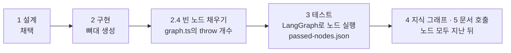
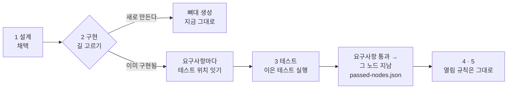

# 「이미 구현됨」 길 설계안 · 2026-10-20

요청: Patchbay 상담이 끝나 설계 v2를 채택하고 뼈대까지 만들었는데, 2 구현의 다음 절차(2.4 노드 채우기)를 Patchbay에 적용할 수 없다. 사용자 결정(2026-10-20, A안): 이미 구현된 프로젝트는 「요구사항 ↔ 기존 코드 · 기존 테스트 대조」로 2 구현을 지나게 한다. **이 문서는 구현 전 설계안이다. 검토받은 뒤 구현한다.**

## 왜 지금 흐름으로는 안 되나

단계 판정(`app/apps/flow/src/workspaceContract.ts` `stagesOf`)은 새 에이전트를 만드는 것을 전제로 한다.

Patchbay에서 실제로 본 것(2026-10-20):

- 설계 v2의 노드 9개는 기능 묶음 R1~R9를 일렬로 이은 것이다. 실행 순서가 아니다.
- 생성된 `evals.test.ts`의 시험 63개는 모두 화면 동작이다. 예: 「내비게이션 레일에서 프로젝트를 고르면 → 활성 프로젝트로 전환」. 노드는 `request` 문자열 하나만 받으므로 정직하게 통과시킬 수 없다.
- 그 동작들은 이미 `app/`에 구현되어 있고 vitest 시험 파일이 약 128개 있다.

뼈대 `src/agent/`는 `.trash/2026-10-20/`으로 옮겼다(MANIFEST에 되돌리는 명령).

## 설계

### 1. 길 고르기

2 구현 화면의 「뼈대 생성」 옆에 「이미 구현된 코드에 잇기」를 둔다. 자동으로 판단하지 않는다. 사람이 고른 값을 작업 공간에 남긴다(커널 저장 함수로만 씀). 두 길은 프로젝트마다 하나다. 바꾸면 이은 기록은 보관하고 지우지 않는다.

### 2. 잇기: 요구사항 ↔ 테스트 위치

- 한 줄은 `요구사항 id → 테스트 파일 · 테스트 이름(describe/it 경로)`이다. 코드 위치(파일)는 선택이다. 요구사항 하나에 여러 줄을 둘 수 있다.
- 저장 위치는 작업 공간 `projects/<alias>/`의 새 파일이다. IR 안에 두지 않는다. IR은 사람이 채택한 설계이고 이것은 구현 쪽 사실이라서, 섞으면 테스트 이름 하나 바꿀 때마다 설계 판이 올라간다.
- 줄마다 `제안`(에이전트가 찾음)인지 `확인`(사람이 봄)인지 적는다. 확인된 줄만 판정에 쓴다.
- 처음 제안은 에이전트가 만든다. 요구사항 문장 · 스캔 결과 · 시험 이름을 보고 후보를 고른다. 사람은 화면에서 줄마다 확인하거나 버린다.

### 3. 2 구현 판정

상태 문구는 「요구사항 이음 n/63」이다. 확인된 연결이 모든 요구사항에 있으면 지남. 빈 요구사항은 「테스트 없음」으로 남는다. 이것이 실제로 비어 있는 곳이라 숨기지 않는다.

### 4. 3 테스트 판정

이은 테스트를 vitest로 돌리고(`--reporter=json`) 연결마다 통과 · 실패 · 못 찾음을 적는다. 요구사항은 확인된 연결이 모두 통과하면 통과다. 모든 요구사항이 통과하면 3 테스트를 지난다. 결과는 연결 파일에 같이 남긴다. `passed-nodes.json`에는 쓰지 않는다 — 쓰면 4 · 5가 열린다(아래 결정 1).

### 4-1. 4 지식 그래프 · 5 문서 호출

이 길에서는 잠근다(사용자 결정 2026-10-20, 미결 1의 b). 단계 띠에 「이미 구현됨 길에서는 열지 않는다」고 적는다.

### 5. 아키텍처 화면

이 길의 프로젝트에서는 「▶ 그래프 실행」 · 「이 노드만 실행」을 숨긴다. 노드를 누르면 옆 패널에 요구사항 → 이은 테스트 · 코드 위치와 마지막 결과(통과 · 실패 · 미실행)를 보인다. 노드 색은 그 노드 요구사항의 통과 비율이다.

## 하지 않음

- 시험 문장을 보고 기대값을 돌려주는 가짜 노드(선택지 D, 기각)
- IR에 테스트 경로 칸을 더하는 것
- 연결을 사람 확인 없이 판정에 쓰는 것
- `src/agent/` 같은 새 폴더를 레포 루트에 다시 만드는 것

## 결정 (2026-10-20)

1. **4 지식 그래프 · 5 문서 호출** — 이 길에서는 잠근다(b). 그 단계는 LangGraph 실행 기록(모델 · 도구 · 문서 호출)에서 근거 경로를 만드는데, 이 길에는 그 기록이 없다.
2. **노드 9개** — R1~R9 일렬을 그대로 쓴다. 실제 구성요소(콘솔 · CLI · 코어 · MCP · 작업 공간)로 다시 짜는 것은 설계 v3 상담으로 따로 한다.

## 구현 순서와 확인

1. 커널: 길 값 · 연결 파일의 스키마와 읽기 · 쓰기 함수 → 확인: 단위 시험
2. `stagesOf`: 길에 따라 2 · 3 판정 → 확인: 기존 시험 그대로 통과 + 이 길의 시험 추가
3. 테스트 실행 · 결과 기록 · `passed-nodes` 반영 → 확인: Patchbay 실제 시험 몇 개로
4. 2 구현 화면: 길 고르기 · 연결 확인 화면 → 확인: 콘솔에서 Patchbay로 직접
5. 아키텍처 화면 옆 패널 → 확인: 같은 방법
6. 에이전트 제안(첫 연결 초안) → 확인: Patchbay 요구사항 63개 중 제안 수와 사람 확인 수
7. 아키텍처 맵(`아키텍처.json` · `.md`) · 저장구조.md 갱신

## 구현 결과 (2026-10-20)

| 칸 | 파일 |
| --- | --- |
| 커널 저장 · 요약 | `app/packages/core/src/studio/existingBuildStore.ts` (+ 시험 5) — 원본 `projects/<alias>/existing-build.json` |
| 단계 판정 | `workspaceContract.ts` `existingStages` · `workspaceView.ts` (+ 시험 1) |
| 실행기 | `app/apps/flow/src/existingRunner.ts` — 테스트 파일 위로 처음 만나는 `node_modules/.bin/vitest`, `--reporter=json`, 실제 경로로 비교 (+ 시험 4, 실제 vitest 1회 포함) |
| HTTP | `GET /api/build` 이 `status: "existing"` 을 준다 · `POST /api/build/existing` {choose · link · confirm · remove · run} |
| CLI | `patchbay build link` — 에이전트 제안 |
| 화면 | 2 구현 · 3 테스트 `ExistingBuildPane`, 아키텍처 `ExistingArchitecture`, 대시보드 흐름도의 구현 · 테스트 세부 단계 |
| 감시 | `existing-build.json` 이 바뀌면 `overlay` 이벤트 |

Patchbay에 적용: 이 길을 고르고, 에이전트 제안 58건을 요구사항 41개에 넣었다(테스트 이름 전부 실제 보고서와 대조). 22개는 지키는 테스트가 없다 — R1.3 · R2.6 · R3.3a · R3.4 · R4.1 · R4.1a · R4.3 · R6.8 · R7.5 · R7.6 · R7.7 · R7.9 · R8.3 · R8.3a~d · R9.4a · R9.6 · R9.6a · R9.6b · R9.7. 확인은 사람이 2 구현 화면에서 한다. 58건을 확인된 것으로 가정한 사본 실행은 58/58 통과(5초).

전체 시험 156 파일 · 1292 통과(기준선 154 · 1281).
