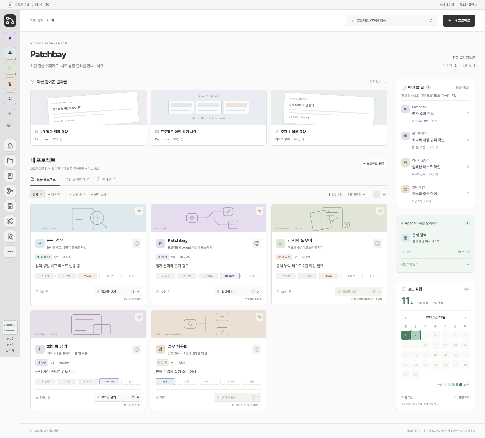
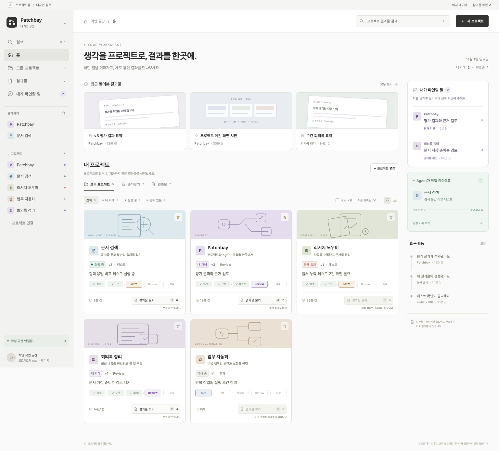

# 전체 프로젝트 메인 창 3안 — 검토 자료

- 기존 시안 작성: 2026-10-31
- 화면 캡처·검증: 2026-11-01
- 요청 범위: 여러 프로젝트를 관리하는 메인 창 3가지를 화면으로 비교·검토한다.
- 상태: 사용자가 A안을 선호하며 결과물 검색·열람 요구를 추가한 뒤, 노션 등 프로젝트 관리 도구의 메인 구조를 참고해 개선하도록 요청했다(2026-11-01). A 검토 시안을 보완했으며 제품 반영 작업은 포함하지 않는다.
- 데이터: 모든 프로젝트·상태·수치는 시안용 예시다.

[세 안 나란히 비교](전체프로젝트-메인-3안_20261031_v1/comparison.html) · [직접 눌러보기](전체프로젝트-메인-3안_20261031_v1/index.html)

**현재 검토용 A:** [벤치마킹을 반영한 A 홈](전체프로젝트-메인-3안_20261031_v1/a-home.html)

## 사용자 수정사항 반영 · 2026-11-02

사용자가 전달한 5가지 수정사항을 A 검토 시안에 반영했다. 기존 64px 왼쪽 바와 로고의 메인 복귀, Patchbay 제목, 오른쪽 프로젝트별 할 일 이동, 아래쪽 코드 실행 캘린더, 카드의 앱·웹 실행 화면 아이콘을 추가했다. 실행 주소 없는 아이콘과 결과물 없는 버튼은 각각 비활성화한다. 프로젝트는 설계·코드·할 일·결과물의 묶음이므로 명칭을 유지하고, Agent는 수행 주체로 구분하는 것을 권고했다.

예시 데이터 기반 검토 단계이며 실제 제품 반영은 하지 않았다. 실행 아이콘은 기존 로컬 검토 화면을 새 탭으로 여는 흐름을 확인한다. [이번 작업 기록](A메인-수정사항반영_20261102_v1.md) · [검증 결과](전체프로젝트-메인-3안_20261031_v1/feedback-validation.json).

## A 홈 구조 개선 · 2026-11-01

사용자 요청: 기존 A가 단조로우니 노션처럼 프로젝트를 관리하는 도구의 메인 화면을 참조한다. 현재의 공식 자료를 확인해 탐색 메뉴, 최근 결과물 내용 미리보기, 프로젝트별 커버, 갤러리·목록 전환, 오른쪽 확인할 일과 실행 상태로 재구성했다. 결과물 통합 검색·열람·결과물이 없는 버튼의 비활성 동작을 유지한다.

| 공식 자료 | 참고한 구조 | A 시안에서의 동작 |
| --- | --- | --- |
| [Notion 사이드바](https://www.notion.com/en-gb/help/navigate-with-the-sidebar) | 즐겨찾기와 작업 공간 탐색을 한곳에 둠 | 이름이 있는 왼쪽 메뉴, 즐겨찾기 추가·해제와 목록 동기화 |
| [Notion 갤러리](https://www.notion.com/help/galleries) | 페이지 내용 또는 커버로 카드 미리보기 | 최근 결과물의 문서 미리보기, 프로젝트마다 구별되는 커버 |
| [Linear 프로젝트](https://linear.app/docs/projects) | 작업 공간의 프로젝트 모음, 보기와 상태별 탐색 | 모든 프로젝트·즐겨찾기·결과물 탭, 갤러리·목록 전환 |
| [Asana Home](https://asana.com/features/project-management/home) | 최근 프로젝트와 할 일·업데이트를 나누어 배치 | 최근 결과물, 확인할 일, Agent 실행, 최근 활동의 위치 구분 |

Notion 공식 사이드바 문서는 현재 전체 페이지 Home의 일부 기능이 사이드바로 옮겨졌다고 설명한다. 옛 Home 구성으로 단정하지 않고 현재 탐색 구조와 갤러리 문서를 참고했다.

[목록 보기](전체프로젝트-메인-3안_20261031_v1/a-benchmark-list.png) · [결과물 열람](전체프로젝트-메인-3안_20261031_v1/a-benchmark-viewer.png) · [모바일](전체프로젝트-메인-3안_20261031_v1/a-benchmark-mobile.png)

Chrome에서 추가 확인 7건·화면 10장을 기록했다. 프로젝트·즐겨찾기·결과물 보기, 검색, 결과물 유무별 버튼, 문서 열람, 모바일 탐색 메뉴를 확인했다. 브라우저 오류·외부 요청·페이지 가로 넘침은 없었다. [벤치마킹 시안 검증 결과](전체프로젝트-메인-3안_20261031_v1/benchmark-validation.json).

## A · 전체 현황형

프로젝트 카드와 현황 요약을 중심에 두고, 최근 작업과 사람이 확인할 일을 함께 보여 준다. 프로젝트를 찾아 들어가는 흐름을 검토한다.

추가 요청(2026-11-01): 프로젝트와 생성 결과물을 함께 검색하고, 프로젝트 카드의 「결과물 보기」에서 목록·미리보기를 연다. 결과물이 없으면 버튼을 비활성화하고 이유를 표시한다. 프로젝트 완료 여부가 아니라 실제 생성된 결과물의 유무로 버튼 상태를 정한다.

결과물은 제목·파일명·예시 본문과 소속 프로젝트 이름으로 찾는다. 검색 결과를 프로젝트와 결과물로 나누며, 숨긴 프로젝트의 결과물은 기본 검색에서 제외한다. 「결과물 모아보기」는 검색어 없이 생성 결과물을 둘러보는 진입점이다. 열람창은 소속 프로젝트·파일 종류·판·초안/시안/검토 중 상태를 표시한다.

## B · 오늘 할 일형

여러 프로젝트의 검토·문제 확인·다음 작업을 모아서 보여 준다. 프로젝트를 넘나들며 지금 할 일을 고르는 흐름을 검토한다.

## C · 단계 비교형

프로젝트별 설계·구현·테스트·Review·결과를 나란히 보여 준다. 현재 위치와 막힌 지점을 비교하는 흐름을 검토한다.

## 확인

- Chrome에서 데스크톱·태블릿·모바일의 A/B/C 및 비교 페이지를 확인하고 화면 11장을 저장했다.
- 검색·빈 결과·필터·정렬·숨김 프로젝트·이동 설명창·안 전환 등 동작 확인 12건을 통과했다.
- 브라우저 오류 0건, 외부 요청 0건, 페이지 가로 넘침 없음. C의 모바일 진행표는 내부에서 가로 스크롤한다.
- [검증 결과](전체프로젝트-메인-3안_20261031_v1/validation.json)
- A안 추가 동작 확인 9건 통과: 결과물 유무별 버튼, 문서·화면 미리보기, 본문/파일명/제목/소속 프로젝트 검색, 숨김·필터·정렬, 모바일과 B·C 보기. 화면 8장 저장. [추가 검증 결과](전체프로젝트-메인-3안_20261031_v1/artifact-validation.json)
