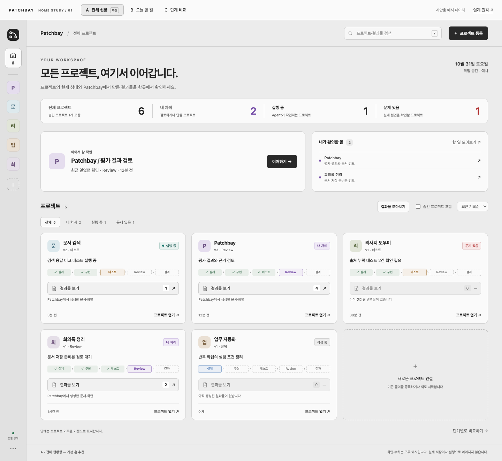
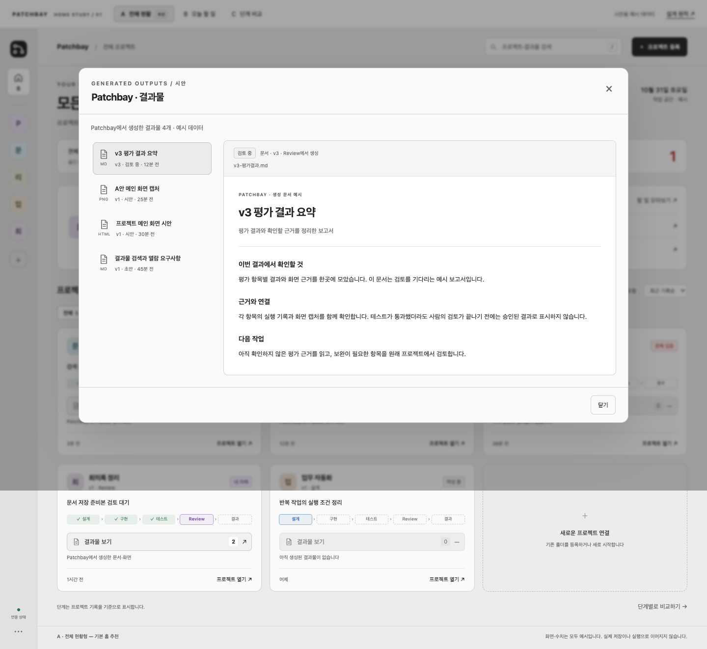
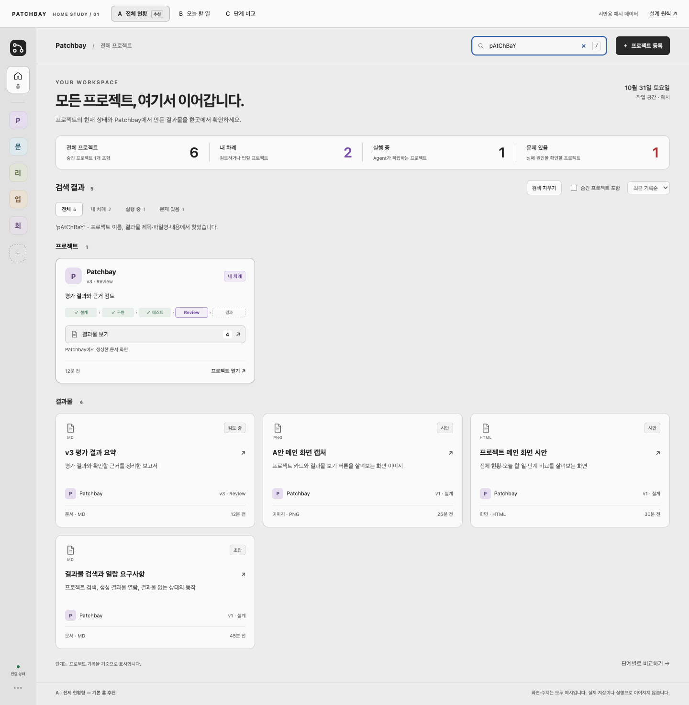
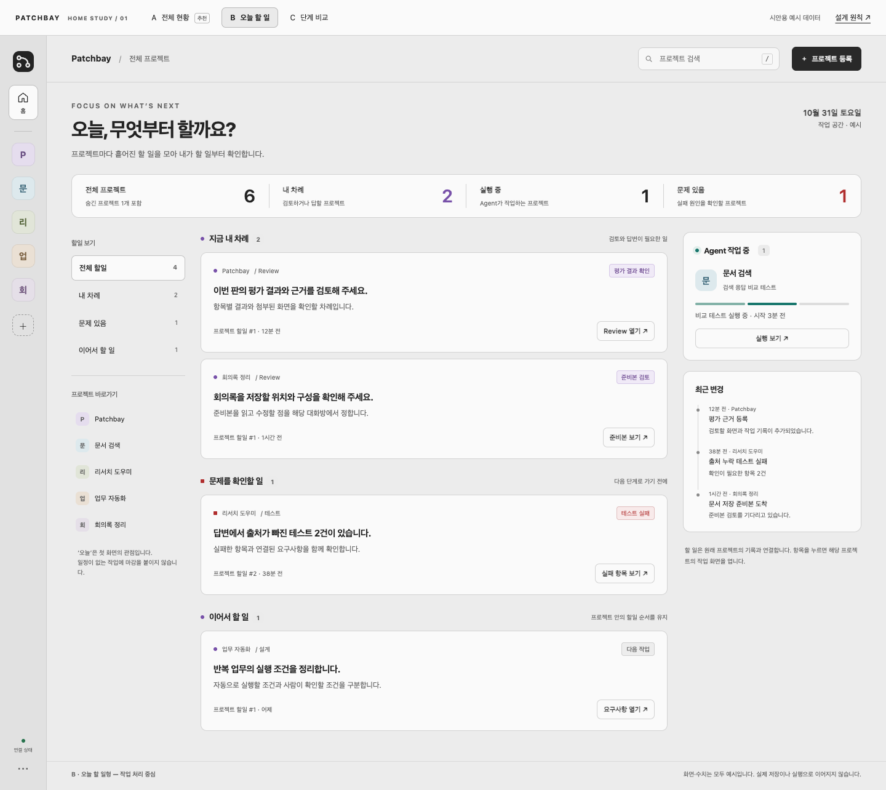
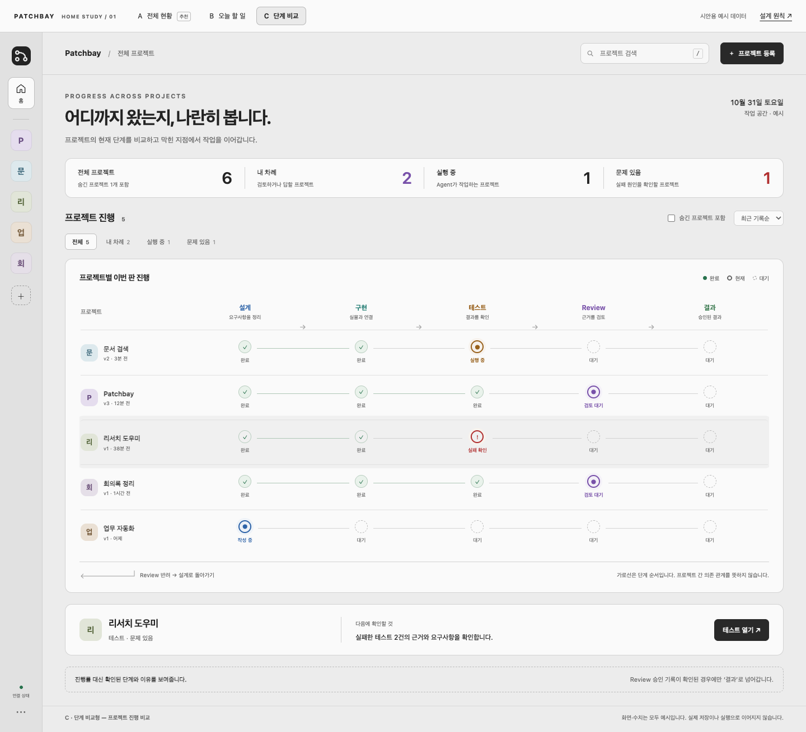

# 전체 프로젝트 메인 창 3안 — 검토 자료

- 기존 시안 작성: 2026-10-31
- 화면 캡처·검증: 2026-11-01
- 요청 범위: 여러 프로젝트를 관리하는 메인 창 3가지를 화면으로 비교·검토한다.
- 상태: 사용자가 A안을 선호하며 결과물 검색·열람 요구를 추가했다(2026-11-01). 검토용 시안을 보완했으며 제품 반영 작업은 포함하지 않는다.
- 데이터: 모든 프로젝트·상태·수치는 시안용 예시다.

[세 안 나란히 비교](전체프로젝트-메인-3안_20261031_v1/comparison.html) · [직접 눌러보기](전체프로젝트-메인-3안_20261031_v1/index.html)

## A · 전체 현황형

프로젝트 카드와 현황 요약을 중심에 두고, 최근 작업과 사람이 확인할 일을 함께 보여 준다. 프로젝트를 찾아 들어가는 흐름을 검토한다.

추가 요청(2026-11-01): 프로젝트와 생성 결과물을 함께 검색하고, 프로젝트 카드의 「결과물 보기」에서 목록·미리보기를 연다. 결과물이 없으면 버튼을 비활성화하고 이유를 표시한다. 프로젝트 완료 여부가 아니라 실제 생성된 결과물의 유무로 버튼 상태를 정한다.

결과물은 제목·파일명·예시 본문과 소속 프로젝트 이름으로 찾는다. 검색 결과를 프로젝트와 결과물로 나누며, 숨긴 프로젝트의 결과물은 기본 검색에서 제외한다. 「결과물 모아보기」는 검색어 없이 생성 결과물을 둘러보는 진입점이다. 열람창은 소속 프로젝트·파일 종류·판·초안/시안/검토 중 상태를 표시한다.

## B · 오늘 할 일형

여러 프로젝트의 검토·문제 확인·다음 작업을 모아서 보여 준다. 프로젝트를 넘나들며 지금 할 일을 고르는 흐름을 검토한다.

## C · 단계 비교형

프로젝트별 설계·구현·테스트·Review·결과를 나란히 보여 준다. 현재 위치와 막힌 지점을 비교하는 흐름을 검토한다.

## 확인

- Chrome에서 데스크톱·태블릿·모바일의 A/B/C 및 비교 페이지를 확인하고 화면 11장을 저장했다.
- 검색·빈 결과·필터·정렬·숨김 프로젝트·이동 설명창·안 전환 등 동작 확인 12건을 통과했다.
- 브라우저 오류 0건, 외부 요청 0건, 페이지 가로 넘침 없음. C의 모바일 진행표는 내부에서 가로 스크롤한다.
- [검증 결과](전체프로젝트-메인-3안_20261031_v1/validation.json)
- A안 추가 동작 확인 9건 통과: 결과물 유무별 버튼, 문서·화면 미리보기, 본문/파일명/제목/소속 프로젝트 검색, 숨김·필터·정렬, 모바일과 B·C 보기. 화면 8장 저장. [추가 검증 결과](전체프로젝트-메인-3안_20261031_v1/artifact-validation.json)
