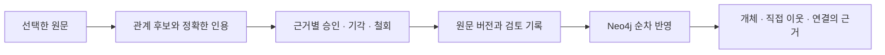

# 지식 그래프 A+B 구현 · 2026-10-17

사용자: 네 가지 시안을 확인한 뒤 추천한 A+B 채택. A의 근거 검토와 B의 기본 이웃·근거 탐색을 기존 지식 그래프 도구에 구현했다.

## 동작

- 마크다운·텍스트 자료를 프로젝트 안에서 선택하고 문단·주어·관계·대상·인용문을 확인한다. 세 관계는 사용한다·의존한다·일부다. 원문에 없는 인용은 저장하지 않는다.
- 직접 후보를 추가하거나 기존 프로젝트에 등록한 Claude·Codex를 선택해 추출할 수 있다. 자동 추출은 버튼을 누른 때만 해당 문서를 전달한다. 화면 열기는 저장된 LLM 설정만 읽는다. LM Studio 연결은 사용하지 않는다. 실제 모델 호출은 이번 검증에서 하지 않았다. 모델 응답 검증·중지는 테스트 대역으로 확인했다.
- 검토는 주장 전체가 아닌 근거별이다. 승인·기각·철회·다시 검토 이력을 보존한다. 같은 기각 후보는 재추출로 되살리지 않는다. 문서가 다른 동명 개체는 자동 병합하지 않는다.
- 원문 버전 전체와 해시를 보존하고 그때의 원문을 열 수 있다. 제목·본문·인접 문단의 문맥이 바뀌면 새 검토가 필요하다. 같은 문맥의 줄 이동은 근거를 재사용하며 수집 당시 줄과 현재 줄을 구분한다.
- B는 승인되고 현재 열람 가능한 근거만 Neo4j에서 찾는다. 개체 검색·직접 이웃·관계별 인용문을 제공한다. 후보·기각·철회·낡은 근거는 정상 탐색에서 제외한다. 반영 지연·실패 때 예전 결과로 답하지 않는다.
- Neo4j가 끊겨도 근거 검토는 저장한다. 다시 반영·원문에서 다시 만들기로 복구한다. 기존 파일·설계·실행 그래프와 문서 호출은 따로 열 수 있다.

## 구현

| 경계 | 파일과 계약 |
| --- | --- |
| 커널 | `core/src/knowledge/semanticContract.ts`, `semantic.ts`: `semanticPaths()`, `readSemanticSource()`, `importSemanticCandidates()`, `reviewSemanticEvidence()`, `semanticProjection()` |
| 원문 | `projects/<alias>/knowledge/semantic.json`. 프로젝트 잠금 + 임시 파일 교체. 원문 버전·문단·개체·주장·근거·증가 순번 검토 이벤트. 폴더·문서 편집기로는 읽기만 |
| 호스트 | `flow/src/semanticHost.ts`: GET `/api/knowledge/semantic`, `/source`, `/version`, `/extractors`; POST `/import`, `/review`, `/sync`, `/extract`, `/stop` |
| Neo4j | `semanticAdapter.ts`: 기존 드라이버 공유, `SemanticRecord`와 `SemanticCursor`는 기존 `Knowledge`와 격리. 매 seq의 의미 그래프와 DB 커서를 한 트랜잭션으로 반영. 중복 전달은 멱등, 순서 누락은 거절, 실패는 정지 |
| 화면 | `SemanticKnowledgePane.tsx`, `semantic.css`. `KnowledgePane.tsx`의 기본 화면으로 연결. `knowledge` SSE로 다른 화면의 검토 변경 갱신 |
| 동작 중 | 추출은 `/api/running`에 표시하며 중지·서버 종료·프로젝트 이름 변경 보호에 포함 |

첫 범위: 자료 10개, 파일당 256KB, 자동 추출 입력 18,000자, 한 번에 최대 40개 자동 후보, 탐색 최대 80개 근거. 큰 자료는 직접 문단을 선택한다. 의미 그래프는 각 순번의 스냅샷을 트랜잭션으로 교체한다. 대규모 자료의 증분 투영·성능 최적화, 자동 병합·PDF·벡터 검색·C 답변·D 분석은 후속이다.

## 검증

- 커널·호스트: 정확한 인용, 지문·판 충돌, 복수 근거의 개별 검토, 재추출 중복·기각 보존, 원문·인접 문맥 변경, 원문 이관, 경로·실경로·비밀·열람 불가 차단, 프로젝트 분리, 승인 철회, 반영 실패·순차 재시도, 명시적 LLM 실행·중지를 검사했다.
- 실제 Neo4j 5.26 Community: 중복 전달, 순번 누락, 유일성 제약 오류의 트랜잭션 전체 복구와 커서 보존, 기존 스캔 전체교체 뒤 의미 관계 보존, 전체 재생 결과를 임시 alias에서 확인했다. 테스트 alias만 정리했다.
- Chrome: 저장→승인→관계 탐색→원문 열기→철회, 낡은 근거, 네 가지 화면 너비와 모바일, 기존 그래프 왕복 등 20개 확인. 실제 Neo4j와 임시 프로젝트를 사용했다. [검증 결과](지식그래프-AB-구현_20261017_v1/browser-validation.json).
- 루트 빌드와 Flow 형검사·클라이언트·서버 빌드 통과. 전체 시험의 한 실행에서 macOS 파일 감시 한도(`EMFILE`) 때문에 SSE 4건이 시간 초과했다. 해당 47개는 기본 설정 재실행으로 통과했다. 최종 전체 검증은 `CHOKIDAR_USEPOLLING=1 pnpm exec vitest run --maxWorkers=4`로 **1,227개 통과**, 실제 DB 통합 시험 1개는 별도 실행해 통과했다.

화면: [A 근거 검토](지식그래프-AB-구현_20261017_v1/review-desktop.png) · [B 관계 탐색](지식그래프-AB-구현_20261017_v1/explore-desktop.png) · [원문 변경](지식그래프-AB-구현_20261017_v1/stale-desktop.png) · [모바일 검토](지식그래프-AB-구현_20261017_v1/review-mobile.png) · [모바일 탐색](지식그래프-AB-구현_20261017_v1/explore-mobile.png).

트랜잭션·재시도와 제약 문법은 [Neo4j JavaScript 공식 문서](https://neo4j.com/docs/javascript-manual/current/transactions/)와 [Cypher 제약 문서](https://neo4j.com/docs/cypher-manual/current/schema/constraints/create-constraints/)를 참고했으며, 실제 5.26 환경에서 별도 검증했다.

## 실제 반영

기존 4318 서버에서 진행 중 LLM이 없음을 확인하고 접속 설정을 유지해 재시작했다. A+B 화면과 API, 모델 자동 조회·호출이 없는 상태, 아키텍처 배치 갱신을 확인했다. 실제 프로젝트의 지식 자료·후보·검토를 임의로 수집·승인하지 않았다. 실제 화면 캡처는 비공개 기록층에 저장했다.

후속 변경(2026-10-17): 사용자 요청으로 LM Studio 추출을 함께 추가했다. 등록한 local 참여자와 명시적인 모델 목록 불러오기·선택·추출을 제공한다. 기록: [LM Studio 추출 추가](지식그래프-LMStudio-추출_20261017_v1.md).
