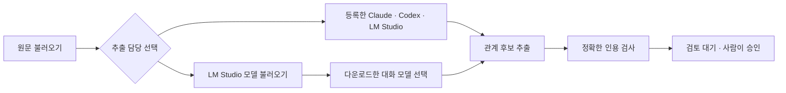

# 지식 그래프 LM Studio 추출 추가 · 2026-10-17

요청: “lm studio에서 추출할 수 있는 기능도 같이 추가해줘”. A+B의 추출 담당에 LM Studio를 추가했다.

## 사용 흐름

`추출 담당`에는 기존에 등록한 로컬 참여자도 표시한다. `LM Studio 모델 불러오기`를 누르면 다운로드된 대화 모델을 읽어 별도 선택지로 제공한다. 임베딩 모델은 제외한다. 조회와 추론은 각각 해당 버튼을 눌렀을 때만 실행한다. 페이지를 열거나 원문을 불러올 때 LM Studio를 호출하지 않는다.

## 구현과 검증

- `SemanticKnowledgePane.tsx`: 등록 LLM과 다운로드한 로컬 모델 선택, 명시적인 목록 조회, 진행·오류·빈 목록 안내. 새 목록에서 사라진 선택은 초기화한다. 프로젝트 전환·화면 종료 시 조회 요청을 취소한다.
- `semanticHost.ts`: `POST /api/knowledge/semantic/local-models`는 `lms ls --json`을 실행한다. 기존 `POST /extract`는 등록 `memberId` 또는 직접 선택한 `localModel` 하나를 받아 공통 `RoomRunner`의 `lms chat -p` 길을 사용한다. 등록 설정 조회는 모델 실행 없이 파일만 읽는다.
- 실패·중지 때 후보를 저장하지 않는다. 원문과 일치하는 인용만 검토 대기로 저장하고 선택 모델을 출처로 남긴다. 검토 승인과 Neo4j 반영은 기존 A+B와 같다.
- 관련 호스트·실행기 테스트 28개와 Flow 형검사·클라이언트·서버 빌드 통과. 등록/다운로드 로컬 모델, 임베딩·잘못된 선택 차단, 명시적 목록 조회, 읽기 전용 연결, 시간 초과·중지·데이터 보존을 검증했다.
- 실제 Qwen2.5 14B Instruct로 임시 문서 두 문장에서 관계 후보 2개를 추출했다. 정확한 인용·검토 대기·모델 출처 보존을 확인했고, Neo4j 승인 관계로 자동 채택하지 않았다. 실제 목록 조회는 대화 모델 3개를 제공했고 임베딩을 제외했다. Chrome 데스크톱·390px 모바일·명시적 호출 13개 확인 통과. [검증 결과](지식그래프-LMStudio-추출_20261017_v1/validation.json), [데스크톱](지식그래프-LMStudio-추출_20261017_v1/desktop.png), [모바일](지식그래프-LMStudio-추출_20261017_v1/mobile.png). 실제 모델 검증은 임시 프로젝트와 메모리 Neo4j 어댑터를 사용했다.

공식 CLI 계약: [lms ls](https://lmstudio.ai/docs/cli/local-models/ls), [lms chat](https://lmstudio.ai/docs/cli/local-models/chat). 외부 모델 다운로드나 설치는 하지 않았다.

## 실제 반영

진행 중인 작업이 없음을 확인하고 기존 설정을 유지해 4318 서버를 재시작했다. 실제 화면의 등록 로컬 참여자 선택·모델 불러오기 버튼과 자동 모델 호출 0건을 확인했다. 아키텍처 배치와 스캔을 갱신했다. 실제 프로젝트의 문서 추출·검토 승인은 실행하지 않았다.
