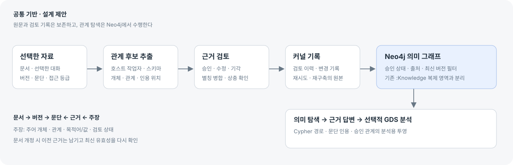

# Neo4j 지식 그래프 재설계 조사와 산출물 비교

2026-10-16 · 조사·설계 제안. 제품 구현과 DB 변경은 별도 단계다.

## 판단

현재 지식 그래프는 파일·승인된 설계·실행 기록의 연결을 Neo4j에 복제하고 찾아보는 기능이다. 사용자가 연결한 강의의 비정형 자료→개체·관계→의미 그래프→GraphRAG·GDS 흐름을 사용하려면, 문서 내용을 지식으로 만드는 수집·추출·검토 계층부터 설계해야 한다.

강의는 [한빛의 파이썬·Neo4j 지식 그래프 영상 강의](https://www.hanbit.co.kr/product/C8863315103)다. 공개 목차를 읽었으며 유료 영상과 실습 파일을 열람한 것은 아니다. 아래 적용 방향은 목차와 공식 문서를 바탕으로 한 제안이다.

그래프에 담을 범위에 대한 추가 답변은 없는 상태다. 우선 **선택한 프로젝트 문서·대화의 개념과 관계**를 중심으로 한다. 기존 요구사항·코드·시험의 연결은 보조 맥락으로 붙인다. 실제 프로젝트 자료 전체를 자동 수집하는 계획은 아니다.

## 현재 코드의 근거

| 확인 지점 | 현재 동작 | 설계에 주는 의미 |
| --- | --- | --- |
| app/apps/flow/src/KnowledgePane.tsx, neo4jContract.ts | 파일·폴더·스킬·산출물·요구사항·평가·설계 노드·문서·실행 표시 | 소프트웨어 구조와 추적 관계는 재사용 가능 |
| app/apps/flow/src/knowledgeView.ts | 스캔/설계/실행 스냅샷의 변경을 Neo4j에 반영 | 문서 의미 추출과 승인 기록의 별도 입력이 필요 |
| app/apps/flow/src/neo4jAdapter.ts:169 | alias에 해당하는 :Knowledge를 전체 삭제한 후 재생성 | 새 의미 지식을 이 레이블에 섞으면 소실될 수 있음. 별도 레이블·키·갱신 경계 필요 |
| 같은 파일 search | 이름·경로·본문 일부 CONTAINS와 이웃 조회 | 개체 판별·별칭·의미 관계·근거 질의 필요 |
| knowledgeView.ts 문서 호출, core/knowledge/retrieve.ts | 메모리의 키워드와 1~2홉 검색 | 실제 Neo4j 경로 검색·근거 검색을 별도 구현해야 함 |
| app/docker-compose.yml | neo4j:5.26-community 선언, GDS/APOC 설정 없음 | DB·드라이버·플러그인 호환 조합을 먼저 확인. 실제 실행 DB/플러그인은 이번 조사에서 미확인 |

## 강의 주제의 제품 적용

| 공개 목차의 주제 | Patchbay에 적용할 내용 | 순서 |
| --- | --- | --- |
| 속성 그래프·Cypher·MERGE | 개체/관계/근거 스키마, 안정 ID, 중복 없는 저장, 필터·경로 질의 | 공통 기반 |
| CSV·JSON·비정형 자료 | 선택한 텍스트 문서/대화→버전별 문단→관계 후보→사람 검토 | 첫 MVP |
| Bloom 시각화 | 유형·관계·홉별 탐색, 클릭한 연결의 근거 문단 표시 | 첫 탐색 화면 |
| LLM·GraphRAG | 문단/개체 검색+Neo4j 관계 탐색→출처를 인용하는 답변 | 비교 평가 후 |
| GDS 중심성·커뮤니티·유사도·경로 | 검토된 의미 관계의 분석용 투영, 알고리즘과 범위 설명 | 데이터 확보 후 선택 확장 |
| GraphQL | 외부 클라이언트가 필요할 때 스키마 API | 초기 필수 아님 |
| APOC·PROFILE·INDEX | 필요한 프로시저만 채택, 유일성 제약과 실제 질의 성능 확인 | 필요 시/각 단계 |

## 공통 기반

문서 → 원문 버전 → 문단을 보존하고, 개체 사이의 주장에 근거 문단을 연결한다. 예를 들어 ‘Patchbay가 Neo4j를 사용한다’는 연결은 어떤 문서의 어느 버전·줄이 근거인지와 검토 상태를 가진다. 후보·승인·기각·개정으로 낡음·철회를 구별한다. ‘이름이 같다’는 이유로 자동 병합하지 않는다.

추출은 호스트 작업자가 수행하고, 커널은 형식 검사와 원문·검토 기록 저장을 맡는다. Neo4j는 실제 관계 탐색·질의 엔진으로 사용한다. 원문/승인 기록으로 재구축하되, 기존 스캔 그래프 전체 교체 범위와 의미 그래프를 분리한다. 새 저장 계약은 구현 시 저장구조.md와 함께 정의한다.

관계의 출처·버전·접근 등급은 검색 시작부터 적용한다. 모델이 만든 후보를 확정 사실로 취급하지 않고, 관계 하나에서 원문 위치까지 돌아갈 수 있게 만든다. 공식 KG Builder의 스키마는 모델을 안내하는 장치이므로 저장 전 별도 검증이 필요하다. 실험적 SDK를 채택하면 어댑터 뒤에서 판을 고정한다. [Neo4j KG Builder 문서](https://neo4j.com/docs/neo4j-graphrag-python/current/user_guide_kg_builder.html)

## 작업 계획

Neo4j 공식 모델링 절차에 따라 ‘답할 질문→모델→표본 그래프→질의 검증→개선’ 순서로 진행한다. [공식 모델링 안내](https://neo4j.com/docs/getting-started/data-modeling/)

| 단계 | 작업 | 다음으로 넘어갈 기준(제안) |
| --- | --- | --- |
| P0 질문·범위 | 표본 자료 약 10개, 평가 질문 약 20개와 사람이 확인한 정답·근거 마련 | 별칭·동명이인·개정·모순·답 없음·접근 제한 사례 포함, 첫 수집의 시간/비용 측정 |
| P1 계약·표본 | 노드/허용 관계/안정 ID/문단 위치/검토·버전 계약, 샘플 Cypher, 기존 그래프 격리 | 재수집 중복 없음, 자료 개정·재구축·권한 변경 결과 일치 |
| P2 수집·검토 | 텍스트 문서·선택 대화→후보→근거 확인→승인→Neo4j 투영 | 승인 연결의 출처 추적 100%, 기각/낡은 근거 기본 제외, 중단·재시도 복구 |
| P3 탐색·질문 | 개체/유형/관계 탐색, 제한 경로, 근거 문단, 인용 답변 평가 | 문서 검색 기준선 대비 질문별 정답/근거/답 없음 처리와 지연·비용 비교 |
| P4 선택 확장 | 승인 관계에 GDS 1~2개 적용, GraphQL 등 실제 수요 검토 | 분석 범위·방향·해석·재현 방법을 함께 제시 |

수치와 범위는 아직 실측하지 않은 제안 목표다. [검토 요청에 사용한 상세 계획](지식그래프-Neo4j-재설계_20261016_v1/plan-for-claude.md)에 세부 질의·저장·이행 조건을 남겼다.

## 참고 자료와 열람 범위

모두 2026-10-16에 확인한 공개 1차 자료다. current 문서가 프로젝트의 Neo4j 5.26과 동일한 API라는 뜻은 아니다.

- [한빛 강의의 공개 목차](https://www.hanbit.co.kr/product/C8863315103): 적용할 주제 범위. 영상/실습 파일 미열람.
- [Neo4j 모델링](https://neo4j.com/docs/getting-started/data-modeling/): 질문에서 출발하는 모델링·질의 검증 절차.
- [공식 KG Builder](https://neo4j.com/docs/neo4j-graphrag-python/current/user_guide_kg_builder.html): 분할·개체/관계 추출·스키마·동일 개체 판별, 실험적 API의 경계.
- [공식 GraphRAG](https://neo4j.com/docs/neo4j-graphrag-python/current/user_guide_rag.html): 검색기·Neo4j·LLM을 연결한 근거 답변 구성.
- [GDS 실행 모드](https://neo4j.com/docs/graph-data-science/current/common-usage/running-algos/): stream은 결과 반환, write는 DB 기록. 분석 결과를 원래 사실과 분리하는 설계의 근거.
- [Neo4j 제약](https://neo4j.com/docs/cypher-manual/current/schema/constraints/create-constraints/): 유일성과 필수값/타입 제약의 구분. Community MVP에 Enterprise 전용 제약을 전제하지 않음.
