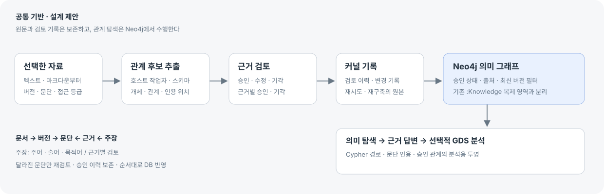
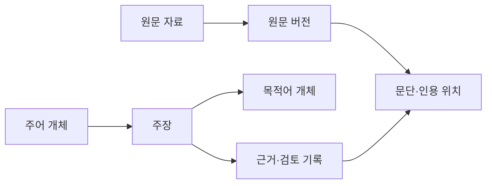

# Neo4j 지식 그래프 조사·Claude 검토·산출물 4안

2026-10-16 착수 / 2026-10-17 정리 · 상태: 조사와 설계 제안 완료, 제품 구현 전.

사용자 지시: “1번은 사실 제외해도 돼 2-4번 진행해줘.” 특정 도서·강의 내용 적용 조건을 제외하고, 공식 자료 조사 → 설계 계획 → Claude 검토 → 4안 제안을 수행했다.

**추천은 A의 근거 검토에 B의 최소 이웃 탐색을 붙여 시작하는 것이다.** 기존 파일·설계·실행 연결은 유지하고, 선택한 자료의 개념·주장·원문 근거를 별도로 쌓는 방향이다. 문서 의미 그래프를 우선하는 것은 설계 가정이며, 요구사항·코드·시험 추적을 우선하면 기존 관계를 확장하는 쪽으로 범위를 조정한다.

- [조작 가능한 4안 비교](지식그래프-Neo4j-재설계_20261016_v2/index.html)
- [Claude에게 전달한 계획 원문](지식그래프-Neo4j-재설계_20261016_v2/plan-for-claude.md)
- [Claude 검토 원문](지식그래프-Neo4j-재설계_20261016_v2/claude-review.md)
- [브라우저 검증 결과](지식그래프-Neo4j-재설계_20261016_v2/validation.json)

## 현재 구현과 차이

| 코드에서 확인한 사실 | 설계에 주는 의미 |
| --- | --- |
| `core/src/knowledge/contract.ts`는 File·Folder·Skill·Artifact와 Requirement·Eval·AgentNode·Document·Run을 정의한다. 스캔뿐 아니라 승인 설계·실행 관계도 있다. | 기존 추적 관계는 재사용한다. 현재 기능을 파일 목록뿐이라고 평가하지 않는다. |
| `knowledge/store.ts`는 스캔·설계·실행 원문에서 그래프 스냅샷을 다시 만든다. | 파일을 원본으로 두고 Neo4j를 재구축 가능한 인덱스로 쓰는 원칙을 유지한다. |
| `neo4jAdapter.ts`의 검색은 문자열 CONTAINS, 이웃은 직접 연결 조회다. | 개체의 별칭·의미 관계·근거·개정 상태를 다루는 새 계약이 필요하다. |
| `knowledgeView.ts`의 문서 호출은 커널의 키워드·1~2홉 검색이며 Neo4j 없이도 답한다. | 새로운 의미 질의는 Neo4j에서 수행하고 결과 출처를 구별한다. |
| `replaceAlias()`는 해당 alias의 `:Knowledge`를 삭제하고 다시 만든다. | 의미 노드의 레이블뿐 아니라 기존 노드와의 교차 연결도 보호해야 한다. |
| compose는 `neo4j:5.26-community`이고 GDS/APOC 설치 설정은 없다. | 실제 실행 버전·플러그인은 구현 전에 확인한다. 최신 문서의 모든 기능을 5.26에 적용할 수 있다고 가정하지 않는다. |

이 조사는 소스 코드와 compose를 기준으로 했다. 실제 DB의 내용·버전·응답속도를 측정한 결과는 아니다.

## 공식 자료에서 가져온 설계 기준

1. **질문에서 출발한다.** Neo4j 모델링 안내는 사용 사례와 질문을 정하고, 표본 모델에 질의를 실행한 뒤 개선하도록 안내한다. 따라서 전체 파일을 그래프로 옮기기 전에 ‘무엇을 알고 싶은가’를 고정한다. [Neo4j 모델링](https://neo4j.com/docs/getting-started/data-modeling/tutorial-data-modeling/)
2. **문서 구조와 의미 추출을 나눈다.** 공식 KG Builder는 텍스트 읽기·분할·스키마·개체/관계 추출·저장·동일 개체 판별을 구분한다. API는 실험적이다. 이 구성을 참고하되 현재 TypeScript 호스트에서 추출하고 커널은 검사·저장을 맡는다. Python SDK 채택은 별도 결정이다. [KG Builder](https://neo4j.com/docs/neo4j-graphrag-python/current/user_guide_kg_builder.html)
3. **그래프 검색과 답변 생성은 별도다.** 공식 GraphRAG는 드라이버·검색기·LLM을 조합하며, 벡터 검색 뒤 Cypher로 관계 맥락을 확장하는 검색기도 제공한다. 초기에는 매개변수화한 검색을 검증하고, 임베딩과 자연어 답변은 기준선 비교 후 추가한다. [GraphRAG 검색기](https://neo4j.com/docs/neo4j-graphrag-python/current/user_guide_rag.html)
4. **안정 ID와 필수값 검사를 함께 둔다.** 유일성 제약은 필수값 존재를 대신하지 않는다. Community MVP는 유일성 제약과 앱의 필수값·참조 검사를 조합한다. Enterprise의 존재·타입·키 제약을 전제로 하지 않는다. [Neo4j 제약](https://neo4j.com/docs/cypher-manual/current/schema/constraints/create-constraints/)
5. **반영은 원자성·순서·재시도를 설계한다.** 드라이버의 트랜잭션은 DB 작업을 묶고 일시 오류를 재시도할 수 있다. 파일 저장까지 함께 커밋해 주지는 않는다. 이 차이를 승인 이벤트와 순차 투영으로 다룬다. [JavaScript 트랜잭션](https://neo4j.com/docs/javascript-manual/current/transactions/)
6. **분석 결과를 원래 주장과 구별한다.** GDS의 stream은 결과를 반환하고 write는 DB에 기록한다. 초기 분석은 승인 관계로 만든 분석용 그래프에서 결과를 반환해 검토한다. 중심성·군집은 사실의 진실이나 사업 중요도 점수가 아니다. [GDS 실행 방식](https://neo4j.com/docs/graph-data-science/current/common-usage/running-algos/)

위는 공식 자료의 설명과 이를 Patchbay에 적용한 설계 판단이다. 모든 참고 자료를 2026-10-16에 확인했으며, SDK·DB·플러그인 판 호환성은 구현 때 검증한다.

## 공통 데이터와 동작

Source → SourceVersion → Chunk가 원문 계층이다. Entity와 Claim은 개념과 ‘누가 무엇에 대해 무엇이라고 주장했나’를 나타낸다. Claim에는 제한된 술어가 있다. Claim과 Chunk를 잇는 Evidence에 검토·인용 위치를 둔다. 기존 Document는 ‘설계의 문서 의존’이므로 원문은 Source라는 별도 이름을 쓴다. 이 영문 이름은 구현 전 스키마 제안이며 제품 화면은 자료·버전·문단·개체·주장·근거로 표현한다.

- `(alias, id)`를 안정 키로 쓰고 이름만으로 같은 개체를 합치지 않는다. 근거 지문은 개체 ID·술어·문단 ID·문단 해시를 포함한다. 재추출 시 동일한 기각 후보를 다시 추천하지 않는다.
- **검토는 근거별로 한다.** pending / approved / rejected / withdrawn 이력은 덧붙여 보존한다. 자료가 바뀌어도 과거 승인을 덮어쓰지 않는다. 승인된 주장에 새 근거가 붙으면 새 근거만 검토 대기다.
- **현재성도 근거별로 판단한다.** 승인되고 최신이며 열람 가능한 근거가 하나 이상인 주장을 기본 질의에 쓴다. 일부 근거가 낡았다고 모든 근거를 무효로 만들지 않는다. 모순은 자동 확정하지 않고 비교 후보로 제시한다.
- 제목·문단 ID·내용 해시·상위 문맥이 같은 문단은 이관 이력을 남기고 근거를 재사용한다. 달라진 문단과 문맥만 재검토한다. 문맥을 확실히 비교할 수 없으면 보수적으로 재검토한다.
- ‘접근 불가’는 자료 상태로 저장하지 않는다. 프로젝트·열람 권한·민감도는 검색 시작부터 적용한다. 제외되거나 없어진 원문과 현재 사용자가 볼 수 없는 원문을 구별한다.
- 의미 노드는 `:SemanticRecord` 계열로 분리하고 `:Knowledge` 레이블을 붙이지 않는다. 초기에는 기존 스캔 노드와 직접 간선을 만들지 않고 경로·원문 지문으로 참조한다. 기존 전체교체 뒤 의미 그래프와 근거가 보존되는지 검증한다.

## Claude 검토와 반영

Claude Code를 실제 호출해 `claude-opus-5-5` 응답을 받았다. 검토에는 계획 본문만 전달했으며 도구·추가 에이전트·링크 열람·파일 수정을 사용하지 않았다. 코드 사실은 이 문서에 제공한 조사 결과를 전제로 검토했다. [응답 원문](지식그래프-Neo4j-재설계_20261016_v2/claude-review.md), [호출 기록](지식그래프-Neo4j-재설계_20261016_v2/claude-request-meta.json)

| 검토 지적 | 최종 반영 |
| --- | --- |
| DB 안의 projectionStatus로 미반영 이벤트를 거를 수 없다. | 반영 상태는 커널 이벤트와 alias별 DB 커서로 계산한다. 그래프의 주장 속성으로 쓰지 않는다. |
| Claim 전체의 stale·승인 상태는 복수 근거를 표현하지 못한다. | 근거별 승인과 현재성을 두고 사용 가능한 주장 여부를 계산한다. |
| eventId만으로 승인·철회 순서를 보장할 수 없다. | alias별 증가 seq, 순차 적용, 실패 시 정지, 동일 seq 재시도, 처음부터 재생한 결과의 동등성 검증을 추가한다. |
| 레이블을 나눠도 :Knowledge와의 간선은 삭제될 수 있다. | 초기 교차 연결은 속성 참조로 두고 스캔 뒤 무손실 검증을 추가한다. |
| Claim 노드가 끼면 홉의 뜻이 바뀐다. | 사용자에게 1홉은 Entity→Claim→Entity 한 의미 관계다. 내부 간선 수와 구별하고, GDS에는 Entity→Entity로 접어서 투영한다. |
| 초기 범위가 크다. | 첫 MVP는 선택한 마크다운·텍스트, 술어 3개, 질의 3개, A + B의 최소형이다. 대화 수집·병합·경로·답변·분석은 후속이다. |
| A는 B와 양자택일할 기능이 아니라 지식을 만드는 전제다. | 4안을 같은 기반 위의 중심 작업으로 제시하고 첫 제품 구성은 A + B의 최소형으로 추천한다. |

Claude의 ‘접근 등급 대신 제한 자료 수집 금지’는 범위 축소 의견으로 받았다. 초기 입력은 열람 허용 자료로 제한하되, Patchbay의 기존 민감도·권한 검사는 유지한다. ‘문서 의미 그래프 우선’ 가정은 사용자에게 우선 목적을 확인하는 질문을 남겼으며, 응답이 없으면 제안의 가정으로 유지한다.

## 저장·반영·검색 계약

1. 커널이 검토 이벤트를 원자 저장한다. 각 이벤트는 alias·eventId·seq·원문 지문·검토 당시 revision을 갖는다. 동시 검토는 revision과 원문 지문이 달라지면 충돌로 돌려준다.
2. 호스트가 alias별 seq 순서대로 Neo4j에 투영한다. 한 이벤트의 변경과 `lastAppliedSeq` 갱신은 같은 DB 트랜잭션에서 처리한다. 실패한 이벤트를 건너뛰지 않는다. 재구축은 원문·이벤트로 재현한다.
3. MVP에서 최신 커널 seq와 DB 커서가 다르면 의미 그래프 조회·답변은 ‘반영 대기’로 응답한다. 이미 기각·철회된 연결을 예전 DB 결과로 계속 보여주지 않기 위한 단순한 일치 조건이다. 단순 파일 검색은 출처를 명시한 별도 결과로 제공할 수 있다.
4. 초기 질의는 개체 검색·직접 이웃·주장 근거 3개로 고정한다. 매개변수·관계 사전·결과 수·실행 시간·접근 범위를 제한한다. 전문 검색 인덱스는 한국어 표본의 CONTAINS 기준선과 비교한다. LLM이 만든 임의 Cypher를 바로 실행하지 않는다.
5. 검색 입구는 하나로 두고 ‘스캔 관계 / 의미 관계 / 원문 검색’의 출처를 표시한다. 기존 문서 호출을 Neo4j 의미 검색인 것처럼 이름만 바꾸지 않는다.

새 원문 파일 경로·저장 함수·API 계약은 구현 단계에서 저장구조.md·아키텍처와 함께 정의한다. 이번 단계에서는 프로젝트 원문 저장 구조를 바꾸지 않았다.

## 작업 계획과 검증 기준

| 단계 | 범위 | 완료 기준 |
| --- | --- | --- |
| P0 · 질문·표본 | 선택 자료 약 10개, 사람이 확인한 질문 약 20개. 정의·관계·근거·개정·동명이인·모순·답 없음·접근 제한 포함 | 답과 원문 위치를 사람이 작성. 추출 정밀도·재현율, 문서당 후보 수·검토 시간·기각률을 표본에서 측정 |
| P1 · 계약·최소 표본 | ID·근거별 검토·순서 있는 이벤트·투영 커서·기존 그래프 격리 | 중복 수집, 기각 재등장, 동시 검토 충돌, 철회 순서, 실패 재시도, 재구축 결과 일치, 기존 스캔 뒤 의미 그래프 보존 |
| P2 · 첫 제품 | 선택 마크다운·텍스트, 술어 3개, 질의 3개. A 검토 + B 이웃·근거 보기 | 승인 근거가 원문으로 되돌아감. 대기·기각·낡음·권한 제한이 정상 결과에 섞이지 않음. 투영 지연·실패 상태를 표시하고 복구 |
| P3 · 탐색·질문 확장 | 대화 수집, 안정 문단 이관, 복수 근거 화면, 제한 경로·개정 영향. C는 별도 평가 | 문서 검색 단독과 그래프 검색의 질문별 정답·근거 일치·답 없음·인용 정확도·지연·비용 비교. 필요한 경우만 임베딩 추가 |
| P4 · 분석 | D. 검토 데이터가 충분할 때 GDS 알고리즘 1~2개 | 실행 버전·관계 방향·가중치·표본 판을 고정하고 재현. 분석 결과를 검토된 원문 주장과 분리 |

10개·20개·술어 3개·질의 3개는 범위 제안이다. 실측 성능·품질 수치가 아니다. 근거 추적·접근 누출·재구축 일치는 표본의 모든 해당 사례에서 확인하고, 정밀도·재현율·검토 시간은 P0 결과를 바탕으로 통과 목표를 정한다. 미지원 질문은 미지원이라고 안내하는지 평가한다.

## 산출물 4안

네 안은 DB를 네 개 만드는 제안이 아니라, 공통 원문·근거·검토 기반 위에서 어떤 작업을 중심에 놓을지 비교하는 안이다. B·C·D도 지식 수집과 검토 기반이 필요하다.

| 안 | 중심 화면과 산출물 | 적합한 목적 | 비용과 한계 |
| --- | --- | --- | --- |
| **A · 지식 구축·검토** | 원문 ↔ 관계 후보, 승인·기각 이력, 반영 대기와 재시도 | 자료를 믿고 쓸 수 있는 지식으로 만드는 것 | 검토 피로를 측정해야 함. **첫 구현 추천** |
| **B · 관계 탐색** | 개체 중심 지도, 1~2 의미 홉, 연결별 원문 근거 | 무엇과 왜 연결되는지 이해하는 것 | 자료가 적으면 관계가 빈약함. 처음에는 A 안에 이웃 패널로 포함 |
| **C · 근거 답변** | 질문·인용 답변·사용한 관계·근거 부족 | 질문에 빠르게 답을 얻는 것 | 문서 검색 대비 개선을 평가해야 함. 답변 품질·지연·모델 비용 추가 |
| **D · 그래프 분석** | 주제 군집·중심 개체·분석 조건 보고서 | 쌓인 관계에서 패턴을 발견하는 것 | 작은 표본의 의미가 약함. GDS 호환성과 해석 검토 필요 |

**구현 순서 제안: A + B 최소형 → B 확장 → 평가 후 C → 데이터가 충분하면 D.** 선택 자료에서 근거 있는 연결 몇 개를 완주해 보는 것이 첫 관문이다.

시안에서는 A의 승인→반영 대기→실패→재시도, 원문 개정, B의 개체 검색·홉·후보 비교·근거 열기, C의 근거 답변·답 없음, D의 분석 결과 표시 방식을 조작할 수 있다. 문장·수치·분석은 가상 예시이며 실제 Neo4j·LLM 질의를 실행하지 않는다. 복수 근거와 변경 안 된 문단의 이관은 최종 계약에 반영했으나 시안에서 완전한 편집 기능을 구현한 것은 아니다.

## 검증과 작업 범위

Chrome에서 상태·조작·키보드·다섯 화면 너비(1512/1280/1024/768/390px)·실제 4318 산출물 경로를 포함한 51개 항목을 확인했다. 런타임 오류와 가로 넘침은 없었다. A~D·모바일 캡처 5개를 같은 이름의 첨부 폴더에 보관했다. 검증은 시안의 조작·상태 표현·화면 배치에 대한 것이며 실제 추출 품질이나 Neo4j 성능 검증이 아니다. 제품 코드·DB·실제 프로젝트 자료·완료 표시를 변경하지 않았다.

캡처: [A 근거 검토](지식그래프-Neo4j-재설계_20261016_v2/a-review.png) · [B 관계 탐색](지식그래프-Neo4j-재설계_20261016_v2/b-explore.png) · [C 근거 답변](지식그래프-Neo4j-재설계_20261016_v2/c-answer.png) · [D 분석](지식그래프-Neo4j-재설계_20261016_v2/d-analysis.png) · [모바일](지식그래프-Neo4j-재설계_20261016_v2/mobile.png).
