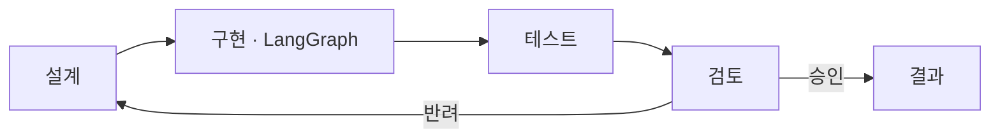

# 프로세스 변경 — 설계 · 구현 · 테스트 · 검토 고리, 승인되면 결과 · 2026-10-15

사용자 요청: 설계-구현-운영-검토로 진행하던 프로세스를 **설계-구현-테스트-검토** 고리로 바꾼다. 검토에서 승인되면 **결과**로 간다. 「운영」이라고 되어 있는 것은 모두 「테스트」로 바꾼다. 관련 문서를 모두 파악하고 단계적으로 고친다.

이 기록과 `기억.md`의 결정 한 줄만 바꾸기 전 이름(「운영」)을 남긴다. 무엇을 바꿨는지 적으려면 옛 이름이 있어야 하기 때문이다.

결정 (2026-10-15, AskUserQuestion):
- 결과는 흐름도 · 단계 설명 · 문서까지만 만든다. 승인 · 반려를 누르고 기록하는 검토 화면은 다음 작업이다.
- 코드 안의 이름(단계 id, API, 작업 공간 폴더)도 test로 바꾼다.
- 지난 기록(절차 · 기억 · 대화 · 일지 · 보관된 옛 판)도 모두 바꾼다.

## 새 고리

화면: 대시보드 흐름도 칸 다섯 개. 위 줄은 설계 → 구현 → 테스트, 아래 줄은 검토 → 승인 → 결과이고, 반려는 검토에서 설계로 가는 점선이다. 검토 칸만 나가는 연결점이 둘이라 칸을 연결점 지정형(`CycleNode`)으로 그린다. 폭은 전과 같은 660px이다. 결과 칸은 승인 기록이 생기기 전까지 「남음」으로 보인다.

## 바꾼 이름 (실측)

| 전 | 지금 | 어디 |
| --- | --- | --- |
| 단계 이름 「운영」(3 운영 · 5단계 운영 · 흐름도 운영) | 「테스트」 | 화면 · 주석 · 검사 · 문서 |
| 흐름도: 설계 → 구현 → 운영 → 달라진 점 검토 → 설계 | 설계 → 구현 → 테스트 → 검토 → (승인) 결과 / (반려) 설계 | `ProjectCycleFlow.tsx` · 대시보드 · 개요 · 기획서 §12 |
| 운영 실행 · 운영 리더 · 운영 그래프 · 운영 대화 · 운영 기록 · 운영 원문 | 테스트 실행 · 테스트 리더 · 테스트 그래프 · 테스트 대화 · 테스트 기록 · 테스트 원문 | 대화방 실행 화면 · 서버 문구 · 문서 |
| 단계 id `run` | `test`. 저장된 흐름도 항목의 `"run"`은 읽을 때 `"test"`로 바꾼다(`cycleItemStore` preprocess) | flow · core |
| `/api/ops/activity` · `/api/ops/app` | `/api/test/activity` · `/api/test/app` (옛 길은 404) | 서버 · 사용 창 |
| 작업 공간 `projects/<alias>/ops/` | `projects/<alias>/test/` (`TEST_STAGE_DIR_NAME`). 있던 프로젝트 하나의 세 파일을 옮겼다 | core `runs/` · flow `dashboardView` |
| 작업 공간 `projects/<alias>/runs/` | `projects/<alias>/test-runs/` (`RUNS_DIR_NAME`) | core `runs/store.ts` · `access.yaml` |
| `OpsPanel.tsx` · `opsContract.ts` · `opsActivity.ts` · `opsRuns.ts` · `opsDashboard.test.ts` | `TestPanel.tsx` · `testContract.ts` · `testActivity.ts` · `testRuns.ts` · `testDashboard.test.ts` (`git mv`) | `OpsActivity`→`TestActivity` 등 식별자, CSS `.ops*`→`.test-*`, 단계 색 `is-run`→`is-test` |
| LangGraph 그래프 `patchbay-operations` | `patchbay-test` (어느 레포에도 등록되지 않은 것을 확인함) | core `execution.ts` · flow `roomExecution.ts` |
| 절차 기록 `대화창-운영실행_20261010_v1` | `대화창-테스트실행_20261010_v1` (`git mv`, 첨부 폴더 함께) | knowledge |
| 기획서 20261010a · 명세 20261014a | 기획서 20261015a(§2에 검토 · 결과 줄, §12 고리) · 명세 20261015a. 옛 판은 `workspace/records/archive/docs/` | `doc-versions.mdc` · README · 아키텍처 |

바꾸지 않은 것:
- 「운영 원칙」. 다른 프로젝트 과정 단계를 인용한 고유 이름이고, 같은 말이 검사 고정자료에도 있다.
- 사용자 대화 원문: 작업 공간의 `rooms` · `consult` · `progress`, 그리고 거기서 만든 Log 기록. 사용자가 실제로 한 말이라 남겼다.
- 흐름도 항목의 실행 상태 `run`(실행 중). 단계가 아니라 상태다.
- 지식 그래프 `Run` · `RAN`, CLI `patchbay runs`, MCP `get_runs`. 「실행」이라는 일반 뜻이다.
- 코드 폴더 `core/src/runs/`.
- 휴지통 `.trash/`, 작업 공간 프로젝트 폴더 안의 보관 사본 `archive/before-acceptance-*/ops/`.
- 절차 첨부 이미지(png) 속 글자.

## 단계별 결과

| 단계 | 내용 | 확인 |
| --- | --- | --- |
| 0 | 범위 조사. 코드 41파일 96곳, 공개 위키 35파일 132곳, 비공개 기록층 24파일 195곳. 같은 말이 쓰인 갈래(단계 · 대화방 실행 · 주석)를 나눴다. 일괄 수정 전 트리를 스크래치패드에 묶어 둠 | — |
| 1 | 코드 id · 구조 (위 표). 흐름도 다시 그림 | 형 검사 통과 |
| 2 | 코드 글자 40파일 95곳. 조사 맞춤(운영이 → 테스트가 · 을 → 를 · 은 → 는 · 과 → 와 · 으로 → 로). 옛 경로를 박아 둔 검사 3개를 고침 | core 546 · CLI 113 · MCP 57 통과, Flow 420/421 |
| 3 | 빌드 · 콘솔 4318 재시작 | 흐름도 칸 다섯 · 연결 다섯(구체화 · 실행 · 결과 확인 · 반려 · 승인), 추가 기능 「테스트」. `/api/test/activity` 200 · `/api/ops/activity` 404. 단계 id `test`. 옮긴 프로젝트의 「노드 9/9 지남」이 새 폴더에서 그대로 읽힘 |
| 4 | 문서 67파일(공개 위키 · 비공개 기록층 · 보관 판) 같은 치환 + 옛 파일 이름 · 폴더 · API 경로. 기획서 · 명세 새 판 | 남은 「운영」은 이 기록과 `기억.md` 결정 한 줄, 예외 「운영 원칙」뿐 |
| 5 | 기억 · 용어(테스트 · 검토 · 승인 · 반려 · 결과) · 저장구조 · 아키텍처 · 개요 · 일지 · 진행 | — |

Flow 실패 1개는 `access.test.ts`로, 할일 사전 준비 작업 쪽 기존 실패(`등록된 프로젝트가 아닙니다`)이며 이번 변경 전에도 있었다.

## 다음

- 검토 화면: 승인 · 반려(이유) 버튼과 기록. 승인된 판을 결과 칸에 칠하고, 반려 이유를 설계로 넘긴다.
- 지금 돌고 있는 Claude Code의 Patchbay MCP는 다시 띄워야 바뀐 설명이 보인다.
