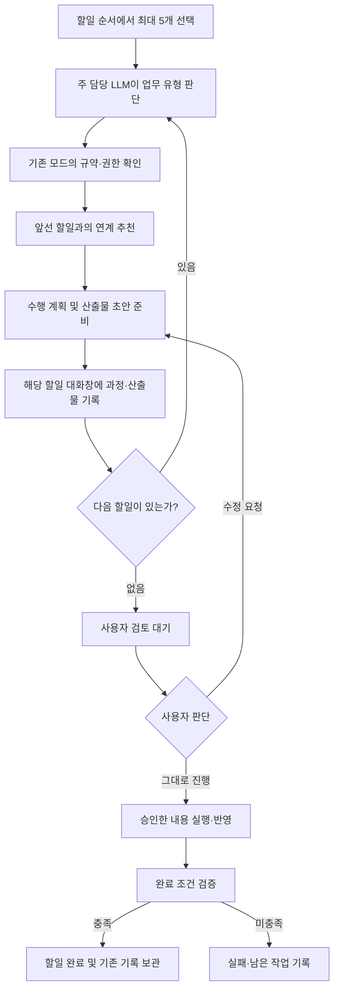
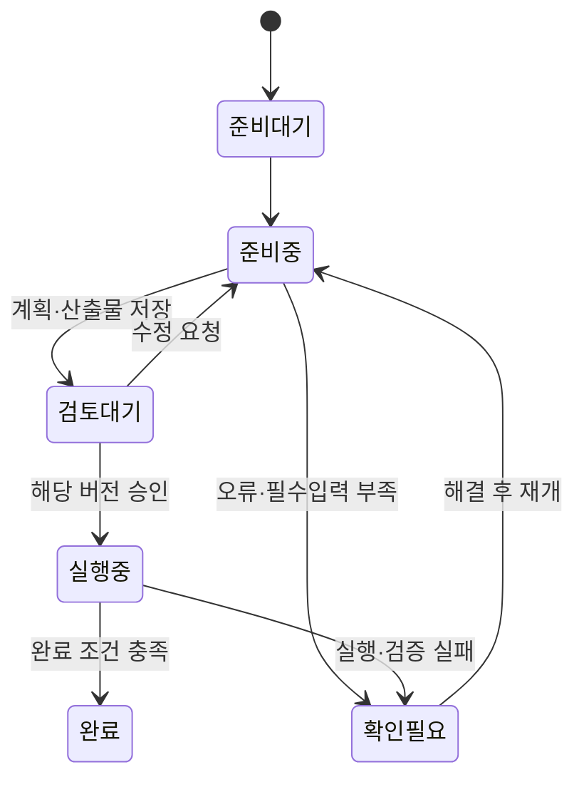

# 할일 자동 업무 수행 — 요구사항

- 작성일: 2026-10-15
- 상태: 요구사항 정리 완료 / 구현 전 검토용
- 범위: 계획 수립, 산출물 사전 준비, 사용자 검토 후 실행·완료
- 이 문서는 요청 내용을 정리한 기록이다. 아래의 제안값과 미정 사항은 구현 확정으로 간주하지 않는다.

## 1. 목적

할일 목록의 순서에 따라 최대 5개 업무를 미리 준비한다. 주 담당 LLM이 각 업무의 유형과 적합한 모드를 판단하고, 수행 계획과 검토 가능한 산출물을 만든다. 사용자는 할일 대화창에서 준비 과정과 결과를 확인한 뒤, “그대로 진행”을 지시해 실제 반영과 완료까지 이어간다.

여기서 **사전 준비**는 계획서만 쓰는 것이 아니라 문서 초안, 디자인 시안, 코드 변경안 등 업무별 산출물까지 만드는 것을 뜻한다. **최종 실행**은 사용자가 확인한 준비 결과를 실제 대상에 반영하고 완료 조건을 검증하는 단계다.

사용자가 언급한 `mod`는 기존 **대화 모드**로 해석한다. 다른 설정을 뜻한다면 구현 전에 범위를 바로잡는다.

## 2. 전체 흐름

사전 준비 순서와 최종 실행 순서를 구분한다. 뒤 할일은 앞 할일이 사용자 검토 대기 중이어도 초안을 준비할 수 있지만, 앞 결과에 의존한 부분은 가정으로 표시한다.

## 3. 사용자 요청에서 확인된 요구사항

| ID | 요구사항 | 기대 동작 |
| --- | --- | --- |
| R01 | 할일 순서대로 사전 업무 수행 | 목록 순서에 따라 한 건씩 계획과 산출물을 준비한다. |
| R02 | 최대 5개까지 진행 | 한 번의 준비 범위는 최대 5개다. 6번째를 자동으로 이어 처리하지 않는다. |
| R03 | 계획과 산출물을 함께 제공 | 수행 단계와 완료 기준뿐 아니라 사용자가 검토할 결과물도 남긴다. |
| R04 | 사용자 확인 후 최종 진행 | 준비 완료만으로 할일을 완료 처리하지 않는다. “그대로 진행” 지시 후 실행·검증한다. |
| R05 | 앞선 할일과 연계 추천 | 관련된 앞 할일과 재사용할 결과, 연계 이유를 제시하고 계획에 반영한다. |
| R06 | 주 담당 LLM이 업무 유형 판단 | 할일의 제목·요구사항·맥락을 바탕으로 업무 유형과 모드를 결정한다. |
| R07 | 기존 모드 설정에 따라 수행 | 선택된 모드의 지시문과 수행 권한을 바탕으로 준비한다. |
| R08 | 할일 대화창에 과정 기록 | 유형 판단, 모드 선택, 연계 추천, 계획, 준비 과정, 산출물을 해당 대화에서 확인한다. |
| R09 | 준비한 대화창의 색상 구분 | 일반 대화와 다른 색상으로 표시해 사전 준비된 대화임을 알아볼 수 있게 한다. |

## 4. 상세 동작 제안

### 4.1 대상과 순서

- 사용자가 할일 영역에서 사전 준비를 시작한다. 자동 시작 시점이나 주기 실행은 이번 요청에서 정해지지 않았다.
- 기본 대상은 목록 위에서부터 미완료·미준비 할일 최대 5개로 제안한다. 5개 미만이면 있는 만큼 준비한다.
- 시작 시 대상과 순서를 고정해 보여준다. 진행 중 추가·재정렬한 목록을 이미 실행 중인 묶음에 몰래 반영하지 않는다.
- 실제 작업이 진행 중인 할일과 중복 실행하지 않는다. 이미 준비한 항목을 다시 준비할 때는 새 결과와 이전 결과를 구분한다.
- 각 할일의 준비가 끝나면 다음 할일로 넘어간다. 앞선 할일을 완료 처리해야만 다음 할일을 준비할 수 있는 구조는 피한다.

### 4.2 주 담당 LLM과 모드

주 담당 LLM은 요청 내용을 읽고 업무 유형, 선택한 모드, 선택 이유, 필요한 입력, 예상 산출물, 완료 조건을 기록한다. 기존 프로젝트별 모드 설정을 우선하고, 없으면 공통 설정과 기본 모드를 따른다.

현행 기본 모드는 토의·보고서 작성·플래닝·디자인·스터디·코딩이며, 모드에는 지시문과 `read`·`edit`·`apply` 권한이 있다. **이 기능 전체를 기존 ‘플래닝’ 모드 하나로 실행하지 않는다.** 업무에 맞는 모드를 선택해 산출물을 준비한다.

현행 플래닝 모드는 `read`이므로 파일 산출물을 작성하려면 별도의 준비 권한 설계가 필요하다. 코딩 모드의 `apply` 역시 사용자 검토 전 실제 대상에 반영할 권한으로 바로 사용하지 않는다. 사전 준비와 최종 반영의 실행 범위를 구분하는 것을 구현 조건으로 제안한다.

적합한 모드가 없거나 필수 자료가 부족하면 이유를 기록하고 해당 항목을 확인 대기로 둔다. 다른 LLM으로의 임의 전환은 별도 정책이 필요하다.

### 4.3 앞선 할일과의 연계

- 현재 할일보다 위에 있는 할일의 요구사항·대화·산출물을 확인한다. 완료된 앞 할일도 연계 후보에 포함한다.
- 연계 추천마다 대상 할일, 근거, 가져올 산출물, 현재 업무에서 사용할 부분, 선행 작업의 상태를 표시한다.
- 단순 참고와 반드시 끝나야 하는 선행 조건을 구분한다.
- 앞 결과가 미승인 초안이면 ‘미승인 결과에 기반한 준비’로 표시한다. 이를 확정 사실로 기록하지 않는다.
- 사용자가 연계를 해제하거나 다른 근거로 바꿀 수 있게 한다. 앞선 결과가 수정되면 영향을 받는 뒤 계획을 재검토 대상으로 표시한다.
- 연계를 이유로 5개 범위 밖의 할일을 새로 실행하거나 목록 순서를 자동 변경하지 않는다.

연계 추천을 자동으로 계획에 채택할지, 사용자 선택 후 채택할지는 미정이다. 기본 제안은 참고 관계는 추천과 함께 초안에 반영하고, 필수 의존 관계는 명시해 최종 승인 때 함께 확인하는 방식이다.

### 4.4 할일별 준비 결과

각 할일에는 다음 내용을 남긴다.

1. 요구사항 요약과 업무 유형, 주 담당 LLM 및 선택 모드
2. 참고한 앞 할일, 연계 이유, 입력 산출물과 그 버전
3. 순서가 있는 수행 계획, 예상 변경 범위, 완료 조건
4. 검토 가능한 산출물과 열기·미리보기 위치
5. 사전 검증 결과, 미검증 항목, 가정 및 사용자 확인 사항
6. “그대로 진행”할 때 수행할 남은 단계

산출물 예시는 보고서 초안, 디자인 시안, 코드 패치 또는 격리된 변경안이다. 실행 권한 안에서 검증할 수 없는 항목은 미검증으로 표시한다. 코드 초안을 실제 서비스에 반영하거나, 문서 초안을 게시하는 것은 최종 실행 단계에 둔다.

### 4.5 대화 기록과 색상

- 할일에 연결된 기존 대화가 있으면 재사용하고, 없으면 전용 대화를 생성한다.
- 대화에 사용자 요청, 유형 판단 요약, 모드 선택 근거, 연계 추천, 수행 계획, 도구 실행 내역과 결과, 산출물, 실패 및 승인 이력을 시간순으로 남긴다. 모델의 비공개 내부 추론은 기록 대상이 아니다.
- 사전 준비한 대화는 대화 목록과 열린 대화창에서 일반 대화와 다른 강조색으로 구분하는 것을 제안한다. 기존 모드 색상과 혼동되지 않게 구체 색상은 시안에서 결정한다.
- 색상 외에도 ‘준비 중’·‘검토 대기’·‘승인 후 실행 중’ 같은 상태 문구나 배지를 함께 표시한다.
- 일반 대화와 준비 대화가 한 방에 섞이면 준비 실행에 해당하는 메시지 구간도 구분한다. 승인 후에도 어떤 구간이 사전 준비였는지 남긴다.

### 4.6 승인·실행·완료

- 사용자는 준비 결과를 확인하고 그대로 진행, 수정 요청, 보류를 선택한다.
- 승인은 확인한 계획과 산출물의 특정 버전에 연결한다. 내용이 바뀌면 이전 승인으로 변경된 내용을 실행하지 않는다.
- 승인 후 이미 준비한 결과를 사용해 남은 반영·검증 단계를 수행한다. 다시 처음부터 생성해 사용자가 확인한 결과와 달라지지 않게 한다.
- 앞선 할일의 최종 결과가 필요한 업무는 그 결과가 확보된 뒤 실행한다.
- 완료 조건을 충족한 경우에만 기존 할일 완료·대화 보관 흐름으로 연결한다. 실패하면 결과와 남은 작업을 기록하고 완료 처리하지 않는다.
- 개별 승인과 최대 5개 일괄 승인 중 지원 범위는 미정이다.

### 4.7 중지·실패·재개

- 사용자는 준비를 중지할 수 있고, 이미 만들어진 계획과 산출물은 유지한다.
- LLM 한도, 연결 오류, 자료 부족은 해당 할일 대화에 원인과 재개 지점을 기록한다.
- 실패한 할일에 의존하는 뒤 할일은 대기시킨다. 독립된 뒤 할일까지 계속 준비할지는 미정이다.
- 새로고침이나 서버 재시작 후 대상 목록, 진행 위치, 검토 대기 결과를 복원하고 같은 업무의 중복 실행을 막는다.

## 5. 상태와 기록 요구사항

위 상태는 기능 설계를 위한 제안이며 현행 할일 상태 구현을 의미하지 않는다. 준비 상태와 실제 할일 완료 여부를 분리해 관리한다. 보류·중지 여부도 기록한다.

저장할 최소 정보는 준비 실행 ID, 할일 ID·대화 ID, 대상 순서, 담당 LLM, 사용 모드와 당시 설정, 연계된 할일·산출물 버전, 계획·산출물 위치와 버전, 상태·시각·오류, 승인 대상과 실행·검증 결과다. 원문 저장은 기존 커널 저장 함수·CLI·MCP를 통하며, 구체 스키마와 경로는 구현 설계에서 결정한다.

## 6. 인수 기준

| ID | 확인 시나리오 | 합격 조건 |
| --- | --- | --- |
| A01 | 미완료 할일 7개에서 시작 | 선택된 최대 5개만 표시된 순서대로 준비하고 6번째는 실행하지 않는다. |
| A02 | 보고서·디자인·코딩 업무 준비 | 주 담당 LLM이 모드와 이유를 기록하고 각 업무의 계획·산출물을 제공한다. |
| A03 | 앞 보고서를 뒤 디자인에서 활용 | 연계 대상·근거·사용한 버전과 미승인 여부를 확인할 수 있다. |
| A04 | 1번이 검토 대기 중인 상태 | 2번의 초안을 준비할 수 있고, 1번에 의존한 가정을 표시한다. |
| A05 | 준비 완료 후 사용자 미승인 | 검토 대기를 유지하고 실제 반영·할일 완료는 발생하지 않는다. |
| A06 | 사용자가 그대로 진행 지시 | 승인한 버전의 산출물을 사용해 실행·검증하고 충족 시 완료·보관한다. |
| A07 | 계획 수정 또는 선행 결과 변경 | 기존 승인을 변경본에 적용하지 않고 영향받는 계획의 재검토를 표시한다. |
| A08 | 할일 대화 조회 | 준비 과정과 산출물 링크를 확인하고 색상과 상태 표시로 일반 대화와 구별한다. |
| A09 | 중지·오류·새로고침 후 재개 | 기존 결과와 진행 위치를 유지하며 중복 실행하지 않는다. |
| A10 | 기존 일반 실행과 함께 사용 | 일반 실행의 순서 제한은 유지하면서, 뒤 할일의 사전 준비가 가능하다. |

## 7. 구현 전 결정할 사항

| 항목 | 제안 또는 선택지 |
| --- | --- |
| 시작 방법 | 할일 영역의 사용자 시작 버튼을 기본으로 제안. 예약·상시 자동 실행은 별도 범위. |
| 최대 5개 선택 방식 | 위에서부터 기본 선택 후 사용자가 1~5개를 선택할 수 있게 할지 결정. |
| 주 담당 LLM 지정 | 프로젝트 담당 설정을 사용할지, 준비 시작 시 선택할지 결정. |
| 연계 추천 채택 | 자동 초안 반영 또는 사용자 선택 후 반영. |
| 승인 범위 | 개별 승인만 지원 또는 의존 순서를 유지하는 일괄 승인도 지원. |
| 실패 후 진행 | 전체 일시정지 또는 독립된 다음 할일은 계속 준비. |
| 코드 등 사전 산출물 | 패치·별도 작업 공간 등 실제 대상을 바꾸지 않고 검토할 방식 결정. |
| 표시 색상 | 기존 모드 색과 구분되는 준비 상태 색상 시안 확정. |

## 8. 현행 구조와 구현 검토 지점

- `knowledge/patchbay/절차/할일-구현_20261014_v1.md`: 현재 실제 호출은 맨 위 미완료 할일부터 허용한다. 이번 기능은 준비 단계에 별도 허용 조건이 필요하다.
- `app/packages/core/src/rooms/modes.ts`(2026-10-15 확인): 프로젝트 모드 → 공통 모드 → 기본 모드 순서와 모드별 권한을 재사용한다.
- 기존 할일 대화 연결·재사용, 실행 상태 표시, 완료 및 대화 보관을 확장한다.
- LLM 판단·실행은 기존 호스트 계층에서 담당하고, 커널은 저장과 상태 관리를 담당하는 구조를 따른다.
- 이번 작업의 산출물은 요구사항 문서다. 제품 코드, 실행 API, 작업 공간 원문 저장 구조는 변경하지 않았다.
